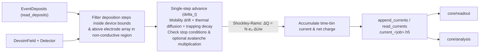

# Carrier Transport and Induced Current (`core/current`)

`src/raser/core/current/` sits in the middle of the simulation chain. It takes the electron-hole pairs generated by [energy deposition](deposit.md) and the electric field and weighting field provided by [device field](field.md), simulates carrier-cluster electric-field drift, thermal diffusion, irradiation-defect trapping, and avalanche multiplication, and computes the induced current on each readout electrode via the Shockley-Ramo theorem. The module outputs `current_<job>.h5` slices to [electronics readout](readout.md), provides net induced charge and initial pair counts to [statistical analysis](analysis.md), and additionally offers laser-pulse current writing and diffusion-only random-walk collection interfaces. See [../stages/current.md](../stages/current.md) for CLI and slice options.

## Inputs and Tunable Model Parameters

`CalCurrent` / `CalCurrentGain` (`cal_current.py`) and `drift` (`drift.py`) take `EventDeposits` read by `read_deposits` (`event`, `detector`, `x`/`y`/`z` [$\mu\text{m}$], `t` [s], `e` [MeV], `pairs`), `DevsimField` (providing electric field, doping, weighting potential, conductive flags, trapping rates, and the 1D planar gain interface), and transport, electrode-array, and avalanche parameters from `Detector`:

| Key or Attribute | Default | Unit | Meaning |
| --- | --- | --- | --- |
| `dimension`, `is_plugin()` | see [device.md](device.md) | None | Selects the time-window and drift-step profile (1D or `is_plugin() == True` uses the 1D profile; others use the 2D/3D profile) |
| `l_x`, `l_y`, `l_z`, `bound` | None (required) | $\mu\text{m}$ | Device bounds $[0, l_x] \times [0, l_y] \times [0, l_z]$ |
| `p_x`, `p_y`, `x_ele_num`, `y_ele_num`, `read_ele_num` | see [device.md](device.md) | $\mu\text{m}$ / count | Pitch and count of the centered readout electrode array |
| `read_out_contact` | None (required) | None | Readout contact list; when length is `read_ele_num`, uses each item's `"name"`; when length is `1`, generates `"<name>1"` through `"<name><read_ele_num>"`. For single-contact devices, induced current is computed only on electrodes around the starting electrode (`my_f.cells_either_side` along `x`, and `read_out_contact[0]["y_span"]` defaulting to `0` along `y`) |
| `material`, `temperature` | None (required) | None, K | Material name (passed to `Material` in [model.md](model.md)) and temperature $T$ |
| `voltage`, `irradiation_model`, `irradiation_flux` | see [device.md](device.md) | V, None, $\text{cm}^{-2}$ | Bias voltage, irradiation model (non-`None` enables trapping decay), and default irradiation fluence |
| `field_interpolation_bins` | `None` | count | Dict of 3D field interpolation bin counts passed to `DevsimField` |
| `has_avalanche`, `avalanche_model` | see [device.md](device.md) | None | When `has_avalanche` is true, invokes `CalCurrentGain` (`"planar_integral"` for 1D fields, `"local_path"` for multi-dimensional fields; under `"local_path"`, `avalanche_model` must be `"vanOverstraeten"`, `"Okuto"`, or `"Hatakeyama"`) |
| `gain_pair_threshold` | `0.05` | pairs | Minimum accumulated electron-hole pairs to emit a new gain cluster in `"local_path"` avalanche mode |
| `gain_max_carriers` | `50000` | clusters | Maximum gain clusters allowed per event in `"local_path"` avalanche mode; `<= 0` means unlimited |
| `local_gain_emit_slices` | `1` | clusters | Number of sub-clusters evenly distributed along the step per emission in `"local_path"` avalanche mode |
| `local_gain_integration_steps` | `3` | steps | Number of sampling points to integrate the impact ionization coefficient within one drift step in `"local_path"` avalanche mode (single-step exponent capped at `50.0`) |
| `e_width_x`, `e_width_y` | None (required for `collect_by_diffusion`) | $\mu\text{m}$ | Rectangular collection zone dimensions centered on each pixel in diffusion-only collection mode |
| `doping.Donors`, `doping.Acceptors` | None (required for `collect_by_diffusion`) | $\text{cm}^{-3}$ | Numerical donor and acceptor concentrations used to compute zero-field electron mobility in diffusion-only collection mode |

## Drift, Diffusion, Trapping, and Avalanche Calculation

### Time Window, Step Size, and Transport Constants

`CalCurrent` and `drift` use the following built-in parameters by device dimension profile:

| Parameter | 1D (or `is_plugin() == True`) | 2D / 3D | Unit | Meaning |
| --- | --- | --- | --- | --- |
| `t_bin` | `5e-12` | `50e-12` | s | Output induced current time-bin width `dt` |
| `t_start` (relative) | `-1.25e-9` | `-12.5e-9` | s | Start offset relative to the event's earliest deposition time (`-0.25 * t_end`) |
| `t_end` (relative) | `5e-9` | `50e-9` | s | Minimum end offset relative to the event's latest deposition time |
| `delta_t` | `2e-12` | `20e-12` | s | Single drift time step for carrier clusters |
| `min_intensity` | `1` | `1` | V/cm | Minimum electric field magnitude threshold to stop drifting (`"low_field"`) |
| `max_drift_time` | `100e-9` | `100e-9` | s | Maximum drift duration cap for a single cluster (`"time_out"`) |
| `kboltz` | `8.617385e-5` | `8.617385e-5` | eV/K | Boltzmann constant used in thermal diffusion step std $\sigma = \sqrt{2 k_B T \mu \Delta t}\times 10^4\ [\mu\text{m}]$ |
| `e0` | `1.60217733e-19` | `1.60217733e-19` | C | Elementary charge used in Shockley-Ramo induced charge $\Delta Q = N e_0 \Delta U_w$ |

### Physics Process Highlights

- **Spatial filtering and thermal diffusion**: Deposition steps outside the device bounds or outside the electrode-array projection are not drifted (still counted in total `pairs`). Each cluster draws Gaussian thermal diffusion steps from `stream("drift")` using single-carrier statistics, and decays carrier count exponentially by the trapping rate if an irradiation model is active.
- **Single-step stop conditions**: During stepping, a cluster reaching the maximum drift time is recorded as `"time_out"`, entering a conductive region (`get_conductive` is true) as `"collected"`, failing an electric field query (`get_e_field_cached` raising `ValueError`) as `"no_field"` (the first fieldless stop point is reported at job end), field magnitude $\le$ `min_intensity` as `"low_field"`, and exiting a device face is clipped proportionally to the boundary and recorded as `"left_device"`.
- **Avalanche multiplication (`CalCurrentGain`)**: 1D fields (`len(axes) == 1`) use `"planar_integral"`, calling `DevsimField`'s planar gain functions directly to compute multiplication; multi-dimensional fields use `"local_path"`, integrating the ionization coefficient along each drift step and emitting sub-clusters once accumulated pairs exceed `gain_pair_threshold`.

## `current_<job>.h5` File Format and Read/Write Functions

`src/raser/core/current/currents.py` provides `append_currents` (appending event by event) and `read_currents` (restoring unstored zero-current electrodes to `0.0` upon reading):

### File Attributes

| Attribute | Type | Unit | Meaning |
| --- | --- | --- | --- |
| `electrodes` | string array | None | List of readout electrode names, ordered identically to the columns of `charge` |
| `dt` | `float64` | s | Time-bin width (equal to `t_bin`) |

### Datasets

| Dataset | Shape and Type | Unit | Meaning |
| --- | --- | --- | --- |
| `event` | `(events,)`, `int64` | None | Recorded event IDs |
| `t0` | `(events,)`, `float64` | s | Left edge of the first time bin of the event (equal to `t_start`) |
| `count` | `(events,)`, `int64` | bins | Number of time bins for the event (equal to `n_bin`) |
| `pairs` | `(events,)`, `float64` | pairs | Total input electron-hole pairs for the event (before avalanche multiplication) |
| `sensitive_pairs` | `(events,)`, `float64` (optional) | pairs | Electron-hole pairs born inside the device, above the electrode array, and in a non-conductive region (present when written by drifting in a solved field) |
| `carriers_without_field` | `(events,)`, `float64` (optional) | count | Total untrapped carriers remaining at stop time in clusters (including gain clusters) that stopped due to `"no_field"` in the event (present when written by drifting in a solved field) |
| `charge` | `(events, len(electrodes))`, `float64` (gzip) | C | Signed net induced charge on each readout electrode in the event (including underflow and overflow bins before/after the time window) |
| `stored` | `(events,)`, `int64` | count | Number of electrodes in the event with non-all-zero current arrays stored in `current` |
| `index` | `(sum(stored),)`, `int64` | None | `0`-based index in `electrodes` of each stored electrode, partitioned per event by `stored` |
| `current` | `(sum(stored * count),)`, `float64` (gzip) | A | Mean induced current in `count` time bins for each stored electrode, concatenated sequentially by event and stored electrode |

## Drift Tracks, Current Plots, and Specialized Interfaces

Under the plot directory (such as `<point>/<seed>/plots/job_<job>/event_<event>/` or `job_<job>_<position>/event_<event>/` for multi-position runs), the following plots are generated:

| Filename | Content | Unit |
| --- | --- | --- |
| `<det_model>_drift_path.pdf`, `.root` | Top panel: 3D device bounding box with deposition points (black), hole (red), electron (blue), gain hole (magenta), and gain electron (light blue) paths; bottom panel: $x$-$z$ plane projection | spatial axes $\mu\text{m}$ |
| `No_<k>electrode_basic_infor.pdf`, `.root` | `electron`, `hole`, `total` (plus `electron gain` and `hole gain` under avalanche) induced current waveforms on the $k$-th non-zero-current electrode (`1`-based) | `Time [s]`, `Current [A]` |
| `cce.pdf`, `.root` | Strip collected charge plot (`TGraph`) when `is_strip` is true; 2D pixel collected charge distribution (`TH2I`) when `is_pixel` is true; title `Charge Collection Efficiency`, values in electron counts (`charge / 1.6e-19`), y-axis (`z`-axis for pixel plots) labeled `charge[Coulomb]` | electron count |

The module also contains two specialized current calculation interfaces:

- **Laser pulse interface (`cal_current.py`)**: `CalCurrentLaser` (default `diffusion=True`) and `write_laser_currents(currents_path, my_d, my_f, my_l, plot_path=None)` (which drifts carrier groups from `LaserInjection` with `diffusion=False`) convolve the electrode induced current with the laser temporal pulse shape `my_l.timePulse` via `pulse_in_bins` and write it as event `0` to `currents_path`; also draws current plots when `plot_path` is provided.
- **Diffusion-only collection interface (`diffusion.py`)**: `collect_by_diffusion(my_d, pairs, positions, window, step)` (called by `raser telescope`, see [../bench/telescope.md](../bench/telescope.md)) performs 2D transverse Gaussian random walks for electrons on pixel detectors (`is_pixel == True`) over duration `window` (s) in time steps `step` (s) using `stream("diffusion")`, returning `(t0, current, charge)` (s, A, C).

## Induced Current in the Example (`HPK-Si-PiN`)

In the [Getting Started](../getting-started.md) example, running the `current` slice on 1D `HPK-Si-PiN` at `200 V` writes `work/HPK-Si-PiN/signal/seed_1/batch/current_0.h5`: attributes record `dt = 5e-12` s and `electrodes = ['top']`; among `200` recorded events, `196` have non-zero induced currents (`index` length `196`), `current` holds `245196` time bins in total, together with `charge` `(200, 1)`, `sensitive_pairs`, and `carriers_without_field`; `planar_drift_path.pdf`/`.root` and `No_1electrode_basic_infor.pdf`/`.root` for the first `100` events are saved in `plots/job_0/event_<event>/`.

## Common Errors

| Exception Type | Error Message | Trigger Condition |
| --- | --- | --- |
| `ValueError` | `Unsupported avalanche model: <avalanche_model>` | `avalanche_model` in `"local_path"` avalanche mode is not in `vanOverstraeten`, `Okuto`, `Hatakeyama` |
| `ValueError` | `<k> readout contacts cannot name <n> electrodes` | `len(read_out_contact)` is neither `1` nor `read_ele_num` |
| `ValueError` | `<deposits_path> holds no event: there is no current to write` | Input deposit file has no recorded events |
| `ValueError` | `<deposits_path> holds no deposit in the detector <detector>: there is no current to write` | No deposition steps remain after filtering by `detector` name |
| `ValueError` | `the field at x, y, z = ... um is ... V/cm: a carrier cannot drift in it` | Electric field components returned by `get_e_field_cached` during drift contain `NaN` or `Inf` |
| `ValueError` | `the gain of <det_name> makes more than gain_max_carriers = <max> clusters of carriers: raise it in the device file` | Gain clusters created in `"local_path"` avalanche mode exceed `gain_max_carriers` |
| `ValueError` | `<det_name> is not a pixel device` / `the device file of <det_name> has no e_width_x [um]` | `collect_by_diffusion` is called on a non-pixel device or missing `e_width_x` / `e_width_y` |
| `ValueError` | `current has shape ..., expected (...)` / `charge has shape ..., expected (...)` | `current` or `charge` array shape passed to `append_currents` mismatches the number of `electrodes` |
| `ValueError` | `<path> holds currents of electrodes ... with dt ... s, not of ...` / `<path> holds sensitive_pairs, the event ... has none` | When appending events to an existing `.h5` file, `electrodes`, `dt`, or optional datasets mismatch the existing file |

## Related Pages

- [Getting Started](../getting-started.md)
- [../stages/current.md](../stages/current.md)
- [device.md](device.md)
- [model.md](model.md)
- [field.md](field.md)
- [deposit.md](deposit.md)
- [readout.md](readout.md)
- [analysis.md](analysis.md)
- [../bench/telescope.md](../bench/telescope.md)
- [../supports/README.md](../supports/README.md)
