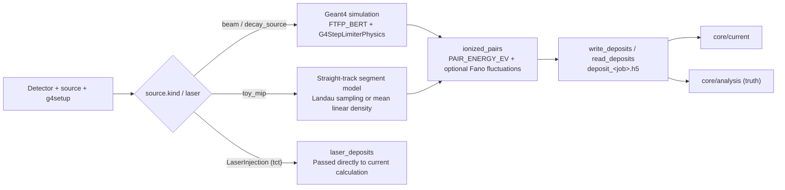

# Energy Deposition and Ionization (`core/deposit`)

`src/raser/core/deposit/` sits at the front end of the simulation chain. Based on the device dimensions and material, signal source configuration, and Geant4 setup script, it computes the energy deposition steps and electron-hole pairs produced by particles in the device, outputs `deposit_<job>.h5` slices to [carrier transport](current.md), and provides the earliest deposition time `truth` to [statistical analysis](analysis.md). The module also provides the `Deposits` read/write functions `write_deposits` / `read_deposits`, the laser pulse deposition interface `LaserInjection` / `laser_deposits`, and the Geant4 geometry visualization function `view_geometry`. See [../stages/deposit.md](../stages/deposit.md) for CLI and slice options.

## Simulation Branches and Parameters

### Device and Signal Source Configuration

Reads the device dimensions `l_x`, `l_y`, `l_z` ($\mu\text{m}$) and material `material` (`"Si"`, `"SiC"`, or `"Diamond"`) via `Detector(det_name, files["device"])` (see [device.md](device.md)). In the Geant4 coordinate system, the device occupies $x \in [-l_x/2, l_x/2]$, $y \in [-l_y/2, l_y/2]$, and $z \in [0, l_z]$ (stored in detector local coordinates in output slices).

The signal source comes from a component JSON (see [../components/source.md](../components/source.md)) and is divided into three simulation branches by `kind`:

| Applicable `kind` | Key | Default | Unit | Meaning |
| --- | --- | --- | --- | --- |
| All | `kind` | None (required) | None | `"toy_mip"`, `"beam"`, or `"decay_source"` |
| `"toy_mip"` | `landau_sampling` | None (required) | None | When `True`, energy deposited per segment is sampled from a Landau distribution (random stream `stream("toy_mip")`, floored at `0.0`); when `False`, uses a fixed mean (mean linear density `PAIRS_PER_UM`: `"Si": 80.0` $\mu\text{m}^{-1}$, `"SiC": 55.0` $\mu\text{m}^{-1}$; Landau width `LANDAU_WIDTH_MEV_PER_UM`: `"Si": 2.0e-5` $\text{MeV}/\mu\text{m}$, `"SiC": 3.2e-5` $\text{MeV}/\mu\text{m}$) |
| `"toy_mip"` | `start`, `end` | `[l_x/2, l_y/2, 0.0]`, `[l_x/2, l_y/2, l_z]` | $\mu\text{m}$ | Start and end points of the straight track in the device coordinate system (all step times are `0.0` s) |
| `"toy_mip"` | `position_range_um` | None (optional) | $\mu\text{m}$ | `{"x": [lo, hi], "y": [lo, hi]}`, uniformly samples start transverse coordinates within the intervals (both keys must be given); without `direction_sigma_mrad`, end `x` and `y` follow start |
| `"toy_mip"` | `direction_sigma_mrad` | None (optional) | mrad | `{"x": sigma, "y": sigma}`, Gaussian samples slopes $dx/dz$ and $dy/dz$ around `0`, computing end transverse coordinates via `start + slope * (end[2] - start[2])` |
| `"toy_mip"` | `packets` | `ceil(length / max_step)` | segments | Number of equal segments per track |
| `"beam"` | `par_type` | None (required) | None | Geant4 particle name string or equal-length list (when a list, one species is sampled uniformly per event) |
| `"beam"` | `par_energy` | None (required) | MeV | Particle kinetic energy or a list of the same length as `par_type` |
| `"beam"` | `par_randx`, `par_randy` | `0`, `0` | $\mu\text{m}$ | Uniform offset half-widths added to the $x$ and $y$ components of direction vector `par_out - par_in` ($\mu\text{m}$) via `stream("source")`, i.e. transverse spread of the aiming point |
| `"beam"` | `particles` | None (optional) | see below | List of multi-particle dicts, firing all particles simultaneously per event; each item can override `par_type`, `par_energy`, `par_randx`, `par_randy`, and shift the emission and aiming points via `offset: [dx, dy, dz]` (default `[0, 0, 0]` $\mu\text{m}$) |
| `"decay_source"` | `nuclides` | None (required) | None | List of resting nuclides `[[Z, A], ...]`, enabling `G4RadioactiveDecayPhysics` (time threshold `1.0e60` years); `DecayStackingAction` sets decay-product start times to `0.0` s and kills daughter nuclei (`fKill`) |
| `"decay_source"` | `par_radius` | `0` | $\mu\text{m}$ | Radius of the circular planar source perpendicular to the emission axis |
| `"decay_source"` | `par_cone` | `None` | deg | Isotropic emission half-cone angle of decay products around the emission axis; corresponding solid-angle fraction is `generated_fraction = (1 - cos(par_cone)) / 2` |

### Geant4 Environment Configuration (`g4setup`)

The Geant4 physics list uses `FTFP_BERT` plus `G4StepLimiterPhysics`, with `RanecuEngine` as the random engine (seeded by the job `seed`). The environment dict `G4SETUP` comes from a `g4setup` Python component (see [../components/g4setup.md](../components/g4setup.md)), defaulting to built-in `DEVICE_ALONE` when unspecified:

| Key | `DEVICE_ALONE` Default | Unit | Meaning |
| --- | --- | --- | --- |
| `geant4_model` | `"device"` | None | Geometry model identifier (`"gdml_import"` enables `GDMLDetectorConstruction`) |
| `world` | `"G4_Galactic"` | None | Geant4 world volume NIST material name; `world_half_side` defaults to `WORLD_HALF_SIDE = 25000` $\mu\text{m}$ (if device, object, or source exceeds this range, takes `2` times the maximum span) |
| `maxstep` | `2` | $\mu\text{m}$ | Maximum step limit for logical volume `"Device"` (`toy_mip` also reads this value when `packets` is omitted) |
| `source.at` | `[0, 0, -17000]` | $\mu\text{m}$ | Source position `par_in` in Geant4 coordinates |
| `source.towards` | `[0, 0, 0]` | $\mu\text{m}$ | Source aiming point `par_out` in Geant4 coordinates |
| `source.angle` | `0` | deg | Incidence tilt angle `par_angle`; when non-zero, `tilted` rotates `par_in` and `par_out` about the $y$-axis at the intersection of the source line with the device face ($z=0$ or $z=l_z$) |
| `object` | `{}` | $\mu\text{m}$, $\text{g/cm}^3$ | Surrounding objects dict, supporting `"elemental"` (single-element volumes) and `"binary_compounds"` (binary compounds, converting atomic counts `natoms_1`, `natoms_2` and atomic weights to mass fractions); hole parameter `tub: {"tub_radius", "tub_depth"}` (`tub_depth` is half-length) is optional under `"elemental"` and required under `"binary_compounds"` (can be an empty dict) |
| `gdml` | None (read under `"gdml_import"`) | $\mu\text{m}$, deg | Contains `file` (required GDML path, searched in order: absolute path, component root, `g4experiment/<file>` under component root, `src/raser/` package dir), `validate` (default `False`), `top_volume`, `position_um` (default `[0, 0, 0]`), `rotation_xyz` (default `[0, 0, 0]`), `auto_center` (default `True`), `placement_name` (default `"ImportedGDML"`); top-level `g4setup` may also set `world_half_size_um` ($\mu\text{m}$) |
| `visualization` | None (optional) | None | Visualization style config under `"gdml_import"` (`imported_visible`, `imported_force_wireframe`, `imported_colour_rgba`, `device_visible`, `hide_device`, `device_colour_rgba`, etc.) |

## Ionization Conversion and Laser Deposition

### Electron-Hole Pair Conversion (`ionization.py`)

`ionized_pairs(event, material, fano=True)` converts each step's deposited energy $E$ (MeV) into the number of electron-hole pairs $\bar{N} = E / (\text{PAIR\_ENERGY\_EV} \times 10^{-6})$ using the material mean ionization energy:

| Material | `PAIR_ENERGY_EV` (eV) | `FANO_FACTOR` (dimensionless) |
| --- | --- | --- |
| `"Si"` | `3.6` | `0.115` |
| `"SiC"` | `8.4` | `0.128` |
| `"Diamond"` | `13.1` | `0.382` |

When `fano=True`, event `event.event` samples the pair count from a Gaussian $\mathcal{N}(\bar{N}, F\bar{N})$ using the independent random stream `stream(f"ionization/{event.event}")` and floors at `0.0`. When `fano=False`, the mean $\bar{N}$ is used directly.

### Laser Deposition (`laser.py`)

`LaserInjection` and `laser_deposits` read a laser component dict (see [../components/laser.md](../components/laser.md)) and directly supply carrier distributions for `raser tct` (see [../bench/tct.md](../bench/tct.md)):

- **Keys read**: `tech` (`"SPA"` or `"TPA"`), `direction` (`"top"`, `"bottom"`, or `"edge"`), `refractionIndex`, `wavelength` (input in nm, multiplied internally by `1e-3` to $\mu\text{m}$), `alpha` (optional, in $\text{m}^{-1}$; when omitted, `absorption_coefficient` log-interpolates from `components/laser/absorption/<material>.txt` and returns `0.0` above the table upper limit), `beta_2` (required under `"TPA"`, in $\text{m/W}$), `temporal_FWHM` (s), `pulse_energy` (J), `spacial_FWHM` ($\mu\text{m}$), `central_time` (s), `l_Rayleigh` (optional, in $\mu\text{m}$, defaulting to $\pi w_0^2 n / \lambda$), `fx_rel`, `fy_rel`, `fz_rel`, `pairs_per_group`, `groups`.
- **Spatial and temporal distribution**: The beam cross-section is divided into 4 rings $\times$ 8 sectors; the temporal width is `temporal_FWHM` for single-photon absorption and `temporal_FWHM / sqrt(2)` for two-photon absorption; deposited energy in `Deposits` returned by `laser_deposits` is computed as `pairs * PAIR_ENERGY_EV[material] * 1e-6`.

## `deposit_<job>.h5` File Format and Read/Write Functions

`src/raser/core/deposit/deposits.py` provides `write_deposits` and `read_deposits` to read and write HDF5 deposit slice files (skipping zero-energy steps in logical volume `"Device"` and events with no remaining steps, and filtering events by `edep_min`/`edep_max`):

### File Attributes

| Attribute | Type | Unit | Meaning |
| --- | --- | --- | --- |
| `generated_events` | `int` | count | Total number of events generated by the source |
| `recorded_events` | `int` | count | Number of events passing non-zero deposition in the device and the energy window |
| `generated_fraction` | `float` | dimensionless | Simulated fraction of source emission directions (`(1 - cos(par_cone)) / 2` for nuclide sources with `par_cone`, `1.0` otherwise) |
| `edep_min`, `edep_max` | `float` | MeV | Lower and upper bounds of the total device energy deposition window (written only when the corresponding threshold is set) |

### Datasets

| Dataset | Shape and Type | Unit | Meaning |
| --- | --- | --- | --- |
| `event` | `(recorded_events,)`, `int64` | None | Recorded event IDs |
| `count` | `(recorded_events,)`, `int64` | steps | Number of deposition steps in each recorded event |
| `detector` | `(sum(count),)`, variable-length `str` | None | Detector name for each deposition step (`"Device"` for single-device runs) |
| `x`, `y`, `z` | `(sum(count),)`, `float64` | $\mu\text{m}$ | Midpoint position of each deposition step in detector local coordinates |
| `t` | `(sum(count),)`, `float64` | s | Global time since primary particle generation |
| `e` | `(sum(count),)`, `float64` | MeV | Energy deposited in the step |
| `pairs` | `(sum(count),)`, `float64` | pairs | Electron-hole pairs generated in the step |
| `x_start`, `y_start`, `z_start` | `(sum(count),)`, `float64` (optional) | $\mu\text{m}$ | Start position of the deposition step (written when all recorded events include start points; step end point is `2 * (x, y, z) - start`) |
| `t_fwhm` | `(sum(count),)`, `float64` (optional) | s | Gaussian FWHM spread of step generation time around `t` (written when all recorded events include `t_fwhm`, e.g. `laser_deposits`) |

## Geant4 Geometry Visualization (`view_geometry`)

`view_geometry` opens the specified visualization driver and executes `components/g4macro/init_vis.mac` and `vis.mac` (under `"gdml_import"`, executes `bench/signal/components/g4macro/vis_pcb.mac` instead; raises `FileNotFoundError` if not found on the component search path). When an export path is given, driver names (case-insensitive) `"TSG"`, `"TSG_FILE"`, and `"TSG_OFFSCREEN"` write `.png`, names starting with `"OGL"` write vector graphics files, and any other driver raises `ValueError`; interactive drivers open a window session and return when closed.

## Deposition Results in the Example (`HPK-Si-PiN`)

In the [Getting Started](../getting-started.md) example, running `raser signal HPK-Si-PiN --scan voltage=100,200 -s 2 -evt 200 --seed 1` uses the `decay/Sr90` radioactive source and `device_alone` geometry with `fano=true`. In `work/HPK-Si-PiN/signal/seed_1/batch/deposit_0.h5`, Geant4 generates `generated_events = 7359` events, records `recorded_events = 200` valid deposition events (`generated_fraction = 0.017037086855465844`), and writes `5476` deposition steps in total (including start points `(x_start, y_start, z_start)` and ionized `pairs`).

## Common Errors

| Exception Type | Error Message | Trigger Condition |
| --- | --- | --- |
| `ValueError` | `events_per_job (...) and generated_per_job (...): a job records a number of events or generates one, so exactly one of them is set` / `either the recorded events (...) or the generated events (...) are asked for, not both and not neither` | Both `events_per_job` and `generated_per_job` are given, or both are `None` |
| `ValueError` | `the <name> asked for are <number>: at least 1` | `events`, `generated`, or `generated_limit` is less than `1` |
| `RuntimeError` | `<recorded> of the <events> events asked for were recorded when the limit of <generated> generated events was reached ...` | `generated_limit` is reached before `events` events are recorded |
| `ValueError` | `<stale>: a g4setup is a script now; write it as <name>.py with its keys in G4SETUP` | `g4setup` points to a `.json` file or a `.json` file with the same name exists in the component directory |
| `ValueError` | `the source <name> gives ['par_in', ...]: where a source sits and where it aims are of the g4setup ...` | Source definition contains `par_in`, `par_out`, or `par_angle` |
| `ValueError` | `the g4setup <name> does not place the source: give it source = {at, towards, angle}` | `g4setup` lacks the `"source"` dict |
| `ValueError` | `the source runs from z = <z0> um to z = <z1> um and enters neither face of the device ...` | `par_angle` is non-zero while the source start lies within $0 \le z_0 \le l_z$ or $z_1 = z_0$ |
| `ValueError` | `par_type has <n> particles and par_energy <m>` | `par_type` and `par_energy` lists in a beam source have different lengths |
| `ValueError` | `Conflicting Geant4 material definition for <compound_name>` | Same `compound_name` is defined with different composition or density in `object.binary_compounds` |
| `ValueError` | `no simulation of deposits for a source of kind <kind>; known: ['toy_mip', 'beam', 'decay_source']` | `source["kind"]` is not in the supported list |
| `ValueError` | `keys <unknown> of the toy MIP source are not read ...` / `the toy MIP source must say landau_sampling: true or false` / `no toy MIP energy loss for the material <material> ...` | `toy_mip` source has unknown keys, lacks `landau_sampling`, or uses a material not in `["Si", "SiC"]` |
| `ValueError` | `no pair energy for the material <material> ...` / `no Fano factor for the material <material> ...` | `ionized_pairs` encounters an unknown material |
| `ValueError` | `some events have <name> and some do not` / `event <n> has no electron-hole pairs ...` / `event <n> has <k> deposits and <m> values of <name>` | `write_deposits` validation finds inconsistent optional columns, `pairs` is `None`, or mismatched column lengths |
| `ValueError` | `no absorption table of <material>: give alpha [1/m] in the laser file` / `the absorption table of <material> starts at <nm> nm, the laser has <wl> nm ...` | Laser component omits `alpha` and the material has no absorption table or the wavelength is below the table lower limit |
| `NameError` | `<tech>` / `<direction>` | `LaserInjection` `tech` is not in `("SPA", "TPA")`, or `direction` is not in `("top", "bottom", "edge")` |
| `ValueError` / `RuntimeError` | `the driver <driver> writes no picture to a given path ...` / `Geant4 refused the command <text> (status <status>)` | `view_geometry` driver does not support image export or a Geant4 UI command fails |
| `ValueError` | `a source of kind <kind> has no par_in and par_out to turn by par_angle = <angle>` | Source `par_angle` is non-zero for a `kind` without rotatable `par_in` and `par_out` |
| `MissingDependency` | `Geant4's Python bindings, g4ppyy, are not installed in this Python` | `g4ppyy` is missing when importing the Geant4 runtime |

## Related Pages

- [Getting Started](../getting-started.md)
- [../stages/deposit.md](../stages/deposit.md)
- [device.md](device.md)
- [current.md](current.md)
- [analysis.md](analysis.md)
- [../components/device.md](../components/device.md)
- [../components/source.md](../components/source.md)
- [../components/laser.md](../components/laser.md)
- [../components/g4setup.md](../components/g4setup.md)
- [../bench/tct.md](../bench/tct.md)
- [../supports/README.md](../supports/README.md)
