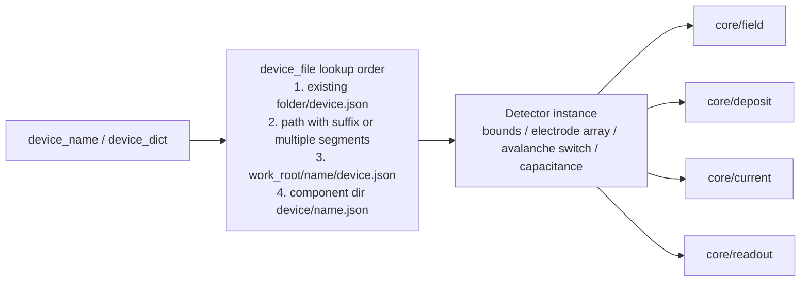

# Device Model (`core/device`)

`src/raser/core/device/build_device.py` sits above the material model. It locates and reads the device JSON definition file, validates electrode layout and avalanche model settings, and builds a unified `Detector` instance for [field solving](field.md), [energy deposition](deposit.md), [carrier transport](current.md), and [electronics readout](readout.md) to query device dimensions, bias voltage, electrode array, and parallel-plate capacitance estimates. See [../components/device.md](../components/device.md) for the device JSON specification.

## Device File Lookup and `Detector` Construction

- **`device_file(device_name)`**: Resolves the absolute path of the device JSON in order: "`device.json` under an existing folder → path with a file suffix or multiple path segments → `<work_root>/<device_name>/device.json` (see [../supports/README.md](../supports/README.md) for `work_root`) → component directory `device/<device_name>.json`".
- **`Detector(device_name, device_dict=None)`**: Reads JSON from disk via `device_json(device_name)` when `device_dict` is `None`, or deep-copies a passed dictionary. Top-level JSON keys are mapped to same-named attributes on `Detector` (with types preserved from JSON and `voltage` converted to `float`), and are then overwritten by derived fields (`det_name`, `device`, `region`, `irradiation_model`, `irradiation_flux`, `dimension`, `electrodes`, `x_ele_num`, `y_ele_num`, `read_ele_num`, `p_x`, `p_y`, `avalanche_model`).

The configuration keys read by `Detector` from the device JSON are listed below:

| Key | Default | Unit | Meaning |
| --- | --- | --- | --- |
| `det_name` | JSON filename stem (`path.stem`) | None | Detector name, assigned to `det_name`, `device`, and `region` |
| `material` | None (required for parallel-plate `capacitance` branch) | None | Semiconductor material name (passed to `Material` in [model.md](model.md)) |
| `det_model` | None (required when accessing `capacitance` without `capacitance_pF`) | None | Device model identifier string |
| `l_x`, `l_y`, `l_z` | None (required) | $\mu\text{m}$ | Device dimensions along $x$, $y$, and $z$ |
| `default_dimension` | None (required) | None | Default field dimension (`1`, `2`, or `3`) |
| `field_dimension` | `default_dimension` | None | Field dimension overriding `default_dimension` |
| `bias.voltage` | None (required) | V | Bias voltage |
| `irradiation.irradiation_model` | `None` if no `irradiation` block (required when present) | None | Irradiation defect model name |
| `irradiation.irradiation_flux` | `0` if no `irradiation` block (required when present) | $\text{cm}^{-2}$ | Irradiation fluence |
| `mesh.mesher` | `None` | None | Mesh generator identifier (e.g. `"sde"`) |
| `mesh.plugin` | `False` | None | Whether the 2D mesh lies in the transverse $x$-$y$ plane |
| `electrodes` | `"pad"` | None | Readout electrode layout: `"pad"`, `"strip"`, or `"pixel"` |
| `read_ele_num` | `1` for `"pad"`; `x_ele_num * y_ele_num` for `"pixel"` | count | Total number of readout electrodes (required in JSON for `"strip"` layout) |
| `x_ele_num`, `y_ele_num` | `1, 1` for `"pad"`; `read_ele_num, 1` for `"strip"` | count | Number of electrodes in $x$ and $y$ (required in JSON for `"pixel"` layout) |
| `p_x` | `l_x` for `"pad"` | $\mu\text{m}$ | Electrode pitch along $x$ (required in JSON for `"strip"` or `"pixel"` layout) |
| `p_y` | `l_y` for `"pad"` or `"strip"` | $\mu\text{m}$ | Electrode pitch along $y$ (required in JSON for `"pixel"` layout) |
| `avalanche_model` | `None` | None | Avalanche ionization model name |
| `enable_gain` | `False` | None | Whether the avalanche gain layer is enabled |
| `capacitance_pF` | None (optional) | pF | Explicitly specified device capacitance |
| `depletion_depth` | `l_z` | $\mu\text{m}$ | Depletion depth used in parallel-plate capacitance calculation |

## Derived Attributes, Layout Validation, and Capacitance Calculation

`Detector` provides the following derived attributes and methods (in-memory object):

- **Electrode layout validation (`LAYOUT_KEYS`)**: `electrodes` must be `"pad"`, `"strip"`, or `"pixel"`, with all required keys for that layout present and no exclusive keys from other layouts mixed in.
- **Avalanche switch `has_avalanche`**: `True` only when `avalanche_model is not None and bool(enable_gain)`; raises an error immediately if `enable_gain` is true while `avalanche_model` is missing.
- **Parallel-plate capacitance estimate `capacitance` (pF)**: Returns `capacitance_pF` directly if given in JSON; returns `None` if `det_model` (lowercased) contains `"3d"`; otherwise computes $\varepsilon_0 \varepsilon_r (A \times 10^{-12}) / (d \times 10^{-6}) \times 10^{12}$, where $\varepsilon_0 = 8.8541878128\times 10^{-12}\ \text{F/m}$, $\varepsilon_r$ comes from `Material(material).permittivity`, single-electrode area $A = p_x \cdot p_y$ ($\mu\text{m}^2$), and $d = \text{depletion\_depth}$ ($\mu\text{m}$).

| Attribute or Method | Type | Unit | Meaning |
| --- | --- | --- | --- |
| `device_dict` | `dict` | None | Deep copy of the device JSON contents |
| `definition_path` | `Path` | None | Absolute path of the device JSON resolved by `device_file(device_name)` |
| `det_name`, `device`, `region` | `str` | None | Device name |
| `dimension` | `int` | None | Device field dimension |
| `voltage` | `float` | V | Bias voltage `float(device_dict["bias"]["voltage"])` |
| `irradiation_model` | `str \| None` | None | Irradiation model name |
| `irradiation_flux` | `float \| int` | $\text{cm}^{-2}$ | Irradiation fluence |
| `mesher` | `str \| None` | None | Mesh generator identifier |
| `bound` | `dict` | $\mu\text{m}$ | Device coordinate bounds `{'x': (0, l_x), 'y': (0, l_y), 'z': (0, l_z)}` |
| `electrodes` | `str` | None | Electrode layout (`"pad"`, `"strip"`, or `"pixel"`) |
| `is_strip`, `is_pixel` | `bool` | None | Whether layout is `"strip"` or `"pixel"` |
| `x_ele_num`, `y_ele_num`, `read_ele_num` | from JSON | count | Number of readout electrodes along $x$, $y$, and total |
| `p_x`, `p_y` | from JSON | $\mu\text{m}$ | Size or pitch of a single readout electrode along $x$ and $y$ |
| `avalanche_model` | `str \| None` | None | Avalanche model name |
| `has_avalanche` | `bool` | None | Whether both avalanche gain and an avalanche model are enabled |
| `capacitance` | `float \| None` | pF | Specified capacitance, parallel-plate estimate, or `None` for 3D models |
| `file(name)` | `Path` | None | Resolves external file paths referenced by the device JSON (relative paths are relative to `definition_path.parent`) |
| `is_plugin()` | `bool` | None | Returns `bool(device_dict.get("mesh", {}).get("plugin", False))` |

## `Detector` in the Example (`HPK-Si-PiN`)

In the [Getting Started](../getting-started.md) example, running `raser signal HPK-Si-PiN --scan voltage=100,200 -s 2 -evt 200 --seed 1` writes the full device definition to `work/HPK-Si-PiN/field/run.json`: `"det_model": "planar"`, `"material": "Si"`, 3D dimensions `l_x = 1300`, `l_y = 1300`, `l_z = 50` $\mu\text{m}$, default `dimension = 1`, and default `bias.voltage = 200.0` V (overridden to `100` V at scan point `voltage_100`). Since `electrodes` is omitted in JSON, the device expands as `"pad"` with `read_ele_num = 1` and `p_x = p_y = 1300` $\mu\text{m}$, and reads junction capacitance `3.44162280284 pF` directly from `capacitance_pF = 3.44162280284`.

## Common Errors

| Exception Type | Error Message | Trigger Condition |
| --- | --- | --- |
| `ValueError` | `` `electrodes` must be pad, strip or pixel, not ... `` | `electrodes` is not in `("pad", "strip", "pixel")` |
| `ValueError` | `` <path>: `electrodes` is ..., which takes the keys ...; missing ..., keys of another layout ... `` | Missing required keys for the current `electrodes` layout in `LAYOUT_KEYS`, or exclusive keys from another layout are mixed in |
| `ValueError` | ``gain is enabled but `avalanche_model` is missing in detector settings`` | `enable_gain` is true while `avalanche_model` is `None` |
| `ValueError` | `depletion_depth must be positive` | `depletion_depth <= 0` when computing parallel-plate capacitance |
| `KeyError` | `bias`, `default_dimension` | Key missing in JSON |
| `AttributeError` | `l_x`, `l_y`, `l_z` | Key missing in JSON |
| `FileNotFoundError` | `Cannot find RASER component device/<name>.json:` and search path list | Device looked up by name is neither in `work/<name>/device.json` nor in the device component directory |
| `FileNotFoundError` / `IsADirectoryError` | OS file-open errors | `device_name` has a suffix or multiple path segments, and that path is not an existing file |
| `FileNotFoundError` | `Cannot find <path>, named by <definition_path>` | Path resolved by `Detector.file(name)` is not an existing file |

## Related Pages

- [Getting Started](../getting-started.md)
- [../components/device.md](../components/device.md)
- [model.md](model.md)
- [field.md](field.md)
- [deposit.md](deposit.md)
- [current.md](current.md)
- [readout.md](readout.md)
- [../supports/README.md](../supports/README.md)
