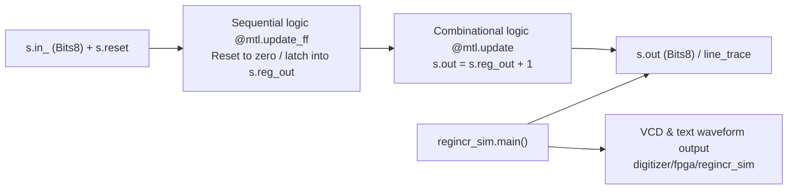

# Digitizer (`core/digitizer`)

`src/raser/core/digitizer/` sits between [electronics readout](readout.md) and [event reconstruction](reconstruction.md) in the module hierarchy (see [../architecture.md](../architecture.md)). It contains the 8-bit register-incrementer hardware model `RegIncr` (`regincr.py`) built with `pymtl3` and its simulation entry point `regincr_sim.main()` (`regincr_sim.py`). Users can import and run this module directly in Python for digital logic simulation and waveform export.

## Hardware Component and Simulation Entry Point

### `RegIncr` Hardware Component (`regincr.py`)

`RegIncr` inherits from `pymtl3.Component` and contains the following ports and logic blocks:

- **`s.in_`**: 8-bit unsigned input port `pymtl3.InPort(pymtl3.Bits8)`.
- **`s.reset`**: Built-in reset port of `pymtl3.Component`; in the sequential block `block1` (`@mtl.update_ff`), sets the internal 8-bit wire `s.reg_out` to `0` when `s.reset` is true, or latches `s.in_` into `s.reg_out` otherwise.
- **`s.out`**: 8-bit unsigned output port `pymtl3.OutPort(pymtl3.Bits8)`, computed in the combinational block `block2` (`@mtl.update`) as `s.out @= s.reg_out + 1`.
- **`line_trace(s)`**: Returns a line-trace string formatted as `"{}({}){}".format(s.in_, s.reg_out, s.out)`.

### `regincr_sim.main()` Simulation Entry Point (`regincr_sim.py`)

Importing and running `raser.core.digitizer.regincr_sim.main()` in Python:

- **Input sequence**: Appends three `0`s to `[0x01, 0x13, 0x25, 0x37]` (yielding `[0x01, 0x13, 0x25, 0x37, 0, 0, 0]`) and writes one value per clock cycle to `model.in_`.
- **VCD waveform output**: Calls `raser.supports.output.output(__file__, "fpga")` (see [../supports/README.md](../supports/README.md)) to create `<project_root>/digitizer/fpga` and passes `vcd_path = os.path.join(path, "regincr_sim")` (without suffix) to `mtl.DefaultPassGroup(textwave=True, linetrace=True, vcdwave=vcd_path)` to generate the VCD waveform.
- **Standard output**: Prints the input list, the VCD save path message `vcd file has been saved in <vcd_path>`, `cycle = <sim_cycle_count>: in = <in_>, out = <out>` for each cycle, and finally calls `model.print_textwave()` to print the text waveform.

## Related Pages

- [../architecture.md](../architecture.md)
- [readout.md](readout.md)
- [reconstruction.md](reconstruction.md)
- [../supports/README.md](../supports/README.md)
