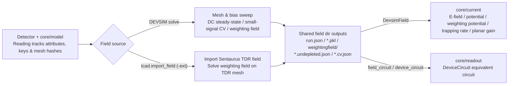
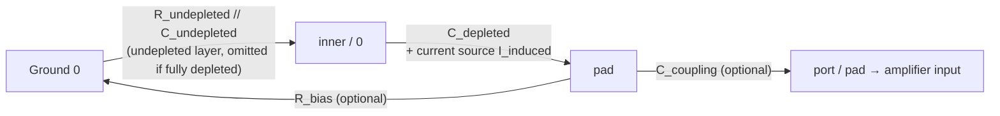

# Field Solving and Loading (`core/field`)

`src/raser/core/field/` sits above [device definition](device.md) and [material models](model.md). It uses DEVSIM to solve (or imports from Sentaurus TDR files) the electric potential, electric field, carrier concentrations, trapping rates, conductive flags, readout electrode weighting fields, and IV/CV/noise curves at a given bias voltage and irradiation fluence. It provides interpolated field queries and planar avalanche gain interfaces (`DevsimField`) to [carrier transport](current.md), and the device equivalent SPICE circuit (`DeviceCircuit`) to [electronics readout](readout.md). See [../stages/field.md](../stages/field.md) for CLI entry points, parameter options, and shared field scheduling.

## Device Solving Configuration and Physics Model Inputs

### 1. Device Definition Reading and Tracking (`reading.py`)

The solver wraps the device object with `Reading(Detector(...))` (see [device.md](device.md) and [../components/device.md](../components/device.md)). It automatically records the device attributes, JSON keys, and external mesh file SHA-256 hashes actually read during solving into the `"read"` field of `run.json` for downstream slice reuse and staleness checks. The device configuration keys read during solving are listed below:

| Key | Default | Unit | Meaning |
| --- | --- | --- | --- |
| `det_name`, `default_dimension`, `field_dimension` | see [device.md](device.md) | None | Device name and dimension (`1`, `2`, or `3`) |
| `l_x`, `l_y`, `l_z` | None (required) | $\mu\text{m}$ | Device dimensions |
| `p_x`, `p_y` | see [device.md](device.md) | $\mu\text{m}$ | Readout electrode pitch |
| `electrodes`, `read_ele_num`, `x_ele_num`, `y_ele_num` | see [device.md](device.md) | None / count | Electrode layout and counts |
| `area_factor` | `1.0` | 1D $\text{cm}^2$, 2D cm, 3D `1` | Area or length factor converting specific current/capacitance per mesh unit to device values |
| `temperature` | None (required) | K | Device temperature $T$ |
| `material` | None (required) | None | Semiconductor material name (e.g. `"Si"`, `"SiC"`, `"Diamond"`) |
| `bias.electrode` | None (required) | None | Name of the electrode where bias voltage is applied |
| `bias.voltage` | None (required) | V | Default target bias voltage |
| `read_out_contact` | None (required) | None | List of readout electrode dicts, each containing `name` and optional `x_span`, `y_span` (unit-cell span) |
| `doping.Acceptors`, `doping.Donors` | None (required) | $\text{cm}^{-3}$ | DEVSIM expressions for acceptor and donor doping concentrations |
| `doping.Acceptors_ir`, `doping.Donors_ir` | None (optional) | $\text{cm}^{-3}$ | Additional doping expressions added onto `Acceptors` and `Donors` |
| `mesh.plugin` | `False` | None | When true, 2D mesh axes map to device `("x", "y")`; otherwise `("z", "x")` |
| `mesh.mesher` | `None` | None | When `"sde"`, 3D mesh axes map to `("x", "y", "z")`; otherwise `("z", "x", "y")` |
| `mesh.1D_mesh` | None (required for 1D) | cm | Contains `mesh_line`, `region`, and `contact` lists |
| `mesh.2D_mesh` | None (required for built-in 2D mesh) | cm | Contains `mesh_line`, `region`, and `contact` lists; `interface` is required for the HEMT `drift_diffusion_v1` branch; during the weighting-field stage, a non-empty `ac_contact` replaces `read_out_contact` to specify readout electrode names |
| `mesh.gmsh_mesh` | None (required for 2D/3D Gmsh mesh) | cm | Contains `file` (`.msh` path resolved via `Detector.file`), `region`, and `contact` |
| `irradiation.irradiation_model` | `None` if no `irradiation` block (required when present) | None | Defect model: `"XingChen"`, `"Perugia"`, `"Schwandt"`, or `"CommonDefect"`; other non-`None` names fall into the custom defect branch with an empty dict by default (zero defects); each defect dict must carry a valid `"type"` (`"donor"` or `"acceptor"`) |
| `irradiation.irradiation_flux` | `0` if no `irradiation` block (required when present) | $\text{cm}^{-2}$ | Default irradiation fluence |
| `avalanche_model`, `enable_gain` | `None`, `False` | None | When `has_avalanche` is true, enables impact ionization in DEVSIM: `"NoAvalanche"` sets ionization rates to `'0'`; `"CustomAvalanche"` reads `custom_ion_n/p` (default `'0'`); `"Fine_exponential_models"` applies to `SiliconCarbide`; `"Tunnel"` adds a tunneling term; for other names, `Silicon` uses van Overstraeten, `SiliconCarbide` uses Hatakeyama, and other materials use `custom_ion_n/p` (default `'0'`). The same `avalanche_model` is passed to `Material.cal_coefficient` in [model.md](model.md) during planar gain calculation and [current.md](current.md) (accepts only `"vanOverstraeten"`, `"Okuto"`, `"Hatakeyama"`) |
| `parameter` | None (optional) | parameter-dependent | `{"name": <str>, "value": <float>}`, writes a parameter to the DEVSIM region (e.g. `"F_sat"`, default `1e5` V/cm) |
| `U_const` | `0` | $\text{cm}^{-3}\cdot\text{s}^{-1}$ | Additional recombination rate node model (number or DEVSIM expression), added to SRH recombination: `Gn = -ElectronCharge * (USRH + U_const)`, `Gp = +ElectronCharge * (USRH + U_const)`; when avalanche is enabled in SiC, also forms `R_TAT = (TAT_FIELD_ENHANCEMENT)*(U_const@n1)` with `TAT_FIELD_ENHANCEMENT` |
| `frequency` | `field.solver.ac.frequency` (`1000.0`) | Hz | Overrides small-signal AC capacitance and noise solving frequency |
| `field.solver` | `SOLVER` (see table below) | see table below | Deep-merged override for default solver settings `SOLVER` |
| `hemt_physics` | None (optional) | None | Enables the 2D AlGaN/GaN HEMT DC transfer characteristics solver when `hemt_physics.transport_model == "drift_diffusion_v1"` |
| `field_interpolation_bins` | `None` (default `{"x": 30, "y": 30, "z": 30}`) | count | Number of bins per axis when `DevsimField` grids unstructured 3D point clouds via inverse-distance weighting (IDW) |
| `capacitance_pF` | None (optional) | pF | Measured single-electrode junction capacitance preferred by `circuit_parameters` |
| `bias_resistance_ohm` | `None` | $\Omega$ | Single-electrode bias resistance |
| `coupling_capacitance_pF` | `None` | pF | Single-electrode AC coupling capacitance (requires `bias_resistance_ohm`) |
| `undepleted_resistance_ohm`, `undepleted_capacitance_pF` | `None` | $\Omega$, pF | Manually specified parallel resistance and capacitance of the undepleted layer (must be given as a pair) |
| `resistive_layer` | None (optional) | see right | Resistive charge-sharing layer configuration: contains `sheet_resistance` ($\Omega/\square$) or Al-implant parameters `implanted` ($\text{cm}^{-2}$), `thickness` ($\mu\text{m}$), `anneal` ($^\circ\text{C}$), together with `strips`, `pads`, optional `grounded`, and optional dielectric coupling layer `coupling: {"thickness" [um], "permittivity"}` |

### 2. Default Solver Parameters `SOLVER` (`solver_section.py`)

Device JSON can deep-merge overrides into the following default settings via `field.solver`:

| Key Path | Default | Unit | Meaning |
| --- | --- | --- | --- |
| `initial.absolute_error` | `1e10` | None | Absolute error tolerance for initial zero-bias solve |
| `initial.relative_error` | `1e-4` | None | Relative error tolerance for initial zero-bias solve |
| `initial.maximum_iterations` | `100` | iterations | Maximum iterations for initial zero-bias solve |
| `voltage_step.absolute_error` | `1e20` | None | Absolute error tolerance for bias-step solve |
| `voltage_step.relative_error` | `1e-4` | None | Relative error tolerance for bias-step solve |
| `voltage_step.maximum_iterations` | `100` | iterations | Maximum iterations for bias-step solve |
| `voltage_step.initial` | `1.0` | V | Initial step size for bias sweep |
| `voltage_step.increase_factor` | `2.0` | None | Step-size multiplier after convergence |
| `voltage_step.decrease_factor` | `0.5` | None | Step-size multiplier after convergence failure |
| `saved_voltage_interval` | `100.0` | V | Bias interval for saving milestone field files (`.pkl`, `.devsim`, `.dd`) |
| `curve_voltage_interval` | `10.0` | V | Bias interval for computing and recording IV/CV/noise curve points |
| `ac.real`, `ac.imaginary` | `1.0`, `0.0` | V | Real and imaginary parts of small-signal AC excitation |
| `ac.frequency` | `1000.0` | Hz | Small-signal AC solve frequency |
| `weighting_tolerance` | `5e-2` | None | Maximum residual weighting potential allowed on the end cells of a single-cell stitched strip weighting field |
| `crosstalk_tolerance` | `5e-2` | None | Minimum ratio of mutual capacitance to total capacitance for adjacent strip electrodes to be considered capacitively coupled |

### 3. External TCAD File Import (`tcad.import_field`)

When a Sentaurus TDR (HDF5) file is specified via `-ext <TCAD_FILE>` (see [../stages/field.md](../stages/field.md)), `tcad.import_field` reads `/collection/geometry_0`:

- **Bias validation**: Reads `ContactExternalVoltage` (V) to obtain the bias on `bias.electrode` (uses `-bias` if the TDR lacks this dataset).
- **Mesh and dataset mapping**: Node coordinates are converted from $\mu\text{m}$ to cm by multiplying by `1e-4`. Imports `ElectrostaticPotential` (`Potential`), `DopingConcentration` (`NetDoping`), `eDensity` (`Electrons`), `hDensity` (`Holes`), `eGapStatesRecombination` (`TrappingRate_n`), and `hGapStatesRecombination` (`TrappingRate_p`), combines with `eMobility` and `hMobility` to determine `Conductive`, and reads `ElectricField_0` (square root of the sum of squared components in 3D) for plotting.
- **Weighting field solving**: Solves the weighting field of each readout electrode on the imported TDR mesh with DEVSIM, supporting semiconductor permittivities `"Silicon": 11.9`, `"SiliconCarbide": 9.76`, `"Oxide": 3.9`, `"Nitride": 7.5`, and metal `"Aluminum"`.

## Disk Output Files

Output files are written to the field run directory `<project>/field` (or an irradiation scan subdirectory). Among them, `.pkl` and `Capacitance_<V>V.json` format integer bias voltages without a decimal point via `voltage_label` (e.g. `Potential_200V.pkl`). Non-zero-bias `.devsim` and `.dd` files, as well as all `.undepleted.json` and `.cv.json` files, use float formatting (e.g. `200.0V.undepleted.json`). Zero-bias state files are named `0V.devsim` and `0V.dd`.

| Filename | Content and Structure | Unit |
| --- | --- | --- |
| `run.json` | Run metadata, `axes` (list of mesh axis names, e.g. `["z"]`, `["z", "x"]`), `read` (`attributes`, `keys`, `files` recorded by `Reading`), and `solved` (lists of solved biases for `"potential"`, `"weighting"`, `"capacitance"`, `"undepleted"`) | bias in V |
| `Potential_<V>V.pkl` | Pickle dict `{"points", "values", "metadata": {"voltage", "dimension"}}`, nodal electric potential | `points`: cm; `values`: V |
| `TrappingRate_p_<V>V.pkl`, `TrappingRate_n_<V>V.pkl` | Same structure, hole and electron trapping rates | `points`: cm; `values`: $\text{s}^{-1}$ |
| `Electrons_<V>V.pkl`, `Holes_<V>V.pkl` | Same structure, electron and hole concentrations | `points`: cm; `values`: $\text{cm}^{-3}$ |
| `Conductive_<V>V.pkl` | Same structure, nodal conductive flag (`1.0` or `0.0`; `1.0` when resistivity $< 10.0\ \Omega\cdot\text{cm}$ or net doping is present with $n + p > 0.5|N_{\text{net}}|$) | `points`: cm; `values`: dimensionless |
| `NetDoping_0V.pkl` (`NetDoping_<V>V.pkl` for TCAD) | Same structure, net doping concentration `Donors - Acceptors` | `points`: cm; `values`: $\text{cm}^{-3}$ |
| `<V>V.undepleted.json` | Undepleted bulk parameters from 1D DEVSIM solve: `voltage_V`, `undepleted_width_um`, `specific_resistance_ohm_cm2`, `specific_capacitance_pF` (`null` when fully depleted), `per` (`"cm^2"`) | V, $\mu\text{m}$, $\Omega\cdot\text{cm}^2$, $\text{pF/cm}^2$ |
| `<V>V.cv.json` | Small-signal capacitance file: `voltage_V`, `specific_capacitance_pF`, `per` (1D `"cm^2"`, 2D `"cm"`, 3D `"device"`), `area_factor`, `frequency_Hz` | V, pF/unit, None, Hz |
| `<V>V.devsim`, `<V>V.dd`, `<det_name>.dat`, `weightingfield/weightingfield.dat`, `converted.devsim` | DEVSIM state archives (non-zero-bias `<V>V.devsim`, e.g. `200.0V.devsim`, reloaded by `-cv`) and Tecplot mesh/field data (`last_solvable.dd` written on convergence failure) | DEVSIM internal units (cm, V) |
| `weightingfield/<contact>/Potential_<V>V.pkl` | Dimensionless weighting potential of readout electrode `<contact>` (conductive-region edge permittivity scaled by `CONDUCTOR_PERMITTIVITY = 1e10` to make it equipotential with the electrode); `metadata` contains `"cells_either_side"` for 2D single-cell stitching and `"contact_name"` for 3D | `points`: cm; `values`: dimensionless |
| `weightingfield/<contact>/Capacitance_<V>V.json` | Mutual capacitance per unit strip length written by periodic single-cell strip stitching (`cells_either_side > 0`): `{"unit": "F/cm", "of", "total", "to": {"neighbour1": ...}, "neighbours_coupled"}` | F/cm |
| `<det_name>_iv.png`, `simIV<min>to<max>.root/.pdf` | Bias-sweep IV curve plot and ROOT file (TTree `SicarTestIV`, branches `voltage`, `Current`) | V, A |
| `<det_name>_cv.png`, `<det_name>_c^-2v.png`, `simCV<min>to<max>.root/.pdf` | Bias-sweep CV and $1/C^2$-V curve plots and ROOT file (TTree `SicarTestCV`, branches `voltage`, `CAP`) | V, pF |
| `<det_name>_noise.png`, `simnoise<min>to<max>.root/.pdf` | Noise-current sweep curve plot and ROOT file (TTree `SicarTestnoise`, branches `voltage`, `Current`) | V, A |
| `Doping.png` and 1D/2D/3D field distribution plots | 1D doping plot `Doping.png`; at each saved bias `<v>`: 1D produces `<title><v>_1d.png`; 2D produces `<title><v>_2d.pdf/.root` and `<title><v>_1d.pdf/.root`; 3D produces `<title>_<v>_3d_1d.pdf/.root`, `_XY`, `_YZ`, `_XZ` (main dir `<title>`: `Potential` / `Potential Distribution `, `Electric Field`, `Electron Trapping Rate`, `Hole Trapping Rate`; weighting field dir: `Weighting Potential`, `Weighting Field`) | axes $\mu\text{m}$, potential V, field V/cm (weighting field $1/\text{cm}$), trapping rate $\text{s}^{-1}$ |
| `HEMT_TRANSPORT_*` | Written by `drift_diffusion_v1`: `HEMT_TRANSPORT_IdVg.csv`, `HEMT_TRANSPORT_final_profile.csv`, `HEMT_TRANSPORT_final.devsim`, `HEMT_TRANSPORT_IdVg.png/.pdf`, `HEMT_TRANSPORT_summary.json` | V, mA/mm, $\text{cm}^{-3}$ |

## Downstream In-Memory Interfaces

### 1. Interpolated Field Query `DevsimField` (`devsim_field.py`)

`DevsimField` loads `.pkl` files and `run.json` from the field directory, interpolates in 1D (`interp1d`), 2D (`LinearNDInterpolator`), or 3D (`RegularGridInterpolator`), and caches queries on a grid resolution (defaults: 1D `z: 0.05` $\mu\text{m}$; 2D `z: 0.1, x: 0.5` $\mu\text{m}$; 2D plugin `x: 0.1, y: 0.1` $\mu\text{m}$; 3D `z: 0.5, x: 1, y: 1` $\mu\text{m}$). It provides query methods taking positions in $\mu\text{m}$ to [current.md](current.md):

- **Single-electrode unit-cell folding**: When only one readout electrode is listed and the device lateral size exceeds the potential mesh span, query coordinates are folded back into one unit cell of the mesh (the middle cell for multi-cell meshes).
- **`get_e_field_cached(x, y, z)` and `get_potential(x, y, z)`**: Returns the electric field `(Ex, Ey, Ez)` (in V/cm, computed as the negative central-difference gradient of potential with step `STEP = 1.0e-5` cm) and potential (V).
- **`get_doping_cached`, `get_trap_e_cached`, `get_trap_h_cached`**: Returns net doping ($\text{cm}^{-3}$) and electron/hole trapping rates ($\text{s}^{-1}$); logs a warning and returns `0.0` on query errors.
- **`get_w_p(x, y, z, i)` and `get_w_p_cached(x, y, z, i)`**: Returns the dimensionless weighting potential of the `i`-th readout electrode. `get_w_p` clamps `< 0` or `NaN` to `0` and `> 1` to `1`; `get_w_p_cached` raises `RuntimeError` if the query fails.
- **`get_conductive(x, y, z)`**: Returns `True` if all vertices of the enclosing mesh element are conductive; outside the mesh, returns the conductive value of the nearest mesh node.
- **Planar avalanche gain calculation**: `planar_gain(my_d)`, `planar_gain_at(my_d, z)`, `planar_gain_depth(my_d)`, and `planar_gain_carrier(my_d)` integrate the impact ionization coefficients along the device centerline $x = 0.5 l_x, y = 0.5 l_y$, applicable to any field whose `axes` includes `"z"`.

### 2. Equivalent Circuit Construction (`circuit_parameters.py`, `device_circuit.py`)

`DeviceCircuit(lines, sources, outputs, alike)` describes the equivalent circuit topology of the device in the SPICE netlist, the `sources` node pairs for induced current sources, the `outputs` front-end input nodes, and the `alike` symmetry groups sharing noise spectra. For a single-electrode planar device, the typical equivalent circuit topology is:

- **`field_circuit(folder, my_d)`**: Extracts `(row, capacitance, undepleted)` from the field directory. For single-contact multi-strip devices, reads `"F/cm"` mutual capacitances from `weightingfield/<electrode>/Capacitance_<bias>V.json`; for regular devices, determines junction capacitance in priority order from `capacitance_pF`, `<voltage>V.cv.json`, or the parallel-plate estimate; for 1D devices, also reads `<voltage>V.undepleted.json`.
- **`device_circuit`, `device_row`, `device_grid`, and `part_of_row`**: Assemble circuits for a single device, a strip row, a resistive grid, and an adaptive local strip row, respectively, for [readout.md](readout.md) to generate SPICE netlists.

## Field Solving in the Example (`HPK-Si-PiN`)

In the [Getting Started](../getting-started.md) example, running `raser signal HPK-Si-PiN --scan voltage=100,200 -s 2 -evt 200 --seed 1` automatically solves the fields at `100 V` and `200 V` in `work/HPK-Si-PiN/field/`:

- `run.json` records `axes: ["z"]`, `solved.potential` and `solved.undepleted` as `[0.0, 100.0, 200.0]`, and `solved.weighting` as `[100.0, 200.0]`.
- Both `100.0V.undepleted.json` and `200.0V.undepleted.json` have `undepleted_width_um` equal to `0.0` (fully depleted, with `specific_capacitance_pF` set to `null`).
- Downstream `DevsimField` loads this 1D field with cache resolution `{'z': 0.05, 'x': 10000.0, 'y': 10000.0}` $\mu\text{m}$.

## Common Errors

| Exception Type | Error Message | Trigger Condition |
| --- | --- | --- |
| `FileNotFoundError` | `no <mode> field of <det_name> at the irradiation flux <flux> in <root> ...` | `solved_field` finds no field record matching the irradiation fluence and mode |
| `ValueError` | `the field in <folder> was solved for another device (<differing>); solve it again with ...` | Current device attributes, JSON keys, or mesh files do not match the `read` record in `run.json` |
| `FileNotFoundError` | `the field in <folder> is not solved at <voltage> V ...` / `has no weighting field at <voltage> V ...` / `has no capacitance at <voltage> V ...` / `has no undepleted bulk at <voltage> V ...` | `solved` in `run.json` lacks the corresponding asset at the target bias |
| `FileNotFoundError` | `no field saved at <voltage> V in <folder>: <have>` | `<voltage>V.devsim` does not exist in the directory when running `-cv` |
| `FileNotFoundError` | `the weighting field at <v_goal> V needs the field solved at that bias: <conductive_file> is missing ...` | `Conductive_<v_goal>V.pkl` is missing when running `-wf` |
| `ValueError` | `<k> of the <n> nodes of <region> are not in <conductive_file>, the first at <coords> cm: the field was solved on another mesh` | Mesh nodes of the current region are not in `Conductive_<v_goal>V.pkl` when solving the weighting field |
| `ValueError` | ``the defect <name> must have "type": "donor" or "acceptor", it has ...`` | Irradiation defect dict lacks a valid `type` (`"donor"` or `"acceptor"`) |
| `RuntimeError` | `Step size too small (less than 1e-7). Exiting loop.` | DEVSIM bias sweep reduces step size below `1e-7` V due to convergence failure |
| `ValueError` | `<det_name>: cells are laid side by side only along x on a mesh of depth and x so far` / `the mesh of <det_name> is <width> um wide, not one pitch of <pitch> um ...` / `the cells of <det_name> do not fit side by side ...` | For single-cell strip weighting field stitching, mesh is not a non-`plugin` 2D mesh, cell width does not equal `p_x`, or left/right boundary nodes are asymmetric |
| `ValueError` | `the weighting potential of <contact> of <simname> at <v_goal> V does not fall off along the row ...` | After single-cell stitching expands beyond twice the initial span, residual weighting potential at both ends still exceeds `weighting_tolerance` or end electrodes remain coupled |
| `ValueError` | `<tdr> holds no electrode voltages: give its bias with -bias` / `<tdr> has no electrode <electrode> ...` / `<tdr> was solved with <V> V on <electrode>, not at <asked> V` | TCAD TDR file bias electrode or bias voltage validation failed |
| `ValueError` | `the region <region> of the TCAD file holds no ...` / `is of <material>, whose permittivity is not known here ...` / `the TCAD file has no electrode <electrode> to read out ...` | TDR semiconductor region lacks carrier/doping/mobility datasets, contains a material with unknown permittivity, or lacks the specified readout electrode |
| `FileNotFoundError` | `<record> is missing: solve the field again ...` / `the <what> of <name> at <voltage> V is not solved: <file> is missing` | `run.json` or the corresponding `.pkl` file is missing when `DevsimField` loads the field |
| `ValueError` | `the <what> in <file> has <d1> dimensions, the field has <d2>` | Dimension of `.pkl` file loaded by `DevsimField` is smaller than the number of `axes` |
| `ValueError` | `Unknown interpolation axes: ...` / `3D interpolation requires at least two bins per axis` / `3D interpolation points must have shape N x 3` / `3D interpolation values must match the point count` / `3D interpolation requires finite points and values` / `3D interpolation point cloud must span every axis` / `Gradient step must be positive` | Validation failure in `interpolation.py` for 3D interpolation inputs, axis bin counts, or gradient step |
| `ValueError` | `<point> is outside the mesh, which runs from <low> to <high>` | Query point is outside the mesh coordinate range when `gradient` computes the electric field |
| `RuntimeError` | `failed when getting w_p cache (<x>, <y>, <z>, <n>)` | `DevsimField.get_w_p_cached` failed to query weighting potential |
| `ValueError` | `the field of <name> is stored along <axes>, without the depth z: it has no planar gain` / `Unsupported avalanche model: <avalanche_model>` / `<name> breaks down at <voltage> V: the breakdown integral is <det>, not below 1` | When `DevsimField` computes planar avalanche gain, `axes` lacks `"z"`, the avalanche model is unsupported, or the breakdown integral $\ge 1$ |
| `FileNotFoundError` | `the field in <folder> has no capacitances between the strips of <det_name> at <V> V: <path> is missing ...` | `Capacitance_<V>V.json` is missing during single-contact strip detector readout |
| `ValueError` | `<det_name> has no capacitance ...` / `A depleted width of <w> m leaves no undepleted layer in a device <t> m thick` / `<det_name> gives <key> alone: the undepleted layer has both ...` / `<det_name> is not a row of strips ...` / `<det_name> is a row of strips and has an undepleted layer ...` / `The capacitances of the row are in <unit>` / `<electrode> of <det_name> has <farad> F in all ... and <to_others> F to the other strips ...` / `A coupling capacitance needs a bias resistance ...` | Validation failure in `circuit_parameters` and `device_circuit` for undepleted layer, strip-array mutual capacitance, or bias/coupling parameters |
| `ValueError` / `NotImplementedError` / `RuntimeError` | `HEMT transport requires a configured mesh interface` / `HEMT_TRANSPORT_V1 requires a 2D device` / `HEMT_TRANSPORT_V1 supports DC transfer sweeps only` / `HEMT_TRANSPORT_V1 currently assumes a Ga-face pseudomorphic barrier` / `Initial HEMT_TRANSPORT_V1 calibration is restricted to 300 K` / `HEMT_TRANSPORT_V1 requires mesh.2D_mesh` / `Use bias=0 for the RASER launcher...` / `Transport config must contain AlGaN_barrier and GaN_buffer` / `Transport config is missing contact ...` / `For this simplified branch, source and drain must contact GaN_buffer` / `Gate must contact AlGaN_barrier` / `Initial model requires n-type GaN...` / `Electron mobilities must be positive` / `polarization_spread_nm must be >= 1 nm...` / `Invalid gate sweep range/step` / `Initial transport branch restricts drain_bias_V to 0..0.2 V` / `Gate sweep must include Vg=0...` / `HEMT_TRANSPORT_V1 solve failed during ...` | Mesh, region, contact, doping, mobility, or sweep-range validation failure or DEVSIM solve error in the HEMT `drift_diffusion_v1` branch |

## Related Pages

- [Getting Started](../getting-started.md)
- [../stages/field.md](../stages/field.md)
- [device.md](device.md)
- [model.md](model.md)
- [../components/device.md](../components/device.md)
- [current.md](current.md)
- [readout.md](readout.md)
- [../supports/README.md](../supports/README.md)
