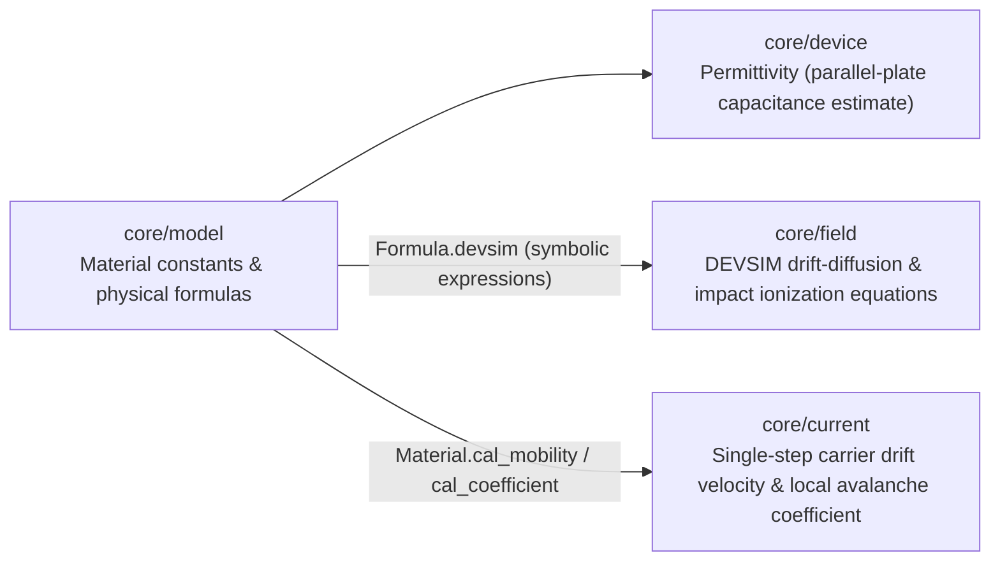

# Materials and Physical Models (`core/model`)

`src/raser/core/model/` sits at the bottom layer of the simulation chain. It defines semiconductor material constants, band structure, dopant ionization, recombination rates, carrier mobility, and impact ionization coefficients. On one hand, the module generates DEVSIM symbolic expressions via `Formula` for [device field solving](field.md). On the other hand, it provides Python numerical calculations of material permittivity, mobility, and impact ionization rates for [device definition](device.md) and [carrier transport](current.md). In the `HPK-Si-PiN` example in [Getting Started](../getting-started.md), the device uses `"Si"` at `300.0 K`, with relative permittivity `11.9` and the `"Selberherr"` mobility model for carrier transport.

## Formula Evaluator (`formula.py`)

`Formula(text, variables, **parameters)` wraps formula text written with `abs`, `exp`, `log`, `pow`, `sqrt`, `tanh`, `ifelse(cond, a, b)`, and the power operator `^` into an object that supports both numerical evaluation and DEVSIM expression generation:

- **`Formula.value(**variables)`**: Evaluates a floating-point value in Python for the given independent variables; `ifelse(cond, a, b)` evaluates only the selected branch.
- **`Formula.devsim(in_conditions=None, **variables)`**: Expands named constants or sub-expressions (which may reference parameters listed later) and returns a DEVSIM symbolic expression string. When `in_conditions` is passed, it first substitutes the corresponding variables only inside `ifelse` condition expressions, and then substitutes `variables` across the full expression.

## Material Database and Transport/Avalanche Interfaces (`material.py`)

`Material(mat_name, mobility_model=None, avalanche_model=None)` initializes basic material properties by material name and allows overriding the default mobility or avalanche model (electron rest mass $m_e = 9.109\times 10^{-31}\ \text{kg}$):

| Material Name (`mat_name`) | Relative Permittivity (`RELATIVE_PERMITTIVITY`) | Electron Effective Mass `electron_mass` (kg) | Hole Effective Mass `hole_mass` (kg) | Default `mobility_model` | Default `avalanche_model` |
| --- | --- | --- | --- | --- | --- |
| `"Si"` | `11.9` | `0.26 * m_e` | `0.386 * m_e` | `"Selberherr"` | `"vanOverstraeten"` |
| `"SiC"` | `9.76` | `0.29 * m_e` | `1.0 * m_e` | `"Das"` | `"Hatakeyama"` |
| `"Diamond"` | `5.7` | Not set | Not set | `"Reggiani_diamond"` | `None` |

- **Mobility calculation `Material.cal_mobility(temperature, input_doping, charge, electric_field)`**: Returns carrier mobility (in $\text{cm}^2/(\text{V}\cdot\text{s})$, with temperature in K, effective doping `input_doping` in $\text{cm}^{-3}$, electric field magnitude in V/cm, `charge > 0` for holes, and `<= 0` for electrons). `"Si"` supports `"Selberherr"` and `"Reggiani"` (`"Reggiani"` distinguishes donors $\ge 0$ and acceptors $< 0$ by the sign of `input_doping`, while all other models take the absolute value), `"SiC"` supports `"Das"`, and `"Diamond"` supports `"Reggiani_diamond"`.
- **Impact ionization coefficient `Material.cal_coefficient(electric_field, charges, temperature)`**: Returns the impact ionization coefficient (in $\text{cm}^{-1}$), supporting `"vanOverstraeten"`, `"Okuto"` (threshold $E > 1.0\times 10^5\ \text{V/cm}$), and `"Hatakeyama"` (`charges < 0` for electrons, `> 0` for holes).
- **Drift velocity plotting `Material.draw_velocity(temperature, Neff)`**: Plots electron and hole drift velocity curves at a given temperature (K) and effective doping concentration ($\text{cm}^{-3}$), saving to `<output_dir>/<mat_name>Mobility<mobility_model>.png` (x-axis `ElectricField  [V/cm]`, y-axis `Velocity [cm/s]`; output path is generated by `output(__file__, "model")` in [../supports/README.md](../supports/README.md)).

## Band Structure, Dopant Ionization, and Recombination Models

### Band Structure (`band_structure.py`)

`BAND_STRUCTURE[material]` provides four `Formula` objects in terms of temperature `T` (K): conduction band effective density of states `N_c`, valence band effective density of states `N_v`, band gap `E_g`, and intrinsic carrier concentration `n_i` ($\sqrt{N_c N_v}\exp(-E_g / (2kT))$, Boltzmann constant $k = 1.3806503\times 10^{-23}\ \text{J/K}$):

| Material | `N_c` ($\text{cm}^{-3}$) | `N_v` ($\text{cm}^{-3}$) | `E_g` (J) |
| --- | --- | --- | --- |
| `"Si"` | `2.82e19*pow(T/300, 1.5)` | `1.83e19*pow(T/300, 1.5)` | `1.12*1.6e-19` |
| `"SiC"` | `3.25e15*pow(T, 1.5)` | `4.8e15*pow(T, 1.5)` | `3.26*1.6*1e-19` |
| `"Diamond"` | `1.8e19*pow(T/300, 1.5)` | `1.5e19*pow(T/300, 1.5)` | `5.47*1.6e-19` |

### Dopants and Incomplete Ionization (`dopants.py`, `incomplete_ionization.py`)

`DOPANTS[material][element]` stores `Dopant(kind, levels, degeneracy, fall_ev_cm)` parameters for each dopant element:

| Material | Element | `kind` | `levels` (ionization energy [eV], fraction) | `degeneracy` | `fall_ev_cm` ($\text{eV}\cdot\text{cm}$) |
| --- | --- | --- | --- | --- | --- |
| `"Si"` | `"P"` | `"donor"` | `((0.046, 1.0),)` | `2.0` | `0.0` |
| `"Si"` | `"As"` | `"donor"` | `((0.054, 1.0),)` | `2.0` | `0.0` |
| `"Si"` | `"Sb"` | `"donor"` | `((0.043, 1.0),)` | `2.0` | `0.0` |
| `"Si"` | `"B"` | `"acceptor"` | `((0.044, 1.0),)` | `4.0` | `0.0` |
| `"SiC"` | `"N"` | `"donor"` | `((0.0533, 0.5), (0.0996, 0.5))` | `2.0` | `0.0` |
| `"SiC"` | `"P"` | `"donor"` | `((0.057, 0.5), (0.113, 0.5))` | `2.0` | `0.0` |
| `"SiC"` | `"Al"` | `"acceptor"` | `((0.216, 1.0),)` | `4.0` | `3e-8` |
| `"SiC"` | `"B"` | `"acceptor"` | `((0.311, 1.0),)` | `4.0` | `0.0` |
| `"Diamond"` | `"B"` | `"acceptor"` | `((0.3685, 1.0),)` | `4.0` | `0.0` |
| `"Diamond"` | `"N"` | `"donor"` | `((1.7, 1.0),)` | `2.0` | `0.0` |
| `"Diamond"` | `"P"` | `"donor"` | `((0.60, 1.0),)` | `2.0` | `0.0` |

- **`ionized_fraction(material, element, concentration_cm3=0.0)`**: Returns a dimensionless ionized fraction `Formula` with independent variables `("carriers", "N_band", "T")` ($\text{cm}^{-3}$, $\text{cm}^{-3}$, K) from Boltzmann statistics. The ionization energy of the $i$-th level decreases with doping concentration: $E_i = E_{0,i} - \text{fall\_ev\_cm}\cdot N^{1/3}$ ($k = 8.617333262\times 10^{-5}\ \text{eV/K}$).
- **`free_holes(material, element, acceptors_cm3, donors_cm3, temperature_k)`**: Solves the charge-neutrality equation for a single-level acceptor and fully ionized compensating donors, returning the free hole concentration ($\text{cm}^{-3}$).

### Recombination and Impact Ionization Models (`recombination.py`, `impact_ionization.py`)

- **`SRH` and `SRH_LIFETIME`**: Shockley-Read-Hall recombination rate `Formula` (independent variables `("n", "p", "n_i", "n1", "p1", "tau_n", "tau_p")`, in $\text{cm}^{-3}\cdot\text{s}^{-1}$). Default carrier lifetimes: `tau_n = 7e-3` s and `tau_p = 7e-3` s for `"Si"`, `tau_n = 2.5e-6` s and `tau_p = 0.5e-6` s for `"SiC"`, and `tau_n = 5.6e-7` s and `tau_p = 2.4e-7` s for `"Diamond"`.
- **`TAT_FIELD_ENHANCEMENT`**: Dimensionless trap-assisted tunneling field enhancement factor `Formula` (independent variables `("E", "F_sat")`, in V/cm; default saturation field `TAT_SATURATION_FIELD = 1e5` V/cm, characteristic field `F_gamma = 3.9e4` V/cm).
- **`VAN_OVERSTRAETEN`**: Contains `"electron"` and `"hole"` `Formula` entries (independent variables `("E", "T")`, in V/cm and K, returning $\text{cm}^{-1}$), enabling the Chynoweth law when $E \ge 1.75\times 10^5\ \text{V/cm}$ (low/high-field boundary $E_0 = 4.0\times 10^5\ \text{V/cm}$, phonon energy $\hbar\omega = 0.063\ \text{eV}$, reference temperature $T_0 = 293.0\ \text{K}$).
- **`hatakeyama(carrier, angle_deg=4.0)`**: 4H-SiC impact ionization coefficient `Formula` (`carrier` is `"electron"` or `"hole"`; `angle_deg` defaults to `OFF_AXIS_DEG = 4.0` degrees, the crystal off-axis angle from `<0001>` toward `<11-20>`; independent variables `("E", "T")`, enabled when $E > 10^4\ \text{V/cm}$, $\hbar\omega = 0.19\ \text{eV}$, $T_0 = 300.0\ \text{K}$).

## Common Errors

| Exception Type | Error Message | Trigger Condition |
| --- | --- | --- |
| `ValueError` | `unbalanced parentheses in ...` | Unbalanced parentheses in a `Formula` expression |
| `ValueError` | `ifelse takes three arguments in ...` | `ifelse(...)` in `Formula` does not have 3 arguments |
| `ValueError` | `the formula takes ..., not ...` | Variable names passed to `Formula.value` or `Formula.devsim` do not match the formula definition |
| `ValueError` | `<element> in <material> is not an acceptor of one level` | Dopant specified in `free_holes` is not a single-level acceptor |
| `ValueError` | `Unsupported avalanche model: <avalanche_model>` | `avalanche_model` in `Material.cal_coefficient` is not in `('vanOverstraeten', 'Okuto', 'Hatakeyama')` |
| `RuntimeError` | `matplotlib is required for draw_velocity` | `Material.draw_velocity` is called without `matplotlib` installed |

## Related Pages

- [Getting Started](../getting-started.md)
- [device.md](device.md)
- [field.md](field.md)
- [current.md](current.md)
- [../supports/README.md](../supports/README.md)
