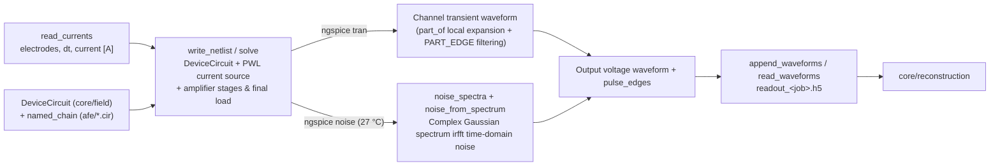

# Electronics Readout (`core/readout`)

`src/raser/core/readout/` takes the electrode induced currents from [carrier transport](current.md) and the equivalent circuit `DeviceCircuit` from [device field](field.md), invokes `ngspice` to solve the transient voltage response and frequency-domain noise spectra of the device circuit and front-end amplifier chain, synthesizes time-domain thermal noise and pulse edge polarity, and outputs `readout_<job>.h5` to [event reconstruction](reconstruction.md). The module also provides `append_waveforms` / `read_waveforms` / `read_circuit_values` read/write interfaces, short-circuit current calculation, and amplifier-stage schematic drawing functions. See [../stages/readout.md](../stages/readout.md) for CLI and slice options.

## Inputs and Front-End Amplifier Chain Parsing

- **Upstream data and circuit objects**: Receives `electrodes`, `dt` (s), and per-event `event`, `t0` (s), `current` (shape `(electrodes, bins)`, in A) returned by `read_currents`, together with `Detector` (see [device.md](device.md)), `DeviceCircuit` (see [field.md](field.md)), and integer `noise_seed` for adding frequency-sampled thermal noise.
- **Front-end amplifier chain (`circuit.py`)**: `named_chain(name)` splits the `amplifier` name on `"+"`, loads SPICE subcircuits via `component_path("afe", f"{part}.cir")` (see [../components/afe.md](../components/afe.md) and [../supports/README.md](../supports/README.md)), and assembles them with `read_chain(paths)`:
  - The last item in the sequence is the one-port load `load` (`.subckt <name> <in>`), and the remaining items from device to load are two-port amplifier stages `stages` (`.subckt <name> <in> <out>`); when a stage repeats in the chain, a numeric suffix starting from `2` is appended (e.g. `Gali52`, `Gali52_2`).
  - SPICE elements and parameters supported by `read_subcircuit(path)` are listed below (non-comment lines outside `.subckt` are stored in `"models"`). `spice_number` supports prefixes `t` (`1e12`), `g` (`1e9`), `meg` (`1e6`), `k` (`1e3`), `m` (`1e-3`), `u` (`1e-6`), `n` (`1e-9`), `p` (`1e-12`), `f` (`1e-15`):

| Element Type | Dict Keys Recognized | Unit | Description |
| --- | --- | --- | --- |
| Resistor `R` | `"between"`, `"ohm"`, optional `"noiseless": True` | $\Omega$ | Marked noiseless when trailing `noisy=0` is present |
| Capacitor `C` | `"between"`, `"farad"` | F | Terminal nodes and capacitance value |
| Inductor `L` | `"between"`, `"henry"` | H | Terminal nodes and inductance value |
| DC Voltage Source `V` | `"between"`, `"volt"` | V | Terminal nodes and DC voltage |
| Voltage-Controlled Voltage Source `E` | `"between"`, `"follows"`, `"gain"` | None | Controlling node pair and voltage gain |
| Subcircuit Instance `X` | `"model"`, `"nodes"` | None | External device or model subcircuit call |

## Transient Solving, Local Expansion, Noise, and Pulse Edge

- **Transient netlist solving (`spice.py`)**: `write_netlist` and `solve` replicate the amplifier stages and load for each output channel and write the induced current into piecewise-linear sources `I<k> <from> <to> PWL(...)`. The netlist prepends 1 zero-current bin before the first time bin so the circuit starts from rest (bin `m` center is at `(m + 1.5) * dt`), runs `ngspice -b` with `tran <dt> <dt * (bins + 1)>`, exports voltages (`out<k>` when stages exist, or the device output node for load-only chains), and interpolates back to the induced-current bin centers, returning an `(outputs, bins)` array (in V).
- **Strip-row local circuit expansion and active-channel filtering (`job.py`)**: When `part_of` is given, the local circuit expands outward from hit electrodes with induced current starting at `margin = 1` on each side and doubling iteratively until the maximum voltage difference between consecutive solves on channels reaching `PART_EDGE = 1e-3` of the largest channel swing is `< 1e-3 * largest`, or until the local circuit covers the whole row. Each event stores only channels whose maximum absolute voltage swing is `>= PART_EDGE * largest` (with `largest > 0`).
- **Frequency-domain noise analysis and time-domain synthesis (`spice.py`, `job.py`, `spectral_noise.py`)**: When `noise_seed` is an integer, `noise_spectra` runs `ngspice` `noise` analysis (27 °C) from `LOWEST_NOISE_HZ = 1e3` Hz to `0.5 / dt` Hz at `PER_DECADE = 50` points per decade to obtain single-sided voltage noise spectral density ($\text{V}/\sqrt{\text{Hz}}$); channels in the same `circuit.alike` group reuse the noise spectrum of the middle channel `group[len(group) // 2]`. `noise_from_spectrum` uses `np.random.default_rng([noise_seed, event.event, place[name]])` on a frequency grid `RECORD = 256` times the waveform length, computes band power via `band_power`, samples a complex Gaussian spectrum, takes `np.fft.irfft`, and adds the first `bins` points onto the output waveform.
- **Pulse edge polarity determination (`pulse_edge.py`)**: `collected_charge_sign(my_d, electrode)` determines collected electrons (`-1`) or holes (`+1`) from `bias.electrode` and `bias.voltage`. `chain_sign(chain)` injects `1 fC` of charge on a `1 pF` planar circuit (`dt = 10e-12` s, `2000` bins, current in bin `5`) to solve the amplifier chain response, returning `+1` if the maximum swing relative to initial baseline `voltage[0]` is upward and `-1` if downward. `pulse_edges` multiplies the two signs and records `> 0` as `"rising"` and `< 0` as `"falling"`.

## `readout_<job>.h5` File Format and Standalone Interfaces

`append_waveforms`, `read_waveforms`, and `read_circuit_values` in `src/raser/core/readout/waveforms.py` read and write HDF5 waveform files:

### File Attributes

| Attribute | Type | Unit | Meaning |
| --- | --- | --- | --- |
| `electrodes` | `string[]` | None | List of all readout output channel names in the circuit |
| `dt` | `float64` | s | Time-bin width |
| `pulse_edge` | `string[]` | None | Pulse edge polarity per channel matching `electrodes` order, `"rising"` or `"falling"` |
| `device_circuit` | `string` (JSON) | F, $\Omega$, $\text{F/m}^2$ | Dict of device equivalent circuit parameters and their sources (parsed by `read_circuit_values`) |

### Datasets

| Dataset | Shape and Type | Unit | Meaning |
| --- | --- | --- | --- |
| `event` | `(events,)`, `int64` | None | Geant4 event IDs |
| `t0` | `(events,)`, `float64` | s | Left edge of the first time bin for the event |
| `count` | `(events,)`, `int64` | bins | Number of time bins in each stored waveform for the event |
| `stored` | `(events,)`, `int64` | count | Number of readout channels with stored waveforms in the event (`0` for signal-less events) |
| `index` | `(sum(stored),)`, `int64` | None | `0`-based index in the `electrodes` attribute for each stored channel |
| `voltage` | `(sum(stored * count),)`, `float64` (gzip) | V | Bin-center output voltages concatenated sequentially by event and stored channel |

### Standalone Python Helper Functions

- **Short-circuit current (`spice.py`)**: `short_circuit_currents(electrodes, dt, currents, circuit)` and `write_short_circuit_netlist` short device outputs to ground (`Vshort<k> <output> 0 0`) and return an `(outputs, bins)` array of short-circuit currents (A).
- **Amplifier stage schematic drawing (`schematic.py`)**: `draw(path, figure_path)` parses layout hints after `;` on SPICE subcircuit lines (directions `right`/`left`/`up`/`down` with step count [default 2], offset `shift <way> <steps>`, transistor `npn`, amplifier `amp`), arranges grid coordinates via `read_hints`, `arrange`, and `layout`, and saves the schematic to `figure_path` (`dpi=160`).

## Readout Waveforms in the Example (`HPK-Si-PiN`)

In the [Getting Started](../getting-started.md) example, `HPK-Si-PiN` at `200 V` uses the default front-end chain `SantaCruz+Gali52+Termination50` and writes `work/HPK-Si-PiN/signal/seed_1/batch/readout_0.h5`: attributes record `electrodes = ['top']`, `dt = 5e-12` s, `pulse_edge = ['falling']`, and `device_circuit` records `"junction_capacitance": {"farad": 3.44162280284e-12, "from": "device file"}` (all other circuit items are `null`); among `200` events, `196` non-empty waveforms are stored (`index` length `196`, `voltage` length `245196`).

## Common Errors

| Exception Type | Error Message | Trigger Condition |
| --- | --- | --- |
| `MissingDependency` | `ngspice is not installed. Install it with conda install -c conda-forge ngspice on x86 Linux, or with env/install-ngspice.sh on macOS arm64 and Linux aarch64` | `ngspice` not found on `PATH` (`spice.py`) |
| `ValueError` | `<text> is not a SPICE number` / `Cannot read the element <line> of <path>` / `<path> has to hold .subckt <name> with the nodes in, or in and out` | SPICE file syntax or port definition is invalid (`circuit.py`) |
| `ValueError` | `<path> has no output: it can only be the load, the last of the chain, not its part <place> of <len>` / `<load_path> is the last of the chain and has to be a load, with the node in alone` | An amplifier stage lacks `out`, or the final load has an `out` port (`circuit.py`) |
| `ValueError` | `The stage <name> has the node <in> as input and as output; give the output a node of its own` / `Element <designator> of <name> has to carry one of ['ohm', 'farad', 'henry', 'volt'], a gain or a model, not ...` / `Element <designator> of <name> is noiseless: only a resistor can be` | Invalid subcircuit dict structure (`circuit.py`) |
| `ValueError` | `<electrode> of <det_name> and its other electrode are at one potential` / `The chain moves its output by <largest> V for 1 fC: it does not answer, so the way its pulses go is not known` / `<det_name> lists the read-out electrodes <contacts>, not one for each of the outputs <outputs>` | Bias voltage is `0`, amplifier chain output swing is `< 1e-9 V`, or readout contact count mismatches output count (`pulse_edge.py`) |
| `ValueError` | `A noise spectrum needs at least two increasing frequencies` | Frequency array has length `< 2` or non-increasing steps (`spectral_noise.py`) |
| `ValueError` | `The bin width must be positive, not <dt> s` / `<len(currents)> currents for <len(electrodes)> electrodes` / `The currents are of the electrodes <electrodes>; the device has current sources for <sources>` / `A stage cannot be named "load"` | Netlist parameter validation failure (`spice.py`) |
| `ValueError` | `<path> is a readout file of an older layout ...: run the readout again` / `<path> has no pulse_edge: the readout of this version did not write it; run the readout again` / `the event <event> has traces of <names>, not each once of the electrodes <electrodes>` / `voltage has shape <shape>, expected (<len>, bins)` / `pulse_edge <pulse_edge> is not one of rising and falling for each of the electrodes <electrodes>` / `<path> holds waveforms of electrodes <in_file> with dt <dt> s, not of <electrodes> with dt <dt> s` | Waveform file read/write or format validation failure (`waveforms.py`) |
| `ValueError` | Layout hint syntax error, element not connected to input, no path from input to output, subcircuit instance missing `; npn`, or no free grid slot for branch | Schematic grid layout validation failure (`schematic.py`) |

## Related Pages

- [Getting Started](../getting-started.md)
- [../stages/readout.md](../stages/readout.md)
- [device.md](device.md)
- [field.md](field.md)
- [current.md](current.md)
- [digitizer.md](digitizer.md)
- [reconstruction.md](reconstruction.md)
- [../components/afe.md](../components/afe.md)
- [../supports/README.md](../supports/README.md)
