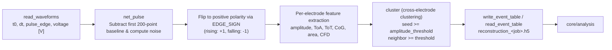

# Event Reconstruction (`core/reconstruction`)

`src/raser/core/reconstruction/` sits after [electronics readout](readout.md) and before [statistical analysis](analysis.md). It subtracts the baseline and estimates noise from each readout electrode's output voltage waveform, extracts pulse amplitude, time-over-threshold arrival time (`ToA`), time-over-threshold duration (`ToT`), center-of-gravity time (`CoG`), main-lobe area (`area`), constant-fraction discrimination (`CFD`), and multi-electrode cluster features, and writes the event summary table `EventTable` to `reconstruction_<job>.h5` for downstream analysis. See [../stages/reconstruction.md](../stages/reconstruction.md) for CLI and reconstruction options.

## Inputs and Tunable Reconstruction Parameters

The core function `event_table` takes `Waveforms` returned by `read_waveforms` (see [readout.md](readout.md); containing file attributes `electrodes`, `dt` (s), `pulse_edge` (`"rising"` or `"falling"`), and per-event `event`, `t0` (s), and stored electrode waveforms `voltage` of shape `(stored_electrodes, bins)` in V) together with the following parameters (the stage function `reconstruct` in [../stages/reconstruction.md](../stages/reconstruction.md) accepts `threshold` and `amplitude_threshold` in `mV` and multiplies them by `1e-3` before passing to `event_table`):

- **`threshold` (V)**: Threshold-crossing level used to compute `ToA`, `ToT`, `CoG`, and neighbor inclusion in clusters.
- **`amplitude_threshold` (V)**: Pulse amplitude threshold for marking an event as `selected` and selecting cluster seed electrodes.
- **`fractions` (tuple of floats)**: Constant-fraction discrimination fractions; every element must lie in the open interval `(0, 1)`.
- **`edges` (list of edge polarities per electrode)**: Built by `chosen_edges(given, derived, electrodes)`. When `given` is `None`, reuses `pulse_edge` written by `readout`; if `"rising"` or `"falling"` differs from `pulse_edge`, `chosen_edges` generates a notice and the stage function `reconstruct` prints a warning.

## Pulse Feature Extraction and Clustering Algorithm (`event.py`, `event_table.py`)

- **Bin centers and baseline noise (`net_pulse`)**: The center time of the `i`-th sample bin is `times[i] = t0 + (i + 0.5) * dt` (s). Takes the arithmetic mean of the first `BASELINE_POINTS = 200` samples as `baseline` (V) and their population standard deviation (`.std()`) as `noise` (V), returns the net waveform `samples - baseline`, and flips it to a positive-going pulse via `EDGE_SIGN` (`+1.0` for `"rising"`, `-1.0` for `"falling"`).
- **Peak amplitude (`get_amplitude`)**: Takes the maximum sample `amplitude = samples[peak]` (V, `peak = int(np.argmax(samples))`); sets `above = False` when `amplitude < threshold` and `above = True` otherwise (`NaN` also enters the `True` branch).
- **Time-over-threshold `ToA` (`get_ToA`) and `ToT` (`get_ToT`)**: Searches backward from `peak` for the first drop below `threshold` and linearly interpolates between the two adjacent bins to obtain `ToA` (s); searches forward from `peak` for the first drop below `threshold`, linearly interpolates, and subtracts `ToA` to obtain `ToT` (s; returns `0.0` if the waveform does not fall below threshold before the end of the record or if `ToA` is missing).
- **Constant-fraction timing `CFD` (`get_CFD50`)**: For a given `fraction`, sets target height `target = samples[peak] * fraction` (requiring `samples[peak] > 0`) and linearly interpolates between adjacent bins satisfying `samples[i - 1] <= target <= samples[i]` searching backward from `peak` to obtain the crossing time (s).
- **Center of gravity `CoG` (`get_CoG`) and main-lobe area `area` (`lobe_area`)**: `CoG` expands left and right from `peak` across the contiguous interval where `samples >= threshold` and computes the sample-weighted mean time (s); `area` expands left and right across the contiguous interval where `samples > 0` and computes the integral area `sum * dt` ($\text{V}\cdot\text{s}$).
- **Multi-electrode clustering (`cluster`)**: Takes electrode indices with `amplitude >= amplitude_threshold` as `seeds`, merges each seed `k` and its immediate neighbors (`k - 1`, `k + 1`) satisfying `amplitude >= threshold` into `members`, and computes `cluster_size = len(members)` and the amplitude-weighted `cluster_center` (`0`-based electrode index; returns `(0, NaN)` when `seeds` is empty). `selected = True` when `cluster_size > 0`.

## `reconstruction_<job>.h5` File Format and Read/Write Functions

`write_event_table` and `read_event_table` (`event_table.py`) read and write the HDF5 file corresponding to `EventTable`:

### File Attributes

| Attribute | Type | Unit | Meaning |
| --- | --- | --- | --- |
| `electrodes` | `string[]` | None | List of electrode names, matching the electrode column order in 2D/3D datasets |
| `threshold` | `float64` | V | Threshold (above baseline) for time-over-threshold and area |
| `amplitude_threshold` | `float64` | V | Amplitude threshold (above baseline) for event selection and cluster seeds |
| `fractions` | `float64[]` | None | Constant-fraction array, shape `(fractions,)` |
| `edge` | `string[]` | None | Pulse edge direction used per electrode, `"rising"` or `"falling"` |

### Datasets

| Dataset | Shape and Type | Unit | Meaning |
| --- | --- | --- | --- |
| `event` | `(events,)`, `int64` | None | Geant4 event IDs |
| `selected` | `(events,)`, `bool` | None | Whether the event has a cluster (at least one electrode with `amplitude >= amplitude_threshold`) |
| `cluster_size` | `(events,)`, `int64` | count | Number of electrodes in the cluster (`0` when no cluster) |
| `cluster_center` | `(events,)`, `float64` | electrode index (`0`-based) | Amplitude-weighted center position of the cluster (`NaN` when no cluster) |
| `traced` | `(events, electrodes)`, `bool` | None | Whether `readout` stored a waveform for that electrode in the event (when `False`, numeric columns are `NaN` and `above` is `False`) |
| `baseline` | `(events, electrodes)`, `float64` | V | Mean of the first `200` samples of the waveform |
| `noise` | `(events, electrodes)`, `float64` | V | Population standard deviation (`.std()`) of the first `200` samples of the waveform |
| `amplitude` | `(events, electrodes)`, `float64` | V | Maximum sample value above baseline |
| `above` | `(events, electrodes)`, `bool` | None | `False` when no waveform; `False` when `amplitude < threshold` and `True` otherwise (in current implementation, `NaN` also enters `True`; when `False`, time and area columns are `NaN`) |
| `ToA` | `(events, electrodes)`, `float64` | s | Time when the rising edge crosses `threshold` (`NaN` if not found) |
| `ToT` | `(events, electrodes)`, `float64` | s | Time difference from `ToA` to the falling-edge `threshold` crossing (`0` if it does not return below threshold) |
| `CoG` | `(events, electrodes)`, `float64` | s | Sample-weighted center-of-gravity time over the contiguous interval containing the peak where samples are `>= threshold` |
| `area` | `(events, electrodes)`, `float64` | $\text{V}\cdot\text{s}$ | Integrated area of the positive main lobe containing the peak |
| `CFD` | `(events, electrodes, fractions)`, `float64` | s | Time when the rising edge crosses each `fractions * amplitude` (`NaN` if not found) |

## Single-Event Waveform Class `InputWaveform` (Standalone Python Construction)

`InputWaveform(voltage, t0, dt, original_x, threshold, amplitude_threshold, pitch_x, pitch_y, CFD=0.5)` allows users to construct single-event reconstruction objects directly in Python (`voltage` is an `(electrodes, bins)` positive pulse above baseline, `original_x` and `pitch_x` share the same unit, default `CFD_LABEL = "CFD50"`):

- Computes `amplitude` per electrode (sets `amplitude`, `ToT`, `charge` to `0` and `ToA`, `CFD50` to `None` when below `threshold`; `charge` is `np.sum(np.abs(samples))`), and summarizes `"ToA"`, `"ToT"`, `"amplitude"`, `"charge"`, `"CFD50"`, `"gravity_center_ToT"`, `"gravity_center_amplitude"`, `"gravity_center_charge"`, `"cluster_size_ToT"`, `"cluster_size_amplitude"`, `"cluster_charge"`, `"gravity_center_ToT_error"`, `"gravity_center_amplitude_error"`, `"gravity_center_charge_error"`, and `"original_x"` in `self.data`.
- When the maximum amplitude is below `amplitude_threshold`, all three cluster sizes are `0` (and other quantities are `None`); for a single electrode (`read_ele_num == 1`), centroid and centroid error are `0` and cluster size is `1`; for multiple electrodes, `ToA` and `CFD50` come from the valid electrode with the largest amplitude, neighboring channels `> 0` are aggregated with seed thresholds `10e-9`, `amplitude_threshold`, and `0.0` respectively, and the difference between centroid and `original_x / pitch_x` is recorded as position error. Can be passed to `WaveformStatistics` in [analysis.md](analysis.md).

## Reconstruction Table in the Example (`HPK-Si-PiN`)

In the [Getting Started](../getting-started.md) example, `work/HPK-Si-PiN/signal/seed_1/batch/reconstruction_0.h5` at `200 V` records attributes `threshold = 0.01` V, `amplitude_threshold = 0.01` V, `edge = ['falling']`, `electrodes = ['top']`, and `fractions = [0.1, ..., 0.9]`. The datasets contain `200` events (`196` with `traced` equal to `True`), with `CFD` shaped `(200, 1, 9)`, and `selected`, `ToA`, `CoG`, etc. written for downstream `analysis`.

## Common Errors

| Exception Type | Error Message | Trigger Condition |
| --- | --- | --- |
| `ValueError` | `<len(samples)> samples, not more than the 200 of the baseline` | Waveform sample count is `<= 200` (`event.py`) |
| `ValueError` | `edge <given>: the thresholds are set on a rising (positive pulses) or a falling (negative pulses) edge` | `edge` is a value other than `"rising"`, `"falling"`, or `None` (`event_table.py`) |
| `ValueError` | `edges <edges>: one of rising or falling for each of <electrodes>` | Length of `edges` mismatches electrode count or contains an invalid element (`event_table.py`) |
| `ValueError` | `fractions <wrong>: a constant fraction lies between 0 and 1` | `fractions` contains a value `<= 0` or `>= 1` (`event_table.py`) |
| `ValueError` | `the readout holds no event` | Input `Waveforms.events` is an empty list (`event_table.py`) |

## Related Pages

- [Getting Started](../getting-started.md)
- [../stages/reconstruction.md](../stages/reconstruction.md)
- [readout.md](readout.md)
- [digitizer.md](digitizer.md)
- [analysis.md](analysis.md)
