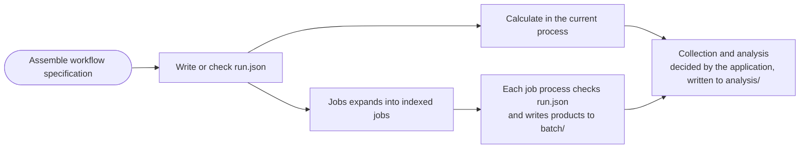

# Run records

_Run identity, records, and selection in `src/raser/supports/runs.py`_

---

## Run

A run is one execution of an application workflow. It corresponds to one
directory under `<project>/<workflow>/<run_id>/`, which holds a run record
`run.json` and the products of that execution.

A run solves three problems:

1. **Product provenance**: it binds output products to the inputs that produced
   them — each referenced Device with its own operating state, Field
   configuration and data hash, the selected components, the calculation
   stages, the work allocation, and the code version.
2. **Multi-job ownership**: it places the indexed jobs expanded from one
   execution in the same run directory. Each job checks against the same run
   record and writes its products to the same directory.
3. **Locating products for later analysis**: the summary analysis stage finds
   the products of a run by run identifier, by the latest-run selector, or by
   an explicit path.

## Responsibilities and encapsulation

| Participant | Responsibility | Exposure and read/write boundary |
| --- | --- | --- |
| Application | Resolves the one or more referenced Devices, their Fields, and the components, and assembles the workflow specification; decides the execution mode, and whether collection and analysis are triggered after execution or by a separate request | Defines the specification content and hands it to the activation step; during collection, calls Runs to locate the run directory and writes summary results under `analysis/` |
| Runs | Reads the optional run configuration; allocates the run identifier; creates the run directory and `batch/` and writes `run.json`; locates run directories by identifier or by condition | Exposes configuration loading, identifier allocation, record writing, and run lookup to applications |
| Jobs | Expands one run into commands that carry the same run identifier and a zero-based index, and executes them concurrently on the local machine or submits them to the cluster | Receives the command, run identifier, and job count from the application, and starts or submits job processes; see [Jobs](jobs.md) |
| Job process | Starts with the allocated run identifier and a job index, executes one indexed job, and writes batch products | Reads the existing `run.json` in the run directory, adopts the total job count from the record, checks that its own specification matches the record, and then writes products to `batch/` |

## Record content

`run.json` is written when the workflow specification is activated. It records
four kinds of information:

- **Identity and version**: the owning workflow, the run identifier, the time
  the record was written, and the commit state of the code repository. These
  distinguish runs and trace the software version.
- **Physics and device inputs**: each referenced Device with its operating
  state, Field configuration and field-data hash, and each selected component
  with its full parameters. These fix the physics inputs and filter compatible
  runs when the latest run is looked up.
- **Stages and output location**: the sequence of calculation stages declared
  by the workflow and the parent output directory. These delimit the workflow
  structure and the ownership of products.
- **Work allocation**: the job count, the random seed, and, where applicable,
  the event count of one job. These serve job splitting and random-number
  reproduction.

When `run.json` already exists in the target run directory, the activation step
compares the current specification with the existing record; a job process
adopts the total job count from the record before the comparison. The run
directory is reused when the specifications match.

## Directory and run selection

The run directory is `<project>/<workflow>/<run_id>/` (product ownership is
described in [Output](../supports/output.md)):

```text
<project>/<workflow>/<run_id>/
├── run.json
├── batch/
└── analysis/
```

`run.json` and `batch/` are created together with the run directory.
Applications that include summary analysis create `analysis/` in the collection
stage.

An existing run directory is located in one of three ways:

- **Run identifier**: names one run and locates the corresponding run directory
  under the owning workflow.
- **Latest-run selector**: scans the existing records under the owning
  workflow, keeps the runs that match the target specification or the given
  conditions, and selects the run directory that is the newest and unique
  match. It is used only to read existing runs; a new run created without an
  identifier is allocated a new one.
- **Explicit path**: gives the path of the target run directory directly.

## Lifecycle



1. **Assembly and activation**: the application resolves each referenced Device
   with its Field, the components, and the work allocation, and produces the
   workflow specification. The activation step writes a new `run.json` in the
   run directory, or checks that the existing record matches the current
   specification.
2. **Job execution**: depending on the workflow and the invocation, the
   application either completes the calculation in the current process and
   writes its products, or hands it to Jobs, which expands it into indexed jobs
   that carry the same run identifier, run locally or on the cluster, and write
   products to `batch/`.
3. **Collection and analysis**: an application that includes a summary stage
   collects automatically after local jobs finish, or, after cluster jobs
   finish, locates the run directory on a separate request. It reads the
   products in `batch/` and writes the analysis results under `analysis/`.

## Failure

- When specification assembly or parameter validation fails, execution stops
  before the run directory is created.
- When an existing run directory is reused and the specification differs from
  the recorded content, execution is refused.
- Looking up the latest run raises an error when nothing matches or when
  several matches share the same timestamp.
- Once the run directory and `run.json` have been created, a failure in later
  execution, submission, or collection keeps the directory and the record.
