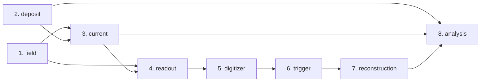

# Simulation Chain and Stage Entry Points (`stages`)

`src/raser/stages/` handles stage commands dispatched by the [Command-Line Interface (`raser`)](../cli.md), as well as full-chain runs for benchmarks and applications. The simulation chain consists of eight stages in order: `field`, `deposit`, `current`, `readout`, `digitizer`, `trigger`, `reconstruction`, and `analysis`, all of equal standing. Each stage is a complete workflow on its own; it can run independently or be chained backward from a target stage. This package assembles the chain, registers commands and options for each stage, resolves stage-command paths to experiment folders, and truncates execution at the target stage. The result computed by a stage under a given set of inputs is a node stored under `nodes/<stage>/<node_id>/` in the experiment folder and pointed to by the view `points/<point>/<stage>/<job>` (one node per job from `deposit` through `reconstruction`, and one per scan point for `field` and `analysis`); field nodes for a device are stored under `<device_project>/field/<node_id>/` and shared across all experiments on that device. Nodes, the parameter table `points.json`, and reuse are handled by [Slices and Reruns](../lifecycle/slices.md); configuration and scan points are handled by [Experiments, Scan Points, and Seeds](../lifecycle/experiments.md); jobs are handled by [Jobs and Clusters](../lifecycle/jobs.md). The individual stages are the [Field Solving Stage (`stages/field`)](field.md), [Energy Deposition Stage (`stages/deposit`)](deposit.md), [Carrier Transport and Induced Current Stage (`stages/current`)](current.md), [Electronics Readout Stage (`stages/readout`)](readout.md), [Digitization Stage (`stages/digitizer`)](digitizer.md), [Trigger Stage (`stages/trigger`)](trigger.md), [Event Reconstruction Stage (`stages/reconstruction`)](reconstruction.md), and [Statistical Analysis Stage (`stages/analysis`)](analysis.md).

## Behavior

### Chain



| Stage | Command | Stage nodes read | What it does |
| --- | --- | --- | --- |
| `field` | `raser field` (`fld`) | None | Computes electric field, weighting field, and IV/CV inside the device |
| `deposit` | `raser deposit` (`dep`) | None | Computes particle energy deposition using Geant4 |
| `current` | `raser current` (`cur`) | `field`, `deposit` | Drifts carriers in the field and computes induced currents on electrodes |
| `readout` | `raser readout` (`rdo`) | `field`, `current` | Feeds currents into the device equivalent circuit and front-end amplifier to obtain waveforms |
| `digitizer` | `raser digitizer` (`digi`) | `readout` | Converts waveforms into digital waveforms via oscilloscope or digitizer-board sampling and quantization |
| `trigger` | `raser trigger` (`trig`) | `digitizer` | Decides which events are recorded according to real trigger-device conditions |
| `reconstruction` | `raser reconstruction` (`reco`) | `trigger` | Extracts hit times and amplitudes from waveforms, and performs track fitting in beam tests |
| `analysis` | `raser analysis` (`ana`) | `deposit`, `current`, `reconstruction` | Aggregates efficiency and time resolution, and produces trend plots under `<experiment>/analysis/` |

`readout` obtains the device equivalent circuit from `field`. `analysis` is responsible for the results of the entire experiment: each scan point has its own result, and cross-point statistics and trend plots are placed directly under `<experiment>/analysis/`. Plots from every other stage are placed in that stage's own node.

When an experiment has multiple devices, each device has its own field; when an experiment has multiple positions (for example, `1` device with `24` positions in `cflm`), each position runs `current` and its downstream stages separately, reading the same deposition and the corresponding device's field. `deposit` runs only once (`cflm` replaces it with its own deposition calculation).

### Full-Chain Run

Scan two bias voltages on `HPK-Si-PiN` (default bias `200 V`), running `2` jobs per point with `200` recorded events per job:

```bash
raser signal HPK-Si-PiN --scan field.voltage=100,200 -s 2 --set deposit.events_per_job=200 --seed 1
```

When `HPK-Si-PiN` is not present under `work/`, the command runs in place in the example project `examples/HPK-Si-PiN/`. It first solves the missing fields at `100 V` and `200 V` and stores them under `examples/HPK-Si-PiN/field/`; it then runs each stage in chain order at the two scan points `points/voltage_100/` and `points/voltage_200/`, writing each job's node for each stage into `examples/HPK-Si-PiN/signal/nodes/<stage>/<node_id>/`. Results for job `0` at the `200 V` point:

- **`deposit`**: Geant4 generates `7359` events and records `200` valid events (`5476` deposit steps).
- **`current`**: `dt = 5e-12 s`, `electrodes = ['top']`; for `200` events, `charge` has shape `(200, 1)` and `current` has shape `(245196,)`; plots are drawn for the first `100` events.
- **`readout`**: Uses device capacitance `3.44162280284e-12 F` and `SantaCruz+Gali52+Termination50`, writing `pulse_edge = ['falling']` and `voltage` of shape `(245196,)`.
- **`digitizer`**: Samples and quantizes the waveforms of the `200` events according to `MXR608A`'s sampling rate, bandwidth, and full-scale range, writing `digitizer.h5`.
- **`trigger`**: Applies the amplitude threshold and writes the IDs of events exceeding the threshold into `trigger.h5`; only those events enter `reconstruction`.
- **`reconstruction`**: Uses `threshold = 0.01 V` and `amplitude_threshold = 0.01 V` to write the feature table for the recorded events, with `CFD` of shape `(<recorded_events>, 1, 9)` (`9` constant fractions).
- **`analysis`**: Aggregates all completed jobs across both scan points, writing one `analysis` node (containing `result.json`) per point, and cross-point statistics and trend plots under `examples/HPK-Si-PiN/signal/analysis/`.

Changing the bias voltage constitutes a separate measurement, so `deposit` and `current` are measured independently at the two points; downstream stages include upstream node IDs in their fingerprints and therefore also have separate nodes.

### Stage Commands

Every stage command runs up to that stage on the experiment in the current folder or at the given path, automatically computing any missing upstream stages:

```bash
raser <stage> [path]
```

Omitting the path uses the current folder; providing a path accepts either a relative or an absolute path. The command reads `config.json` in the experiment folder to identify which benchmark or application the experiment belongs to and which device it uses, then runs under that experiment's project and component search paths. For example, to run an existing experiment only up through `readout`:

```bash
raser readout examples/HPK-Si-PiN/signal
```

Execution includes only the target stage and all upstream stages it reads directly or indirectly. Any upstream node with the same fingerprint is reused regardless of which scan point or run produced it; missing ones are computed first in chain order, and required fields are solved before jobs start. On multi-position experiments, a stage command runs all positions of that stage: for example, running `raser current` on `cflm` runs `deposit`, `field`, and `current` for all `24` positions. When the experiment class does not include the requested stage, the command exits with an error and lists the stages that the experiment has.

`field` has no upstream stages, so `raser field [path]` simply solves the fields required by each device and scan point of the experiment. `raser <stage> --draw <object>` draws objects belonging to that stage, such as schematics and impulse responses for `readout`, or meshes and doping on mesh nodes for `field`.

### Nodes, Views, and Reuse

Each stage node has four kinds of inputs: the setting values used by the stage, the part of the component files it uses, the node IDs of its upstream nodes, and the seed of measurement stages (`deposit`, `current`) as well as the own seeds of `readout` (NGspice noise) and `digitizer` (clock phase and aperture jitter). A fingerprint is computed from these inputs, and the fingerprint is the node ID. A node folder contains the files written by the stage together with `node.json`; `node.json` records the inputs verbatim, along with the code version, runtime environment, and run status.

- **Reuse**: Matching fingerprints are reused. When a scan affects only downstream settings, upstream nodes are shared across points. Nodes are append-only: reverting a setting points the view back to the original node and reuses it directly.
- **Staleness**: When the code version differs from the one recorded in the node, only a notice is printed and the result is still reused.
- **Locking**: Each node is locked individually. A partially written node carries the `.part` suffix and is renamed to its final name only after writing finishes.

## Rules

### Execution of Stage Commands

`chain.py` executes a stage command in the following steps:

1. **Resolve experiment**: Read `config.json` from the experiment folder and extract the experiment name and device name.
2. **Validate stage**: If the experiment does not contain the target stage, exit with an error listing the stages of the experiment.
3. **Truncate execution**: Pass the target stage to the executor, which runs only the target stage and all of its upstream stages.
4. **Enter experiment**: Configure the project root and component search paths for the experiment's command (see `project_root_context` in [Common Infrastructure (`supports`)](../supports/README.md)), change into the experiment folder to run, and restore the original directory afterward.
5. **Cluster resume**: Rewrite the experiment path on the command line to an absolute path. When a cluster job reruns the original command from the experiment folder, it uses this absolute path to locate the same experiment.

### Stage Execution Callbacks

Each stage is a module; `field` is the 1st stage and registers its command and provides an execution callback just like the other seven. Callbacks import their corresponding modules lazily at runtime, so heavy dependencies such as Geant4 and ROOT are loaded only when the stage runs:

| Stage | Module | What it does in a job |
| --- | --- | --- |
| `field` | `raser.stages.field` | Obtains the field node needed for this point; missing fields have already been solved before jobs start |
| `deposit` | `raser.stages.deposit` | Writes the deposit node for this job |
| `current` | `raser.stages.current` | Writes the current node for this job |
| `readout` | `raser.stages.readout` | Writes the waveform node for this job |
| `digitizer` | `raser.stages.digitizer` | Writes the digital waveform node for this job |
| `trigger` | `raser.stages.trigger` | Writes the recorded events for this job |
| `reconstruction` | `raser.stages.reconstruction` | Writes the feature table for this job |
| `analysis` | `raser.stages.analysis` | Aggregates the nodes of all jobs at this point and writes the point's `analysis` node |

When `-g4_vis` is enabled, `chain.job_command` appends `-g4_vis` and `--g4-vis-driver <driver>` to each job command so that child processes also launch Geant4 visualization.

## Software Implementation

### Source File Responsibilities

- `src/raser/stages/__init__.py`: Package entry point for `raser.stages`.
- `src/raser/stages/chain.py`: Assembles the eight stages into the chain, defines component-kind mappings, shared experiment resolution and truncated execution for stage commands, and `job_command` for forwarding `-g4_vis`.
- Stage modules and subpackages: `field/`, `deposit.py`, `current.py`, `readout.py`, `digitizer.py`, `trigger.py`, `reconstruction.py`, `analysis/`. Each module registers its own command and options and provides an execution callback.

## Interface

### Settings

`config.json` is divided into eight sections, one per stage, and chain settings belong to the sections listed below. Use `--set <section>.<key>=<value>` to modify a setting and `--scan <section>.<key>=<value1>,<value2>` to scan it; shared run parameters (`-s`, `--seed`, `--same-seeds`, `--set`, `--scan`, `--dry-run`) are documented in [Command-Line Interface (`raser`)](../cli.md). Settings in the `digitizer` and `trigger` sections are documented on their respective pages. The code retains no defaults: the "Value in example" column shows the values written in `examples/HPK-Si-PiN/signal/config.json`, with different values from other examples in parentheses; if `config.json` is missing a key that is needed, an error is raised naming the missing `section.key`, for example `ValueError: examples/HPK-Si-PiN/signal/config.json has no deposit.generated_limit`; missing keys that are not used (for example, when `deposit.generated_per_job` is `null`) do not raise an error.

| Section.Key | Value in example | Unit | Meaning |
| --- | --- | --- | --- |
| `field.voltage` | `200.0` (uses bias voltage from the device file when `null`) | $\text{V}$ | Device bias voltage; determines which field is used |
| `field.irradiation_flux` | `null` (uses irradiation fluence from the device file, or `0` if the device file has no irradiation block) | $\text{cm}^{-2}$ | Device irradiation fluence ($1\ \text{MeV}$ neutron-equivalent fluence); determines which field is used |
| `deposit.g4setup` | `"device_alone"` (`"time_resolution"` in the `timeres` example) | None | Geant4 setup component name; the setup's `source` block names the source it uses |
| `deposit.g4setup.source` | `"decay/Sr90"` (`"bunch"` in the `bmos` example) | None | Replaces the whole source: radioactive source, beam, or straight-line MIP component name; the setup's `angle` is kept |
| `deposit.events_per_job` | `200` (`10000` in the `timeres` example, `1000` in the `telescope` example) | events/job | Number of valid deposit events to record per job |
| `deposit.generated_per_job` | `null` (unused) | events/job | Fixed number of primary events generated per job, as an alternative to recording a target count |
| `deposit.generated_limit` | `10000000` | events/job | Maximum number of primary events generated per job when running by recorded event count |
| `deposit.edep_min` | `null` (no lower bound) | $\text{MeV}$ | Lower bound on total deposited energy in the device for recording an event |
| `deposit.edep_max` | `null` (no upper bound) | $\text{MeV}$ | Upper bound on total deposited energy in the device for recording an event |
| `deposit.fano` | `true` | None | Whether to apply Fano fluctuation sampling when generating electron-hole pairs by ionization |
| `deposit.plots` | `100` (`0` in the `timeres`, `bmos`, and `cflm` examples) | events/job | Per job, `deposit` draws the Geant4 geometry and tracks of the first N recorded events ($\le 0$ disables plotting) |
| `current.plots` | `100` (`0` in the `timeres`, `bmos`, and `cflm` examples) | events/job | Per job, `current` draws carrier drift paths and current waveforms for the first N recorded events ($\le 0$ disables plotting) |
| `readout.amplifier` | `"SantaCruz+Gali52+Termination50"` | None | Front-end amplifier stages and termination-load SPICE component names joined with `+` |
| `readout.sheet_resistance` | `null` (uses the resistive-layer sheet resistance in the device file) | $\Omega$ | Overrides resistive-layer (AC-LGAD) sheet resistance; passing a non-`null` value for a device without a resistive layer raises `ValueError` |
| `reconstruction.threshold` | `10.0` | $\text{mV}$ | Threshold for over-threshold timing (`ToA`, `ToT`, `CoG`), main-lobe area (`area`), and neighboring cluster channels |
| `reconstruction.amplitude_threshold` | `10.0` | $\text{mV}$ | Amplitude threshold for cluster seed channels; events recorded by `trigger` in which a seed is found are marked as selected (`selected`), and timing statistics in `analysis` use selected events |
| `reconstruction.fractions` | `[0.1, 0.2, 0.3, 0.4, 0.5, 0.6, 0.7, 0.8, 0.9]` | None | Amplitude fractions for constant fraction discrimination (`CFD`) |
| `reconstruction.edge` | `null` (inherits `pulse_edge` written by `readout`) | None | Pulse edge on which thresholds act: `"rising"` or `"falling"` |

Two CLI switches are specified only on the command line: `-g4_vis` opens Geant4 geometry and track visualization (or exports an offscreen geometry image) and exits the job, disabled by default; `--g4-vis-driver` specifies its visualization driver, defaulting to `"TSG_QT_GLES"`.

### Files Read and Written

- **`<experiment>/config.json`**: Full set of settings for the run, sectioned into eight stages, read by stage commands.
- **`<experiment>/points.json`**: Parameter table, one row per scan point, recording the scan-axis values and the node ID used by each stage; recomputed from `config.json` on each run.
- **`<experiment>/nodes/<stage>/<node_id>/`**: A stage node containing the files written by that stage and `node.json`.
- **`<experiment>/points/<point>/<stage>/<job>`**: Symlink pointing to this job's node for that stage; `points/<point>/field` and `points/<point>/analysis` are each a single symlink. Point names are derived from scan-axis values, for example `voltage_100`.
- **`work/<device>/field/<node_id>/`**: Shared field node of the device; see [Field Solving and Loading (`core/field`)](../core/field.md) for its format.
- **Deposit file `deposit.h5` in the `deposit` node**: Energy deposit steps and electron-hole pairs; still written when `0` events are recorded, after which `Ended` is raised to terminate the job. Attributes include `generated_events`, `recorded_events`, `emission_probability` (`1.0` for sources without an emission distribution), and optional `edep_min`, `edep_max` ($\text{MeV}$); datasets store per-event `event` and `count`, and per-deposit-step `detector`, `x`/`y`/`z` ($\mu\text{m}$, with optional start coordinates `x_start`/`y_start`/`z_start`), `t` ($\text{s}$, with optional `t_fwhm`), `e` ($\text{MeV}$), and `pairs` (pairs). See [Energy Deposition and Ionization (`core/deposit`)](../core/deposit.md) for shapes, types, and units.
- **Current file `current.h5` in the `current` node**: Time-domain induced currents and net induced charge on each readout electrode; in multi-position experiments, one file `current.<position>.h5` per position is stored in the same job's node and written only when that position has deposits. Attributes include `electrodes` and `dt` ($\text{s}$); datasets store per-event `event`, `t0` ($\text{s}$), `count`, `pairs` (pairs), plus `sensitive_pairs` (pairs) and `carriers_without_field` (carriers) during field drift, `charge` ($\text{C}$), `stored`; per stored electrode `index`; and flattened across time bins, `current` ($\text{A}$) for electrodes with nonzero current. See [Carrier Drift and Induced Current (`core/current`)](../core/current.md).
- **Waveform file `readout.h5` in the `readout` node**: Output voltage waveforms solved through the device equivalent circuit and front-end amplifier chain; in multi-position experiments, `readout.<position>.h5` is written only when a corresponding current file exists. Attributes include `electrodes`, `dt` ($\text{s}$), `pulse_edge` (`"rising"` or `"falling"` per electrode), and `device_circuit` (JSON string); datasets store per-event `event`, `t0` ($\text{s}$), `count`, `stored`; per stored electrode `index`; and flattened across samples, `voltage` ($\text{V}$). See [Electronics Readout (`core/readout`)](../core/readout.md).
- **`digitizer` and `trigger` nodes**: Digital waveforms and recorded events; see [Digitization Stage (`stages/digitizer`)](digitizer.md) and [Trigger Stage (`stages/trigger`)](trigger.md).
- **Feature table `reconstruction.h5` in the `reconstruction` node**: Per-event waveform features; in multi-position experiments, `reconstruction.<position>.h5` is written only when a corresponding input exists. Attributes include `electrodes`, `threshold` ($\text{V}$), `amplitude_threshold` ($\text{V}$), `fractions`, and `edge`; datasets store per-event `event`, `selected`, `cluster_size`, `cluster_center`; per event and electrode `traced`, `baseline` ($\text{V}$), `noise` ($\text{V}$), `amplitude` ($\text{V}$), `above`, `ToA` ($\text{s}$), `ToT` ($\text{s}$), `CoG` ($\text{s}$), `area` ($\text{V}\cdot\text{s}$); and per event, electrode, and constant fraction `CFD` ($\text{s}$). See [Event Reconstruction (`core/reconstruction`)](../core/reconstruction.md).
- **Per-stage plots**: When `plots > 0`, `deposit` and `current` write their plots into their respective nodes.
- **`analysis` node**: One per scan point, containing `result.json`, `events.h5`, and per-point plots; see [Statistical Analysis Stage (`stages/analysis`)](analysis.md).
- **`<experiment>/analysis/`**: Cross-point statistics and trend plots written by `analysis`.
