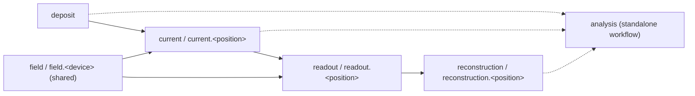

# Simulation Chain and Stage Entry Points (`stages`)

`src/raser/stages/` sits between top-level experiment workflows (`bench`, `apps`) and low-level physics algorithms (`core`). It wraps the physics calculations in `core` into lifecycle slices (`deposit`, `field`, `current`, `readout`, `reconstruction`), standalone workflows (`field`, `analysis`), and stage CLI entry points (`raser dep|cur|rdo|reco`). This page describes the dependency expansion of the slice chain, the HDF5 data files handed off between stages, stage commands, and common chain options.

## Job Slice Chain Order and Dependencies

`expand(devices, deposit)` in `src/raser/stages/chain.py` builds the slice sequence `SLICES` for an experiment job. For a single device at a single position, it contains 5 `Slice` objects in order. When `Workflow.devices` defines multiple devices, `field.<device>` is expanded per device. When the total number of positions is greater than 1 (a single device with multiple positions still shares `field`), `current.<position>`, `readout.<position>`, and `reconstruction.<position>` are expanded per position:

Each slice is defined in `src/raser/stages/chain.py` as follows:

| Order | Slice Name (`Slice.name`) | Prerequisites (`needs`) | Option Keys Read (`keys`) | Component File Kinds (`kinds`) | `new_events` | `shared` |
| --- | --- | --- | --- | --- | --- | --- |
| 1 | `deposit` | `()` | `("source", "g4setup", "events_per_job", "generated_per_job", "generated_limit", "edep_min", "edep_max", "fano")` | `("source", "g4setup")` | `True` | `None` |
| 2 | `field` (`field.<device>` for multiple devices) | `()` | `("voltage", "irradiation")` (prefixed with `<device>.` for multiple devices) | `()` | `True` | `field.SHARED` (each device's shared field interface for multiple devices) |
| 3 | `current` (`current.<position>` for multiple positions) | `("deposit", "field")` (`("deposit", "field.<device>")` for multiple devices) | `("plots",)` | `()` | `True` | `None` |
| 4 | `readout` (`readout.<position>` for multiple positions) | `("current", "field")` (`("current.<position>", "field")` for single device with multiple positions; `field.<device>` for multiple devices) | `("amplifier", "sheet_resistance")` | `()` | `False` | `None` |
| 5 | `reconstruction` (`reconstruction.<position>` for multiple positions) | `("readout",)` (or `("readout.<position>",)`) | `("threshold", "amplitude_threshold", "fractions", "edge")` | `()` | `False` | `None` |

## Job Slice Data File Paths and Formats

Under `batch/` of the scan-point directory holding the slice (`<holder>/<seed_dir>/batch/` for seeded workflows, `<holder>/batch/` for unseeded workflows; path generated by `output(kwargs, name)` in `src/raser/stages/files.py`, where `<job>` defaults to `0` if `job_index` is not passed), job `<job>` (0-based integer index) reads and writes the following files per slice:

| File Name | Written By | Read By | HDF5 Attributes (`attrs`) and Units | HDF5 Datasets (`datasets`) and Units |
| --- | --- | --- | --- | --- |
| `deposit_<job>.h5` | [`deposit`](deposit.md) | [`current`](current.md), [`analysis`](analysis.md) (`timing.py` reads the earliest deposit time as `truth`) | `generated_events`, `recorded_events`, `generated_fraction`, `edep_min` [MeV] (if set), `edep_max` [MeV] (if set) | Per event (length `recorded_events`): `event` (int64), `count` (int64); per deposit step (length `sum(count)`): `detector` (string), `x`, `y`, `z` [um] (local step midpoint in standard Geant4 chain; local step start in `cflm`), `x_start`, `y_start`, `z_start` [um] (step start, if present), `t` [s], `t_fwhm` [s] (if present), `e` [MeV], `pairs` (float64, number of electron-hole pairs) |
| `current_<job>.h5` (`current.<position>_<job>.h5` for multiple positions) | [`current`](current.md) | [`readout`](readout.md), [`analysis`](analysis.md) (reads only `current_<job>.h5` without position suffix; `collection.py` reads `charge` and `pairs` to compute charge collection efficiency) | `electrodes` (string array, list of electrode names), `dt` [s] (time bin width) | Per event: `event` (int64), `t0` [s] (left edge of first time bin), `count` (int64, number of time bins), `pairs` (electron-hole pairs before multiplication), `sensitive_pairs` (driftable pairs generated in non-conductive region, written during field drift), `carriers_without_field` (carriers stopped in zero-field region, written during field drift), `charge` [C] (shape `(events, electrodes)`, net induced charge per electrode), `stored` (int64, number of electrodes with nonzero current); per stored electrode: `index` (int64, 0-based electrode column index); per time bin: `current` [A] (1D flattened array, `count` consecutive points per stored electrode) |
| `readout_<job>.h5` (`readout.<position>_<job>.h5` for multiple positions) | [`readout`](readout.md) | [`reconstruction`](reconstruction.md) | `electrodes` (string array, all possible output electrode names), `dt` [s] (time bin width), `pulse_edge` (string array, `"rising"` or `"falling"` per electrode), `device_circuit` (JSON string, device equivalent-circuit element values and sources) | Per event: `event` (int64), `t0` [s], `count` (int64, number of samples per waveform), `stored` (int64, number of electrodes stored for this event); per stored electrode: `index` (int64, electrode index); per sample: `voltage` [V] (1D flattened array, `count` consecutive bin-center voltages per stored electrode) |
| `reconstruction_<job>.h5` (`reconstruction.<position>_<job>.h5` for multiple positions) | [`reconstruction`](reconstruction.md) | [`analysis`](analysis.md) (reads only `reconstruction_<job>.h5` without position suffix) | `electrodes` (string array), `threshold` [V] (timing and area threshold), `amplitude_threshold` [V] (event selection threshold), `fractions` (float64 array, CFD fractions), `edge` (string array, timing edge per electrode: `"rising"` or `"falling"`) | Per event (1D): `event` (int64), `selected` (bool), `cluster_size` (int64), `cluster_center` (float64, in units of electrode index); per event and electrode (2D `(events, electrodes)`): `traced` (bool), `baseline` [V], `noise` [V], `amplitude` [V], `above` (bool), `ToA` [s], `ToT` [s], `CoG` [s], `area` [V s]; per event, electrode, and constant fraction (3D `(events, electrodes, fractions)`): `CFD` [s] |

## Slice Chain in the Example (`HPK-Si-PiN`)

In the [Getting Started](../getting-started.md) example, after running `raser signal HPK-Si-PiN --scan voltage=100,200 -s 2 -evt 200 --seed 1`, jobs `0` and `1` at each scan point run through the 5 slices above in order:

1. **Shared field calculation**: Detecting that the fields for `100 V` and `200 V` are not ready, the program first calls `raser field HPK-Si-PiN -bias 100.0` and `200.0` to solve the electric potential, weighting field, IV/CV, and 1D undepleted-layer parameters, writing them to `work/HPK-Si-PiN/field/`.
2. **Slice data handoff (using job `0` in `seed_1/batch/` at the `200 V` default point as an example)**:
   - [`deposit_0.h5`](deposit.md): Geant4 generates `7359` events and records `200` valid events (`5476` deposit steps).
   - [`current_0.h5`](current.md): With `dt = 5e-12 s` and `electrodes = ['top']`, it writes `charge` `(200, 1)` and `current` `(245196,)` for `200` events, and plots the first `100` events.
   - [`readout_0.h5`](readout.md): Using a device capacitance of `3.44162280284e-12 F` and the `SantaCruz+Gali52+Termination50` chain, it writes `pulse_edge = ['falling']` and `voltage` `(245196,)`.
   - [`reconstruction_0.h5`](reconstruction.md): Using `threshold = 0.01 V` and `amplitude_threshold = 0.01 V`, it writes the feature table for `200` events and the 9-channel `CFD` `(200, 1, 9)`.
3. **Summary analysis**: Running `raser analysis work/HPK-Si-PiN/signal` then aggregates the `deposit`, `current`, and `reconstruction` files from all finished jobs across `100 V` and `200 V`, writing `work/HPK-Si-PiN/signal/analysis/result.json` and `points.json`.

## Stage Commands (`raser dep|cur|rdo|reco`)

`raser deposit|current|readout|reconstruction <target>` (short commands `dep|cur|rdo|reco`, defined in `src/raser/stages/stage_commands.py`):

- When `<target>` is an experiment folder containing `config.json`, it reads `workflow` and `device`, switches to the experiment's project root and the workflow's component search paths, and executes with `until=<stage>`, running only that stage slice and its transitive prerequisites via `Slice.needs`. For multi-position experiments (such as `cflm`), specifying `current` runs `deposit`, `field`, and all 24 `current.<pad>` slices.
- When `<target>` is a device name, it automatically uses `work/<device>/signal` (`workflow="signal"`) as the target experiment directory and runs up to the specified stage; if that experiment directory does not exist yet, it is created with default parameters.

| Option | Default | Unit | Description |
| --- | --- | --- | --- |
| `target` (positional argument) | Required | None | Experiment folder path (reads its `config.json`), or device name (corresponds to `work/<device>/signal`) |

## Common Simulation Chain Options

`signal`, `cce`, `timeres`, and `bmos` mount all 4 groups of CLI options; `deposit` (`dep`), `current` (`cur`), `readout` (`rdo`), and `reconstruction` (`reco`) cumulatively mount options from `deposit` up to their own stage; `cflm` mounts `--plots`, `-vol`, `-irr`, `-amp`, `--sheet-resistance`, and the reconstruction options. Two chain option keys, `fano` and `fractions`, have no standalone CLI arguments (`fano` can be configured in `"set"` of `config.json` or specified via `--set` / `--scan`; `fractions` can be configured as a numeric list in `"set"` of `config.json`, whereas CLI `--set` / `--scan` only supports a single scalar folder-name string or comma-separated scan values):

| Stage | Option / Key | Default (`chain.DEFAULTS` or CLI parser) | Experiment Override Default | Unit | Description |
| --- | --- | --- | --- | --- | --- |
| `deposit` | `source` (optional positional argument) | `"decay/Sr90"` | `bmos`: `"bunch"` | None | Particle source or beam component name (or JSON path) |
| `deposit` | `--g4setup` | `"device_alone"` | `cce`: `"charge_collection"`; `timeres`: `"time_resolution"` | None | Geant4 geometry setup script name (or `.py` path) |
| `deposit` | `-evt`, `--events-per-job` | `1` | `cce`: `10000`; `timeres`: `10000` | events | Number of valid deposited events recorded per job (mutually exclusive with `-gen`) |
| `deposit` | `-gen`, `--generated-per-job` | `None` | None | events | Total number of events generated by the particle source per job (alternative to `-evt`) |
| `deposit` | `--generated-limit` | `None` (`10000000` at runtime) | None | events | Maximum number of source events generated per job to record `-evt` valid events |
| `deposit` | `--edep-min` | `None` | None | MeV | Minimum total deposited energy inside the device required to record an event |
| `deposit` | `--edep-max` | `None` | None | MeV | Maximum total deposited energy inside the device required to record an event |
| `deposit` | `fano` (no standalone CLI argument; via `config.json` `"set"` or `--set` / `--scan`) | `True` | None | None | Whether to enable Fano fluctuation sampling for ionized electron-hole pairs |
| `deposit` | `-g4_vis` | `False` (CLI default) | None | None | Enable Geant4 geometry and track visualization, then end the job after drawing |
| `deposit` | `--g4-vis-driver` | `"OGL"` (CLI default) | None | None | Geant4 visualization driver used by `-g4_vis` (writes `g4_geometry` image when set to `TSG`, `TSG_FILE`, `TSG_OFFSCREEN` (case-insensitive) or starting with `OGL`) |
| `current` | `--plots` | `100` | `cce`, `timeres`, `bmos`, `cflm`: `0` | events | Plot carrier drift paths and electrode currents for the first N recorded events of each job |
| `current` | `-vol`, `--voltage` | `None` (uses `device.bias.voltage`) | None | V | Device bias voltage (maps to `device.bias.voltage`) |
| `current` | `-irr`, `--irradiation` | `None` (uses device `irradiation.irradiation_flux`, or `0` if absent) | None | n$_{\text{eq}}$/cm$^2$ | Irradiation fluence |
| `readout` | `-amp`, `--amplifier` | `"SantaCruz+Gali52+Termination50"` | None | None | Readout amplifier and termination circuit chain name (joined with `+`) |
| `readout` | `--sheet-resistance` | `None` | None | Ohm | Sheet resistance of the resistive layer (overrides the device file value; available only for devices with `resistive_layer`) |
| `reconstruction` | `-threshold` | `10.0` | None | mV | Pulse threshold for time of arrival (`ToA`), time over threshold (`ToT`), center of gravity (`CoG`), and neighboring electrode clustering |
| `reconstruction` | `-amplitude_threshold` | `10.0` | None | mV | Pulse amplitude threshold for event selection (`selected`) and seed electrode clustering |
| `reconstruction` | `fractions` (no standalone CLI argument; list configured in `config.json` `"set"`) | `[0.1, 0.2, 0.3, 0.4, 0.5, 0.6, 0.7, 0.8, 0.9]` | None | None | List of amplitude fractions for constant fraction discrimination (`CFD`) |
| `reconstruction` | `--edge` | `None` (uses `pulse_edge` written by `readout`) | None | None | Pulse edge on which thresholds act, `"rising"` or `"falling"` |

## Common Errors

| Error Message | Trigger Condition |
| --- | --- |
| ``FileNotFoundError: no field of <det_name> ready for this run: solve it with `raser field <det_name>` `` | No solved field matching the current bias voltage and irradiation fluence is found when executing the `field` slice |
| `SystemExit: <target>: neither an experiment folder (a folder with a config.json) nor a device; give one of them, e.g. work/<device>/cce or HPK-Si-PiN` | The `target` passed to `raser dep|cur|rdo|reco` is neither an experiment folder containing `config.json` nor a matching device file (only `FileNotFoundError` is caught; if the target exists but is not a readable device file, the original exception propagates) |
| `SystemExit: <folder>: the experiment <workflow> has no <stage> slice; its slices: <names>` | A stage command is called on an experiment directory whose workflow does not include that slice (for example, running `raser deposit` on a `tct` experiment that only has `current` and `readout` slices) |

## Related Pages

- [Getting Started](../getting-started.md)
- [../architecture.md](../architecture.md)
- [../cli.md](../cli.md)
- [../lifecycle/experiments.md](../lifecycle/experiments.md)
- [../lifecycle/slices.md](../lifecycle/slices.md)
- [field.md](field.md)
- [deposit.md](deposit.md)
- [current.md](current.md)
- [readout.md](readout.md)
- [reconstruction.md](reconstruction.md)
- [analysis.md](analysis.md)
- [../supports/README.md](../supports/README.md)
