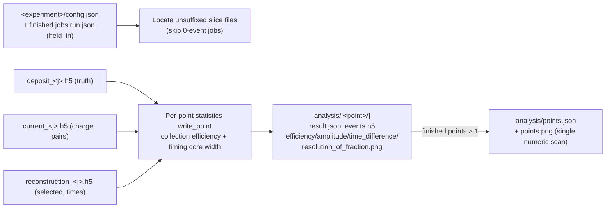

# Statistical Analysis Stage (`stages/analysis`)

`src/raser/stages/analysis/` is a single-job statistical analysis workflow independent of the job slice chain, with CLI entry point `raser analysis <experiment>` (short alias `raser ana <experiment>`). It reads the [`deposit`](deposit.md), [`current`](current.md), and [`reconstruction`](reconstruction.md) files of finished jobs across all scan points of the analyzed experiment, calls [../core/analysis.md](../core/analysis.md) to compute charge collection efficiency and pulse time resolution, and writes per-point summaries and cross-scan-point comparison results to `<experiment>/analysis/`.



## Inputs (What It Reads)

- **Experiment configuration and finished job list**: Reads the original experiment workflow from `<experiment>/config.json` (to bind the corresponding component search paths and project root), collects all non-stale jobs with `batch/job_<index>.done` across scan points, and locates the actual directory holding each slice from `"held_in"` in each run directory's `run.json` (jobs with `0` recorded events are automatically skipped).
- **Three types of slice HDF5 files** (aggregates only single-position files without a position suffix):
  - **`batch/reconstruction_<index>.h5`** (see [reconstruction.md](reconstruction.md)): Reads attributes `threshold`, `amplitude_threshold`, `fractions`, and `edge` (all jobs within the same scan point must have identical reconstruction parameters), as well as per-event `event`, `selected`, `ToA`, `ToT`, `CoG`, `CFD`, `amplitude`, `baseline`, and `noise`.
  - **`batch/current_<index>.h5`** (see [current.md](current.md)): Reads per-event `event`, `charge` (net induced charge per electrode in `C`), and `pairs` (initial number of electron-hole pairs), and checks that the event ID set matches the reconstruction table exactly.
  - **`batch/deposit_<index>.h5`** (see [deposit.md](deposit.md)): Reads the deposit-step time array `t` (`s`) for each event and takes the earliest deposit time as the time-resolution reference `truth` (`s`).

## Outputs (What It Writes)

### Outputs in the Example (`HPK-Si-PiN`)

In the [Getting Started](../getting-started.md) example, running `raser analysis work/HPK-Si-PiN/signal` aggregates two bias points (`100 V` and `200 V`, with `2` jobs and `400` recorded events per point):

1. **Directory layout**: Following the same scan-point naming rules as the signal simulation directories, analysis results for the device's default `200 V` bias are written directly under `work/HPK-Si-PiN/signal/analysis/`, while `100 V` results are written to `work/HPK-Si-PiN/signal/analysis/voltage_100/`; multi-point comparison files `points.json` and `points.png` are written in the `analysis/` root directory.
2. **Per-point statistical results `result.json`**:
   - **`200 V` (`analysis/result.json`)**: Across all `400` events, charge collection efficiency `mean = 0.9348` (`0.9347645480767679`, `mean_error = 0.007225`, `spread = 0.1445`); `276` selected events exceed the `10 mV` amplitude threshold (`polarity = -1.0`), among which `ToA` retains `241` events inside the window after `5` iteration rounds, giving `sigma = 123.99 ps` (`1.2399e-10 s`) and `sigma68 = 123.69 ps`, while `CFD30` gives `sigma = 33.35 ps` and `sigma68 = 31.66 ps`.
   - **`100 V` (`analysis/voltage_100/result.json`)**: Across `400` events, collection efficiency `mean = 0.9195` (`0.9194852059626839`, `mean_error = 0.008746`, `spread = 0.1749`), with `257` selected events (`CFD30` `sigma = 43.58 ps`, `sigma68 = 38.87 ps`).
3. **Multi-point comparison file `analysis/points.json` (excerpt)**:

   ```json
   [
    {
     "point": "voltage_100",
     "voltage": 100,
     "events": 400,
     "efficiency": 0.9194852059626839,
     "efficiency_error": 0.00874583566620318,
     "selected": 257,
     "ToA": {
      "sigma68": 1.4373747887851763e-10,
      "sigma": 1.4600067149809272e-10,
      "sigma_error": 1.0200597423600211e-11
     }
    },
    {
     "point": "",
     "voltage": 200,
     "events": 400,
     "efficiency": 0.9347645480767679,
     "efficiency_error": 0.007224687825783201,
     "selected": 276,
     "ToA": {
      "sigma68": 1.2368887903341034e-10,
      "sigma": 1.2399174526244709e-10,
      "sigma_error": 9.047206914503263e-12
     }
    }
   ]
   ```


Charge collection efficiency histogram for the `400` recorded events at `200 V`, with the dashed line marking the mean collection efficiency `0.9348`.


Pulse amplitude histogram for the `276` selected events reaching or exceeding the `10 mV` threshold at `200 V`, with the dashed line marking the amplitude threshold.


Time-difference distributions relative to `truth`, shaded fit windows, and truncated Gaussian fit curves for `ToA`, `CoG`, and `CFD10`–`CFD90` at `200 V`.


Comparison of charge collection efficiency (left) and time resolution of each `CFD` channel (right) across the `100 V` and `200 V` bias points.

### Output Files and Data Fields

Each scan-point directory `<experiment>/analysis/[<point>/]` writes the following files:

- **`result.json`**:
  - `reconstruction` (written when recorded events exist): `threshold` (`mV`), `amplitude_threshold` (`mV`), `fractions` (list of floats), `edge` (list of edge directions).
  - `collection`: Total events `events`, `mean`, `mean_error`, `spread` (dimensionless; when event count `< 2`, writes `events` and `collection.error`).
  - `timing`: `events`, `selected` (number of selected events); when recorded events exist, writes `polarity` (`+1.0` or `-1.0`), and when iterative fitting completes for all timing quantities, writes `times` (keys `"ToA"`, `"CoG"`, and `"CFD<percent>"`, each with `events`, `window`, `window_events`, `rounds`, `mean`, `mean_error`, `sigma`, `sigma_error`, `sigma68` in `s`, and `missing`); writes `timing.error` when there are zero events or fewer than `20` valid values for any timing quantity.
- **`events.h5`** (generated when recorded events exist; contains 1D datasets for all `selected` events):

| Dataset Name | Type | Unit | Description |
| --- | --- | --- | --- |
| `job` | `int64` | None | 0-based index of the event's job in the scan point's finished job list |
| `event` | `int64` | None | Geant4 event ID within its job |
| `ToA` | `float64` | `s` | Time of arrival over threshold |
| `ToT` | `float64` | `s` | Time over threshold |
| `amplitude` | `float64` | `V` | Maximum amplitude above baseline |
| `baseline` | `float64` | `V` | Baseline mean |
| `noise` | `float64` | `V` | Baseline population standard deviation |
| `truth` | `float64` | `s` | Time of the event's earliest energy deposit step |
| `CoG` | `float64` | `s` | Time center of gravity over the above-threshold interval |
| `CFD<percent>` | `float64` | `s` | Constant fraction discrimination time named by `round(100 * part)` (data for identically named fractions are concatenated) |

- **Per-point distribution plots**: `efficiency.png` (generated when $\ge 2$ recorded events), `amplitude.png` (generated when recorded events exist), `time_difference.png` (generated when `timing.times` is produced; shows up to `3 × 4` subplots for `ToA`, `CoG`, and the first `10` `CFD*` channels relative to `truth` in `ps`), and `resolution_of_fraction.png` (generated when `timing.times` is produced).

When the number of analyzed scan points is $> 1$, the `<experiment>/analysis/` root directory also writes:

- **`points.json`**: JSON array where each entry contains `"point"`, scan parameter key-values, `"events"`, `"efficiency"`, `"efficiency_error"`, `"selected"`, and `{"sigma68", "sigma", "sigma_error"}` for each timing quantity (in `s`; missing efficiency or timing resolution is written as `null` or omits the timing key, respectively).
- **`points.png`**: Generated if and only if there is a single numeric (non-boolean) scan variable; plots collection efficiency on the left and `sigma` (`ps`) of each `CFD*` channel on the right versus the scan variable.

Details on the charge collection efficiency formula and iterative truncated Gaussian fitting are documented in [../core/analysis.md](../core/analysis.md).

## Options

`raser analysis <experiment>` takes the positional argument `experiment` and mounts common lifecycle run options (see [../cli.md](../cli.md) and [../lifecycle/experiments.md](../lifecycle/experiments.md); this workflow has no component files or addressable keys):

| Option Key | CLI Argument | Default | Unit | Description |
| --- | --- | --- | --- | --- |
| `experiment` | `<experiment>` (positional) | Required | None | Path to the analyzed experiment directory (e.g. `work/<device>/<command>`) |
| `batch` | `-b`, `--batch` | `False` | None | Submit the analysis job to the cluster queue |
| `mem` | `-mem` | `1` | `8000 MB` | Cluster job memory allocation tier |
| `dry_run` | `--dry-run` | `False` | None | Only print the status of analysis jobs to be run |
| `scan` | `--scan` | `[]` | None | Common scan option list |
| `set` | `--set` | `[]` | None | Common single-value setting list |

## Common Errors

| Exception Type | Error Message | Trigger Condition |
| --- | --- | --- |
| `SystemExit` | `<len(failed)> of <len(points)> points are not complete:\n  <experiment>/<point>: no finished job` | The experiment has scan points with no finished jobs yet (writes results for remaining finished points and writes `points.json` if $> 1$ points before exiting) |
| `FileNotFoundError` | `<path>: job <index> recorded <recorded> events but left no <name> file` | A job recorded events in `deposit_<index>.h5` but is missing the corresponding `current` or `reconstruction` file |
| `ValueError` | `<path>: events <list> are in the currents or in the reconstruction of the job, not in both` | Event ID sets in `current_<index>.h5` and `reconstruction_<index>.h5` of the same job do not match |
| `ValueError` | `the jobs of the point were reconstructed with different settings: <settings>` | Different jobs at the same scan point used different reconstruction parameters |
| `NotImplementedError` | `<len> electrodes; the time of an event with several electrodes is not settled` | Calling time-resolution extraction on a multi-electrode reconstruction table |
| `ValueError` | `<deposits>: event <number> is not among the deposits of the job` | An event ID in the reconstruction table does not appear in that job's `deposit_<index>.h5` |
| `TooFewValues(ValueError)` | `<count> events in the point, a mean and a spread need at least 2` | Writes `collection.error` when fewer than `2` events for collection efficiency; writes `timing.error` when zero events or fewer than `20` valid samples for timing fit |

Errors from efficiency calculation, truncated Gaussian fitting, and `WaveformStatistics` are documented in [../core/analysis.md](../core/analysis.md).

## Related Pages

- [Getting Started](../getting-started.md)
- [Core Physics and Numerics: `core/analysis`](../core/analysis.md)
- [Simulation Chain Overview](README.md)
- [Deposit Stage](deposit.md)
- [Current Stage](current.md)
- [Reconstruction Stage](reconstruction.md)
- [CLI Overview](../cli.md)
- [Experiments and Scan Points](../lifecycle/experiments.md)
- [Slices and Status Inspection](../lifecycle/slices.md)
- [Paths and Runtime Supports](../supports/README.md)
