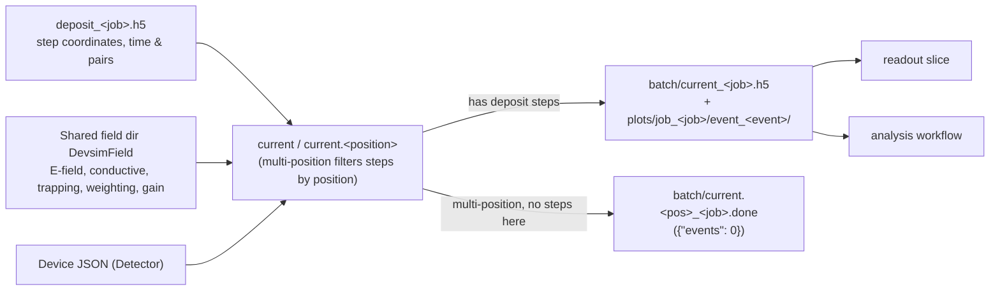

# Carrier Transport and Induced Current Stage (`stages/current`)

`src/raser/stages/current.py` wraps carrier drift, thermal diffusion, defect trapping, and Shockley-Ramo induced current calculation from [../core/current.md](../core/current.md) into the `current` slice (expanded per position as `current.<position>` in multi-position or multi-device experiments), and provides the stage CLI entry point `raser current <target>` (short alias `raser cur <target>`). `current` sits after [`deposit`](deposit.md) and [`field`](field.md) and before [`readout`](readout.md). It drifts the electron-hole pairs from deposit steps in the solved electric field and weighting field to produce time-domain induced currents `current_<job>.h5` on each electrode, and also provides net induced charge and initial pair counts to the final [`analysis`](analysis.md) stage.

## Inputs (What It Reads)

- **Deposit slice file `batch/deposit_<job>.h5`**: Read via `read_deposits` (see [deposit.md](deposit.md) and [../core/deposit.md](../core/deposit.md)) for each recorded event's `event`, `detector`, deposit-step coordinates `x`/`y`/`z` ($\mu\text{m}$), global time `t` (`s`), deposited energy `e` (`MeV`), and number of electron-hole pairs `pairs`. In multi-position expanded `current.<position>` slices, only deposit steps whose `detector` name contains `<position>` are selected; if the job has no deposit steps at that position, it writes a `{"events": 0}` marker and ends the slice for that position.
- **Solved shared device field `DevsimField`**: Locates the shared field directory from the device bias `my_d.voltage` and run irradiation fluence (option `irradiation` takes precedence, defaulting to device `irradiation_flux`; see [field.md](field.md)), and constructs `DevsimField` to provide interpolated electric field, net doping, conductive region flags, trapping rates, readout electrode weighting fields, and the 1D planar avalanche gain interface (see [../core/field.md](../core/field.md)).
- **Device definition `files["device"]`**: Reads device boundaries, readout electrode layout, transport, and avalanche parameters via `Detector` (see [../core/device.md](../core/device.md)), and passes them along with the `--plots` limit to `CalCurrent` / `CalCurrentGain`.

## Outputs (What It Writes)

- **Induced current slice file `batch/current_<job>.h5`** (`batch/current.<position>_<job>.h5` for multiple positions): Written under `batch/` in the scan-point seed directory holding the slice; any existing file is removed first and events are appended one by one. Once complete, `batch/current_<job>.done` is written (`{"events": 0}` when a multi-position slice has no deposits, with no `.h5` file generated).
- **Drift path and induced current plots**: For the first `plots` recorded events of each job, plots drift trajectories and electrode current waveforms under `<point>/<seed>/plots/job_<job>/event_<event>/` (`job_<job>_<position>/event_<event>/` for multiple positions).

### Outputs in the Example (`HPK-Si-PiN`)

In the [Getting Started](../getting-started.md) example, when running `raser signal HPK-Si-PiN --scan voltage=100,200 -s 2 -evt 200 --seed 1`, the `current` slice reads the `200` events from `deposit_0.h5` together with the electric field and `top` electrode weighting field at the corresponding bias from `work/HPK-Si-PiN/field/`, writes `work/HPK-Si-PiN/signal/seed_1/batch/current_0.h5` and the empty marker `current_0.done`, and generates `planar_drift_path.pdf`/`.root` and `No_1electrode_basic_infor.pdf`/`.root` under `plots/job_0/event_<event>/` for the first `100` recorded events.

Taking `work/HPK-Si-PiN/signal/seed_1/batch/current_0.h5` as an example:

- **File attributes (`attrs`)**:
  - `dt = 5e-12` (time bin width in `s`)
  - `electrodes = ['top']` (list of readout electrode names)

- **Dataset (`datasets`) list**:

| Dataset Name | Example Shape | Type | Unit | Description |
| --- | --- | --- | --- | --- |
| `event` | `(200,)` | `int64` | None | Geant4 event ID of each recorded event |
| `t0` | `(200,)` | `float64` | `s` | Left edge time of the first time bin |
| `count` | `(200,)` | `int64` | bins | Number of time bins for each event |
| `pairs` | `(200,)` | `float64` | pairs | Total input electron-hole pairs before multiplication |
| `sensitive_pairs` | `(200,)` | `float64` | pairs | Pairs generated inside the device in the non-conductive region above the electrode array that actually participate in drift |
| `carriers_without_field` | `(200,)` | `float64` | carriers | Total untrapped carriers that stopped due to encountering a zero-field region (`"no_field"`) |
| `charge` | `(200, 1)` | `float64` | `C` | Net induced charge per electrode |
| `stored` | `(200,)` | `int64` | electrodes | Number of electrodes with nonzero current stored for each event |
| `index` | `(196,)` | `int64` | None | Indices of stored electrodes in `electrodes` (`196` out of `200` events produced nonzero current) |
| `current` | `(245196,)` | `float64` | `A` | 1D induced current waveform flattened across time bins for all stored electrodes |

Single-event carrier drift path plot for `HPK-Si-PiN` (top: 3D bulk trajectories inside the device; bottom: deposit points, electron trajectories, and hole trajectories in the local plane).

Single-event induced current plot for `HPK-Si-PiN`, showing the electron component, hole component, and total induced current versus time.

Details on drift step size, thermal diffusion, trapping, avalanche multiplication, and all plot types are documented in [../core/current.md](../core/current.md).

## Options

`raser current` mounts options from the `deposit` and `current` stages (see [deposit.md](deposit.md) and [../cli.md](../cli.md)):

| Option | Default | Unit | Description |
| --- | --- | --- | --- |
| `--plots` | `100` (`0` by default for `cce`/`timeres`/`bmos`/`cflm`) | events | Maximum number of first N recorded events per job for which drift path and electrode current plots are drawn (`current` slice key) |
| `-vol`, `--voltage` | `None` (uses device `bias.voltage`) | V | Device bias voltage (belongs to `field` slice, see [field.md](field.md)) |
| `-irr`, `--irradiation` | `None` (uses device `irradiation.irradiation_flux`, or `0` if absent) | $\text{cm}^{-2}$ | Irradiation fluence (belongs to `field` slice, see [field.md](field.md)) |

## Common Errors

Errors from carrier drift, avalanche multiplication, zero-field stop points, and `current_<job>.h5` I/O are documented in [../core/current.md](../core/current.md); stage CLI entry errors are documented in [README.md](README.md).

## Related Pages

- [Getting Started](../getting-started.md)
- [Core Physics and Numerics: `core/current`](../core/current.md)
- [Simulation Chain Overview](README.md)
- [Device Definition](../core/device.md)
- [Material Models](../core/model.md)
- [Field Stage](field.md)
- [Deposit Stage](deposit.md)
- [Readout Stage](readout.md)
- [Analysis Stage](analysis.md)
- [CLI Overview](../cli.md)
- [Experiments and Scan Points](../lifecycle/experiments.md)
- [Slices and Status Inspection](../lifecycle/slices.md)
- [Paths and Runtime Supports](../supports/README.md)
