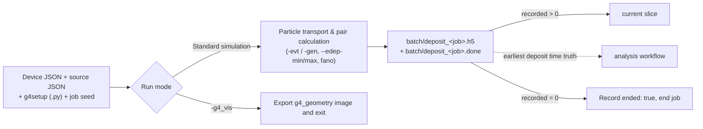

# Energy Deposition Stage (`stages/deposit`)

`src/raser/stages/deposit.py` wraps the particle-source simulation and ionization pair conversion from [../core/deposit.md](../core/deposit.md) into `deposit`, the starting slice of the simulation chain, and provides the stage CLI entry point `raser deposit <target>` (short alias `raser dep <target>`). `deposit` has no upstream slice dependencies in the simulation chain. It generates energy-deposit steps and electron-hole pair data `deposit_<job>.h5` for each job, delivers them to the [`current`](current.md) slice for carrier drift, and provides the earliest deposit time `truth` for the final [`analysis`](analysis.md) slice. If a single job records `0` valid events, it writes `deposit_<job>.h5` and ends subsequent slices for that job; if `-g4_vis` is enabled, it exports the Geant4 geometry image and ends the job.

## Inputs (What It Reads)

- **Target argument `<target>`**: Path to an experiment folder containing `config.json`, or a device name (automatically maps to the `work/<device>/signal` experiment directory).
- **Device and component configuration**:
  - `files["device"]`: Reads device geometry dimensions and materials via `Detector` (see [../core/device.md](../core/device.md) and [../components/device.md](../components/device.md)).
  - `files["source"]`: Particle source or beam component JSON (see [../components/source.md](../components/source.md)).
  - `files.get("g4setup")`: `G4SETUP` dictionary exported by the Geant4 setup script; defaults to built-in `DEVICE_ALONE` (see [../components/g4setup.md](../components/g4setup.md)).
- **Job seed and slice options**: Job random `seed` injected by the lifecycle, event count (`events_per_job` and `generated_per_job` are mutually exclusive and one must be set), generation limit `generated_limit`, total deposited energy window `edep_min`/`edep_max`, Fano fluctuation flag `fano`, and visualization switches `g4_vis`/`g4_vis_driver`.

## Outputs (What It Writes)

- **Deposit slice file `batch/deposit_<job>.h5` and completion marker `batch/deposit_<job>.done`**: Written under `batch/` in the scan-point seed directory holding the `deposit` slice. If a single job records `0` events, `deposit_<job>.done` writes `{"ended": true}` and skips all downstream slices for that job.
- **Geant4 geometry visualization (`-g4_vis`)**: When `--g4-vis-driver` (case-insensitive) is `"TSG"`, `"TSG_FILE"`, or `"TSG_OFFSCREEN"`, exports `g4_geometry.png` under the seed or scan-point folder; when starting with `"OGL"`, exports vector image `g4_geometry`, then exits the job. Other driver names starting with `"TSG"` raise `ValueError`.

### Outputs in the Example (`HPK-Si-PiN`)

In the [Getting Started](../getting-started.md) example, when running `raser signal HPK-Si-PiN --scan voltage=100,200 -s 2 -evt 200 --seed 1`, the `deposit` slice uses the `decay/Sr90` radioactive source, `device_alone` geometry, and `fano = true`, collecting `200` valid deposit events each for jobs `0` and `1` at both bias points and writing empty `deposit_<job>.done` markers. Taking `work/HPK-Si-PiN/signal/seed_1/batch/deposit_0.h5` as an example:

- **File attributes (`attrs`)**:
  - `generated_events = 7359` (total Geant4 generated events)
  - `recorded_events = 200` (valid recorded events with nonzero energy deposit inside the device)
  - `generated_fraction = 0.017037086855465844` (simulated solid-angle fraction of source emission directions; if `--edep-min` or `--edep-max` is set, the corresponding attributes are also written in `MeV`)

- **Dataset (`datasets`) list**:

| Dataset Name | Example Shape | Type | Unit | Description |
| --- | --- | --- | --- | --- |
| `event` | `(200,)` | `int64` | None | Geant4 event ID of each recorded event |
| `count` | `(200,)` | `int64` | steps | Number of deposit steps in each recorded event |
| `detector` | `(5476,)` | `object` (variable-length string) | None | Name of the detector logical volume containing the deposit step |
| `x`, `y`, `z` | `(5476,)` | `float64` | $\mu\text{m}$ | Local coordinates of the deposit step midpoint (step start under `cflm`) |
| `x_start`, `y_start`, `z_start` | `(5476,)` | `float64` | $\mu\text{m}$ | Local coordinates of the deposit step start (optional columns) |
| `t` | `(5476,)` | `float64` | `s` | Global time of the deposit step |
| `e` | `(5476,)` | `float64` | `MeV` | Deposited energy |
| `pairs` | `(5476,)` | `float64` | pairs | Converted number of electron-hole pairs |

Physics branches (Geant4, `toy_mip`, laser deposition), ionization conversion constants, and full format details such as `t_fwhm` are documented in [../core/deposit.md](../core/deposit.md).

## Options

Options for `raser deposit` and the `deposit` stage of the simulation chain are listed below (workflow default overrides are in [README.md](README.md), and common run options are in [../cli.md](../cli.md)):

| Option / Key | Default | Unit | Description |
| --- | --- | --- | --- |
| `source` | `"decay/Sr90"` | None | Signal source or beam component name/path (positional argument) |
| `--g4setup` | `"device_alone"` | None | Geant4 setup script name/path |
| `-evt`, `--events-per-job` | `1` | events | Number of valid events to record per job (mutually exclusive with `-gen`) |
| `-gen`, `--generated-per-job` | `None` | events | Total number of events generated by the particle source per job (alternative to `-evt`) |
| `--generated-limit` | `None` (`10_000_000` at runtime) | events | Maximum total events generated to collect `-evt` recorded events |
| `--edep-min` | `None` | MeV | Minimum total deposited energy in the device required to record an event |
| `--edep-max` | `None` | MeV | Maximum total deposited energy in the device required to record an event |
| `fano` | `True` | None | Whether to enable Fano fluctuation sampling for ionized pairs (set via `config.json` `"set"` or `--set`/`--scan`) |
| `-g4_vis` | `False` | None | Enable Geant4 geometry and track visualization, then end the job after exporting the image |
| `--g4-vis-driver` | `"OGL"` | None | Geant4 visualization driver name used by `-g4_vis` |

## Common Errors

| Exception Type | Error Message | Trigger Condition |
| --- | --- | --- |
| `ValueError` | `events_per_job (...) and generated_per_job (...): a job records a number of events or generates one, so exactly one of them is set` | Both `events_per_job` and `generated_per_job` are provided or both are missing |
| `SystemExit` | `<target>: neither an experiment folder ...` / `<folder>: the experiment <workflow> has no deposit slice; its slices: ...` | Target is neither an experiment directory with `config.json` nor a valid device, or the workflow has no `deposit` slice (see [README.md](README.md)) |

Errors from Geant4 simulation, laser deposition, visualization drivers, and `deposit_<job>.h5` I/O are documented in [../core/deposit.md](../core/deposit.md).

## Related Pages

- [Getting Started](../getting-started.md)
- [Core Physics and Numerics: `core/deposit`](../core/deposit.md)
- [Simulation Chain Overview](README.md)
- [Device Definition](../core/device.md)
- [Device Component Library](../components/device.md)
- [Source Component Library](../components/source.md)
- [Laser Component Library](../components/laser.md)
- [Geant4 Setup Component Library](../components/g4setup.md)
- [Current Stage](current.md)
- [Analysis Stage](analysis.md)
- [CLI Overview](../cli.md)
- [Experiments and Scan Points](../lifecycle/experiments.md)
- [Slices and Status Inspection](../lifecycle/slices.md)
- [Paths and Runtime Supports](../supports/README.md)
