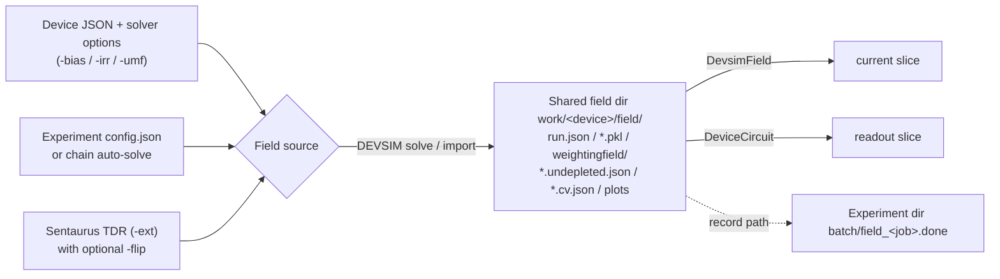

# Field Solving Stage (`stages/field`)

`src/raser/stages/field/__init__.py` wraps device physics field solving and external TCAD field import from [../core/field.md](../core/field.md), providing the standalone CLI entry point `raser field <det_name>` (alias `raser fld <det_name>`) and the cross-experiment shared slice `field` in the simulation chain (expanded per device as `field.<device>` in multi-device experiments). In the simulation chain, `field` sits at the front with no upstream slice dependencies. Solved results are stored in the shared field directory for the [`current`](current.md) slice to drift carriers and the [`readout`](readout.md) slice to assemble the device equivalent circuit. When a chain command starts and the field for the required bias voltage or irradiation fluence is not ready, the main command automatically calls `raser field` first to solve it.

## Inputs (What It Reads)

- **Positional argument `det_name`**: Can be a device name or device path, or a path to an experiment folder containing `config.json`. When a device is passed, it reads the device definition directly via `Detector` (see [../core/device.md](../core/device.md) and [../components/device.md](../components/device.md)). When an experiment directory is passed, it reads `workflow` and `device` from its `config.json` and sequentially prepares the required shared fields for all scan points of that experiment.
- **Bias voltage, irradiation, and solver overrides**: Target bias voltage comes from `-bias` (`-vol` in chain commands), defaulting to `bias.voltage` in the device JSON; irradiation fluence comes from `-irr` (`irradiation_flux`), defaulting to `irradiation.irradiation_flux` in the device JSON (`0` if absent); `"field": {"solver": ...}` in the device JSON deeply overrides the default solver configuration `SOLVER`. When a device sets `hemt_physics.transport_model == "drift_diffusion_v1"`, it switches to the HEMT DC transfer-characteristic solver path (prints a notice and drops `-cv`, `-wf`, `-noise`).
- **External TCAD file (`-ext` / `--extract`)**: Specifies a Sentaurus TDR file path to import already-solved fields and solve the weighting field of each readout electrode on that mesh; passing `-flip` reverses the coordinate column order of imported nodes (and swaps `x` and `y` axes in 2D plots).
- **Existing shared field record `<field_dir>/run.json`**: Before solving, reads `options`, `files.device["field"]`, `read` (tracked device attributes, keys, and mesh hashes), and `solved` (bias lists already completed for `"potential"`, `"weighting"`, `"capacitance"`, and `"undepleted"`). Bias stages already recorded as complete are skipped directly; if the irradiation fluence, mode, device `"field"` config, or read device parameters have changed, the entire directory is marked stale and re-solved.

## Outputs (What It Writes)

Field-solving outputs are written to the shared field directory `work/<device>/field/` (when scanning `irradiation_flux` or device fields, they are written to corresponding subdirectories under that directory). In the job directory of an experiment simulation chain, only the completion marker `batch/field_<job>.done` recording the path to that shared directory is written. Formats, units, and physics modeling of all disk assets are documented in [../core/field.md](../core/field.md).

### Outputs in the Example (`HPK-Si-PiN`)

In the [Getting Started](../getting-started.md) example, when running `raser signal HPK-Si-PiN --scan voltage=100,200 -s 2 -evt 200 --seed 1`, `work/HPK-Si-PiN/field/` has not been solved beforehand:

1. **Auto-solve and slice markers**: Before launching signal jobs, the main command prints `the field is not ready: raser field HPK-Si-PiN -bias 100.0` and `the field is not ready: raser field HPK-Si-PiN -bias 200.0`, spawns single-job processes to solve the fields at `100 V` and `200 V`, and stores both bias points in the same directory `work/HPK-Si-PiN/field/`. Each signal job then writes `{"field": ".../work/HPK-Si-PiN/field"}` into `batch/field_0.done` and `batch/field_1.done` (`seed_1/run.json` records the same shared digest `"23679e6b10596a26"` for `field` and its downstream slices; see [../lifecycle/slices.md](../lifecycle/slices.md)).
2. **Files actually written in the shared field directory**:
   - **Metadata record `run.json`**: Records `"axes": ["z"]`, `"options": {"irradiation_flux": null, "mode": "full"}`, `"settings": {"umf": false, "imported": null}`, and under `"solved"`, `[0.0, 100.0, 200.0]` for `"potential"` and `"undepleted"` and `[100.0, 200.0]` for `"weighting"`.
   - **Bulk fields and undepleted-layer files**: `Potential_0V.pkl` / `100V.pkl` / `200V.pkl`, `Electrons_0V/100V/200V.pkl`, `Holes_0V/100V/200V.pkl`, `NetDoping_0V.pkl`, `TrappingRate_n_0V/100V/200V.pkl`, `TrappingRate_p_0V/100V/200V.pkl`, `Conductive_0V/100V/200V.pkl`, DEVSIM state archives `0V.devsim`/`0V.dd`, `100.0V.devsim`/`100.0V.dd`, `200.0V.devsim`/`200.0V.dd`, `HPK-Si-PiN.dat`, and 1D undepleted bulk parameters `0.0V.undepleted.json`, `100.0V.undepleted.json`, `200.0V.undepleted.json` (fully depleted at both `100.0 V` and `200.0 V`: `undepleted_width_um` and `specific_resistance_ohm_cm2` are `0.0`, and `specific_capacitance_pF` is `null`).
   - **Weighting field**: `weightingfield/top/Potential_100V.pkl`, `Potential_200V.pkl`, and the corresponding weighting potential and weighting field distribution plots.
   - **Characteristic curves and 1D profiles**: `HPK-Si-PiN_iv.png`, `HPK-Si-PiN_cv.png`, `HPK-Si-PiN_c^-2v.png`, `Doping.png`, `simIV0to100.0.root`/`.pdf`, `simIV0to200.0.root`/`.pdf`, `simCV0to100.0.root`/`.pdf`, `simCV0to200.0.root`/`.pdf`, `Electric Field0/100.0/200.0_1d.png`, `Potential0/100.0/200.0_1d.png`, `Electron Trapping Rate0/100.0/200.0_1d.png`, `Hole Trapping Rate0/100.0/200.0_1d.png`.

Dark current (IV) curve of `HPK-Si-PiN` from the reverse bias scan.

CV curve of `HPK-Si-PiN` capacitance versus reverse bias voltage.

1D electric field profile of `HPK-Si-PiN` along depth at `200 V` bias.

### Files Written in Other Run Modes

- **Small-signal capacitance `-cv [V]`**: Computes small-signal capacitance from the `.devsim` archive at the specified bias (defaults to the target bias if omitted), writes `<V>V.cv.json` (containing `voltage_V`, `specific_capacitance_pF`, `per` [1D `"cm^2"`, 2D `"cm"`, 3D `"device"`], `area_factor`, `frequency_Hz`), and records that bias in the `"capacitance"` list of `run.json`.
- **Default combined execution**: When none of `-iv`, `-cv`, or `-wf` is specified, runs the bias scan with CV followed by weighting-field solving (clearing DEVSIM devices between the two phases while keeping linear solver settings).

## Options

### `raser field` CLI Options

Common run and scan options are documented in [../cli.md](../cli.md) and [../lifecycle/experiments.md](../lifecycle/experiments.md):

| Option | Default | Unit | Description |
| --- | --- | --- | --- |
| `det_name` | Required (positional) | None | Device name/path, or path to an experiment folder whose shared fields are to be solved |
| `-iv` | `False` | None | Solve potential/electric field up to the target bias and generate IV curves |
| `-cv [V]` | `None` (target bias when `-cv` is passed alone) | V | Solve small-signal capacitance from a saved `.devsim` archive and write `<V>V.cv.json` |
| `-wf` | `False` | None | Solve the weighting field of each readout electrode at the target bias |
| `-irr`, `--irradiation_flux` | `None` (uses device `irradiation.irradiation_flux`, or `0` if absent) | $\text{cm}^{-2}$ | Irradiation fluence (corresponds to workflow option key `irradiation_flux`) |
| `--mode` | `"full"` if `devsim` is installed, else `"fast"` | None | Field acquisition mode: `"full"`, `"semi_fast"`, or `"fast"` |
| `-bias` | `None` (uses device `bias.voltage`) | V | Target bias voltage |
| `-noise` | `False` | None | Solve and plot device noise current during the bias scan |
| `-umf` | `False` | None | Load `devsim.umfpack.umfshim` as the DEVSIM linear solver |
| `-ext`, `--extract` | `None` | None | Import fields from the specified Sentaurus TDR file and solve weighting fields |
| `-flip` | `False` | None | Reverse node coordinate column order when importing a TCAD field (and swap `x` and `y` axes in 2D plots) |

### Options Assigned to the `field` Slice in the Simulation Chain

In experiment chain commands (such as `raser current`, `raser signal`), the following options belong to `field` (prefixed with `<device>.` in multi-device experiments):

| Option | Default | Unit | Description |
| --- | --- | --- | --- |
| `-vol`, `--voltage` | `None` (maps to `device.bias.voltage`) | V | Device bias voltage |
| `-irr`, `--irradiation` | `None` (uses device `irradiation.irradiation_flux`, or `0` if absent) | $\text{cm}^{-2}$ | Irradiation fluence |

## Common Errors

| Exception Type | Error Message | Trigger Condition |
| --- | --- | --- |
| `SystemExit` | `<folder>: this is the field itself; give its device, raser field <device>` | Passing the `field` directory itself as an experiment folder to `raser field` |
| `NotImplementedError` | ``the <mode> mode of a field is not there yet: only `--mode full` is`` | `--mode` is `"semi_fast"` or `"fast"` |
| `ValueError` | ``<address> = <value>: a value with a comma cannot be handed to `raser field --scan` ...`` | During automatic `raser field` invocation by a chain command, a modified `device.*` key value serializes with a comma |
| `FileNotFoundError` | ``no field of <det_name> ready for this run: solve it with `raser field <det_name>` `` | No ready shared field matching the current bias voltage and irradiation fluence is found when executing the `field` slice |

Errors from device validation, mesh construction, interpolation, equivalent circuits, and HEMT solving are documented in [../core/field.md](../core/field.md).

## Related Pages

- [Getting Started](../getting-started.md)
- [Core Physics and Numerics: `core/field`](../core/field.md)
- [Simulation Chain Overview](README.md)
- [Device Definition](../core/device.md)
- [Material Models](../core/model.md)
- [Device Component Library](../components/device.md)
- [Current Stage](current.md)
- [Readout Stage](readout.md)
- [CLI Overview](../cli.md)
- [Experiments and Scan Points](../lifecycle/experiments.md)
- [Slices and Status Inspection](../lifecycle/slices.md)
- [Jobs and Cluster Submission](../lifecycle/jobs.md)
- [Paths and Runtime Supports](../supports/README.md)
