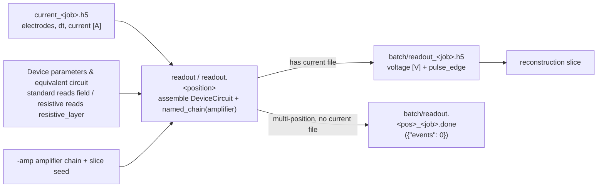

# Electronics Readout Stage (`stages/readout`)

`src/raser/stages/readout.py` wraps device equivalent-circuit solving, front-end amplifier chain SPICE transient response, and frequency-domain thermal noise synthesis from [../core/readout.md](../core/readout.md) into the `readout` slice (expanded per position as `readout.<position>` in multi-position experiments), and provides the stage CLI entry point `raser readout <target>` (short alias `raser rdo <target>`). `readout` sits after [`current`](current.md) and before [`reconstruction`](reconstruction.md). It depends on the `current` and `field` slices without modifying generated events (`new_events=False`), so upstream slices can be reused when scanning different amplifier chains under the same current input; the output waveform file `readout_<job>.h5` is passed directly downstream for event reconstruction.

## Inputs (What It Reads)

- **Induced current file `batch/current_<job>.h5`** (`batch/current.<position>_<job>.h5` for multiple positions): Reads attributes `electrodes`, `dt` (`s`), and each event's `event`, `t0` (`s`), and `current` (`A`) via `read_currents`. In multi-position experiments, if the current file for a position is missing, it returns a `{"events": 0}` marker and skips waveform solving.
- **Device definition and equivalent circuit (`Detector` and `DeviceCircuit`)**: Reads the device JSON (see [../core/device.md](../core/device.md) and [../components/device.md](../components/device.md)) and builds the equivalent circuit according to the device structure (see [field.md](field.md) and [../core/field.md](../core/field.md)):
  - **Devices with `resistive_layer`**: Builds a 2D resistive mesh circuit or 1D resistive row circuit according to `is_pixel`; specifying `--sheet-resistance` (in `Ohm`) overrides the sheet resistance in the device file (setting `--sheet-resistance` on a standard device raises an error).
  - **Standard devices**: Locates the shared field directory `work/<device>/field/` matching the current bias voltage and irradiation fluence, and assembles `DeviceCircuit`:
    - Periodic row of repeated single electrodes: Reads inter-strip capacitances (in `F/cm`) from `weightingfield/<electrode>/Capacitance_<bias>V.json`, and expands a local circuit along the row covering the hit strip and its coupled neighboring electrodes for each event.
    - Other devices: Junction capacitance is taken in order from `capacitance_pF` in the device file, `<V>V.cv.json` in the field directory (must already be recorded as solved in `run.json`), or a parallel-plate estimate; 1D undepleted-layer parameters are taken from `undepleted_resistance_ohm` and `undepleted_capacitance_pF` in the device file or `<V>V.undepleted.json` in the field directory; `bias_resistance_ohm` and `coupling_capacitance_pF` are also read from the device file.
- **Front-end amplifier chain (`amplifier`)**: Passed to `named_chain`, which splits on `"+"` and loads `afe/<part>.cir` SPICE subcircuit chains (see [../core/readout.md](../core/readout.md) and [../components/afe.md](../components/afe.md)).
- **Slice random seed (`seed`)**: Job/slice-derived seed injected by the lifecycle (see [../lifecycle/experiments.md](../lifecycle/experiments.md)), used for frequency-domain thermal noise sampling; noise addition is skipped when running without a seed.

## Outputs (What It Writes)

- **Readout waveform slice file `batch/readout_<job>.h5`** (`batch/readout.<position>_<job>.h5` for multiple positions): Written under `batch/` in the scan-point seed directory holding the slice; any existing file is removed first. Once complete, `batch/readout_<job>.done` is written (when a multi-position slice has no current file, only the `.done` marker containing `{"events": 0}` is written).

### Outputs in the Example (`HPK-Si-PiN`)

In the [Getting Started](../getting-started.md) example, when running `raser signal HPK-Si-PiN --scan voltage=100,200 -s 2 -evt 200 --seed 1`, `HPK-Si-PiN` is a standard single-electrode planar device whose device file directly specifies `capacitance_pF = 3.44162280284` (`3.44162280284e-12 F`). Combined with the default amplifier chain `SantaCruz+Gali52+Termination50`, it writes `work/HPK-Si-PiN/signal/seed_1/batch/readout_0.h5` and the empty marker `readout_0.done`.

Taking `work/HPK-Si-PiN/signal/seed_1/batch/readout_0.h5` as an example:

- **File attributes (`attrs`)**:
  - `dt = 5e-12` (sampling time bin width in `s`)
  - `electrodes = ['top']` (list of all possible output electrode names)
  - `pulse_edge = ['falling']` (leading pulse edge direction corresponding to `electrodes`: `"rising"` or `"falling"`)
  - `device_circuit` (JSON string): `'{"junction_capacitance": {"farad": 3.44162280284e-12, "from": "device file"}, "between_electrodes": null, "bias_resistance": null, "coupling_capacitance": null, "undepleted_layer": null}'`

- **Dataset (`datasets`) list**:

| Dataset Name | Example Shape | Type | Unit | Description |
| --- | --- | --- | --- | --- |
| `event` | `(200,)` | `int64` | None | Geant4 event ID of each recorded event |
| `t0` | `(200,)` | `float64` | `s` | Left edge time of the first time bin |
| `count` | `(200,)` | `int64` | bins | Number of waveform samples per event |
| `stored` | `(200,)` | `int64` | electrodes | Number of electrodes with stored waveforms in each event |
| `index` | `(196,)` | `int64` | None | Indices of stored electrodes in `electrodes` |
| `voltage` | `(245196,)` | `float64` | `V` | Bin-center output voltage concatenated sequentially across events and stored electrodes |

Details on `ngspice` transient solving, frequency-domain thermal noise synthesis, local strip-row circuit convergence, and pulse-edge polarity detection algorithms are documented in [../core/readout.md](../core/readout.md).

## Options

`raser readout` mounts options from the `deposit`, `current`, and `readout` stages (upstream options and common options are in [deposit.md](deposit.md), [current.md](current.md), and [../cli.md](../cli.md)):

| Option Key | CLI Argument | Default | Unit | Description |
| --- | --- | --- | --- | --- |
| `amplifier` | `-amp`, `--amplifier` | `"SantaCruz+Gali52+Termination50"` | None | Front-end amplifier and termination load subcircuit chain name joined with `"+"` |
| `sheet_resistance` | `--sheet-resistance` | `None` | $\Omega$ | Overrides the resistive-layer sheet resistance in the device file (only for devices with `resistive_layer`) |

## Common Errors

| Exception Type | Error Message | Trigger Condition |
| --- | --- | --- |
| `ValueError` | `<det_name> has no resistive layer to give a sheet resistance of <sheet_ohm> Ohm` | Setting `--sheet-resistance` on a device without `resistive_layer` |
| `FileNotFoundError` | `no <mode> field of <det_name> at the irradiation flux <flux> in <root> ...` | No solved shared field found matching the irradiation fluence and mode |
| `ValueError` | `the field in <folder> was solved for another device (<differing>); solve it again with ...` | Shared field directory does not match the current device definition |
| `FileNotFoundError` | `the field in <folder> is not solved at <voltage> V ...` / `the field in <folder> has no weighting field at <voltage> V ...` | Shared field is missing the potential or weighting field at the target bias |
| `FileNotFoundError` | `the field in <folder> has no capacitances between the strips of <det_name> at <voltage> V: <path> is missing ...` | Periodic strip-row device is missing `weightingfield/<electrode>/Capacitance_<bias>V.json` |
| `ValueError` | `The capacitances of the row are in <unit>` | Strip-row capacitance JSON unit is not `"F/cm"` |
| `ValueError` | `<det_name> gives <key> alone: the undepleted layer has both undepleted_resistance_ohm and undepleted_capacitance_pF` | Device file provides only one of the two undepleted-layer keys (resistance or capacitance) |
| `ValueError` | `A coupling capacitance needs a bias resistance: without it the electrode has no DC potential` | `coupling_capacitance_pF` is configured without `bias_resistance_ohm` |
| `ValueError` | `<det_name> has no capacitance: its device file gives none, its field was not asked for one, and the device has no estimate` | Device has neither a measured capacitance, nor a solved field capacitance, nor a parallel-plate estimate |

Errors from SPICE netlist generation, missing `ngspice`, noise spectra, and `readout_<job>.h5` I/O are documented in [../core/readout.md](../core/readout.md); stage CLI errors are documented in [README.md](README.md).

## Related Pages

- [Getting Started](../getting-started.md)
- [Core Physics and Numerics: `core/readout`](../core/readout.md)
- [Simulation Chain Overview](README.md)
- [Device Definition](../core/device.md)
- [Field Solving and Equivalent Circuit: `core/field`](../core/field.md)
- [Device Component Library](../components/device.md)
- [Front-End Electronics Component Library](../components/afe.md)
- [Field Stage](field.md)
- [Current Stage](current.md)
- [Reconstruction Stage](reconstruction.md)
- [CLI Overview](../cli.md)
- [Experiments and Scan Points](../lifecycle/experiments.md)
- [Slices and Status Inspection](../lifecycle/slices.md)
- [Paths and Runtime Supports](../supports/README.md)
