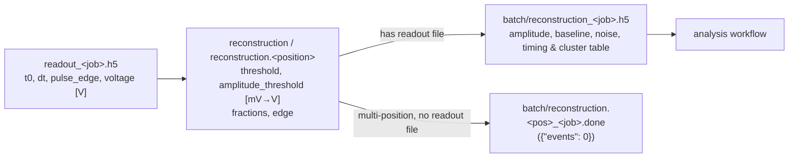

# Event Reconstruction Stage (`stages/reconstruction`)

`src/raser/stages/reconstruction.py` wraps baseline subtraction, pulse timing, and multi-electrode clustering from [../core/reconstruction.md](../core/reconstruction.md) into `reconstruction`, the final slice of the simulation chain (expanded per position as `reconstruction.<position>` in multi-position experiments), and provides the stage CLI entry point `raser reconstruction <target>` (short alias `raser reco <target>`). `reconstruction` immediately follows [`readout`](readout.md) without modifying upstream events (`new_events=False`), so existing `readout` waveform files can be reused when adjusting reconstruction thresholds or CFD fraction lists; the output event feature table `reconstruction_<job>.h5` is delivered to the final [`analysis`](analysis.md) stage for time-resolution statistics.

## Inputs (What It Reads)

- **Readout waveform file `batch/readout_<job>.h5`** (`batch/readout.<position>_<job>.h5` for multiple positions): Reads attributes `electrodes`, `dt` (`s`), `pulse_edge` (`"rising"` or `"falling"` per electrode), and each event's `event`, `t0` (`s`), and `voltage` (`V`) via `read_waveforms` (see [readout.md](readout.md) and [../core/readout.md](../core/readout.md)). In multi-position experiments, if the readout file for a position is missing, it returns a `{"events": 0}` marker and skips reconstruction.
- **Reconstruction options**:
  - `threshold` and `amplitude_threshold`: Passed in `mV` from CLI and config, converted to `V` (multiplied by `1e-3`) inside the stage before passing to `event_table`.
  - `fractions`: List of constant fraction discrimination ratios in the open interval `(0, 1)`.
  - `edge`: `"rising"`, `"falling"`, or `None`; when `None`, uses `pulse_edge` written by `readout`. If an explicitly specified edge is opposite to an electrode's `pulse_edge`, a notice is printed to the terminal.

## Outputs (What It Writes)

- **Event reconstruction table file `batch/reconstruction_<job>.h5`** (`batch/reconstruction.<position>_<job>.h5` for multiple positions): Written by `event_table` and `write_event_table` under `batch/` in the seed directory holding the slice, along with `batch/reconstruction_<job>.done` (when a multi-position slice has no readout file, a `{"events": 0}` marker is written and no `.h5` file is generated).

### Outputs in the Example (`HPK-Si-PiN`)

In the [Getting Started](../getting-started.md) example, when running `raser signal HPK-Si-PiN --scan voltage=100,200 -s 2 -evt 200 --seed 1`, `reconstruction` uses default thresholds `threshold = 10.0 mV` and `amplitude_threshold = 10.0 mV`, 9 CFD fractions `[0.1, ..., 0.9]`, and `pulse_edge = ['falling']` inherited from `readout_0.h5`, writing `work/HPK-Si-PiN/signal/seed_1/batch/reconstruction_0.h5` and the empty marker `reconstruction_0.done`.

Taking `work/HPK-Si-PiN/signal/seed_1/batch/reconstruction_0.h5` as an example:

- **File attributes (`attrs`)**:
  - `threshold = 0.01` (threshold in `V`)
  - `amplitude_threshold = 0.01` (event selection and clustering seed threshold in `V`)
  - `edge = ['falling']` (pulse timing edge per electrode)
  - `electrodes = ['top']` (list of all electrode names)
  - `fractions = [0.1, 0.2, 0.3, 0.4, 0.5, 0.6, 0.7, 0.8, 0.9]` (array of CFD fractions)

- **Dataset (`datasets`) list**:

| Dataset Name | Example Shape | Type | Unit | Description |
| --- | --- | --- | --- | --- |
| `event` | `(200,)` | `int64` | None | Geant4 event ID of each recorded event |
| `selected` | `(200,)` | `bool` | None | Whether the event has at least one seed electrode with amplitude $\ge$ `amplitude_threshold` |
| `cluster_size` | `(200,)` | `int64` | electrodes | Number of electrodes in the cluster |
| `cluster_center` | `(200,)` | `float64` | electrode index (0-based) | Amplitude-weighted cluster center (`NaN` when there is no cluster) |
| `traced` | `(200, 1)` | `bool` | None | Whether `readout` saved a waveform for this electrode in this event (`True` for `196` events) |
| `above` | `(200, 1)` | `bool` | None | Whether the waveform peak reaches `threshold` |
| `baseline` | `(200, 1)` | `float64` | `V` | Baseline mean over the first `200` waveform samples |
| `noise` | `(200, 1)` | `float64` | `V` | Baseline population standard deviation over the first `200` waveform samples |
| `amplitude` | `(200, 1)` | `float64` | `V` | Maximum pulse amplitude above baseline |
| `ToA` | `(200, 1)` | `float64` | `s` | Time of arrival over threshold |
| `ToT` | `(200, 1)` | `float64` | `s` | Time over threshold |
| `CoG` | `(200, 1)` | `float64` | `s` | Time center of gravity over the above-threshold interval |
| `area` | `(200, 1)` | `float64` | $\text{V}\cdot\text{s}$ | Integrated area of the positive main pulse lobe |
| `CFD` | `(200, 1, 9)` | `float64` | `s` | Timing results for each constant fraction in `fractions` |

Details on baseline estimation, linear-interpolation timing, and multi-electrode clustering algorithms are documented in [../core/reconstruction.md](../core/reconstruction.md).

## Options

`raser reconstruction` mounts all upstream stage options and common options (see [README.md](README.md) and [../cli.md](../cli.md)); options specific to this stage are listed below:

| Option Key | CLI Argument | Default | Unit | Description |
| --- | --- | --- | --- | --- |
| `threshold` | `-threshold` | `10.0` | mV | Threshold for computing `ToA`, `ToT`, `CoG`, `area`, and adding neighboring electrodes to clusters |
| `amplitude_threshold` | `-amplitude_threshold` | `10.0` | mV | Amplitude threshold for event selection (`selected`) and cluster seeds |
| `fractions` | (list configured in `"set"` of `config.json`) | `[0.1, 0.2, 0.3, 0.4, 0.5, 0.6, 0.7, 0.8, 0.9]` | None | List of amplitude fractions for constant fraction discrimination (`CFD`) |
| `edge` | `--edge` | `None` (uses `pulse_edge` written by `readout`) | None | Pulse edge direction on which thresholds act: `"rising"` or `"falling"` |

## Common Errors

Errors from insufficient baseline samples, invalid `edge` / `fractions` values, empty `readout` files, and `reconstruction_<job>.h5` I/O are documented in [../core/reconstruction.md](../core/reconstruction.md); stage CLI errors are documented in [README.md](README.md).

## Related Pages

- [Getting Started](../getting-started.md)
- [Core Physics and Numerics: `core/reconstruction`](../core/reconstruction.md)
- [Simulation Chain Overview](README.md)
- [Electronics Readout: `core/readout`](../core/readout.md)
- [Readout Stage](readout.md)
- [Analysis Stage](analysis.md)
- [CLI Overview](../cli.md)
- [Experiments and Scan Points](../lifecycle/experiments.md)
- [Slices and Status Inspection](../lifecycle/slices.md)
- [Paths and Runtime Supports](../supports/README.md)
