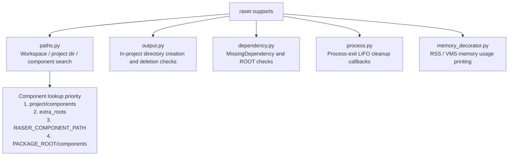
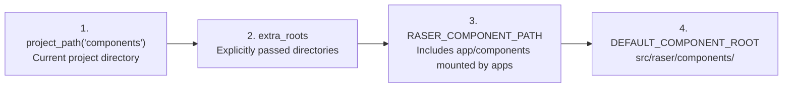

# Common Infrastructure (`supports`)

`src/raser/supports/` sits at the bottom of the software hierarchy and provides five shared utilities for `cli`, `lifecycle`, `stages`, `core`, `components`, `bench`, and `apps`: workspace and component path resolution (`paths.py`), controlled output paths and file operations (`output.py`), missing dependency reporting (`dependency.py`), process-exit cleanup callbacks (`process.py`), and function memory diagnostics (`memory_decorator.py`).



## Path Resolution and Component Search (`supports/paths.py`)

### Environment Variables

| Environment variable | Default behavior | Meaning |
| --- | --- | --- |
| `RASER_WORK_PATH` | `<REPO_ROOT>/work` in a source tree; `<cwd>/work` in an installed package | Workspace root directory path, read by `work_root()` |
| `RASER_PROJECT_PATH` | Current working directory `Path.cwd()` | Current project directory path, read by `project_root()` |
| `RASER_COMPONENT_PATH` | Empty string `""` | List of additional component search root directories separated by `os.pathsep`, read by `component_roots()` |

### Component Search Priority

`component_roots(extra_roots=None)` combines and deduplicates the following 4 types of root directories from highest to lowest priority; `component_path(*parts)` returns the first path where the target file exists:



### Public Path Interfaces

| Interface | Arguments | Behavior and return value |
| --- | --- | --- |
| `PACKAGE_ROOT` / `REPO_ROOT` / `DEFAULT_COMPONENT_ROOT` | Module constants | Package directory `src/raser` (or installed `raser`); `REPO_ROOT` is the repo root if `source_tree(package_root=PACKAGE_ROOT)` detects `pyproject.toml` next to `src/raser`, otherwise `None`; `DEFAULT_COMPONENT_ROOT` is `PACKAGE_ROOT / "components"` |
| `default_work_root(tree=REPO_ROOT, cwd=None)` | Repository tree, current directory | Returns `<tree>/work` in a source tree, or `<cwd>/work` in package-install mode |
| `work_root()` / `project_root()` / `project_path(*parts)` | Relative path parts | Returns the active workspace root, project root, or an in-project subpath as a `Path` |
| `infer_project_root(input_value)` | Target name, path, or `None` | Returns `project_root()` when `RASER_PROJECT_PATH` is non-empty or `input_value is None`; for a path (absolute, multi-segment, or with suffix), returns the parent of `"components"` if present after the first segment, otherwise the directory itself or the file's parent directory; for a plain device name (such as `"HPK-Si-PiN"`), returns `work_root() / str(input_value)` |
| `project_root_context(project_path_value, component_apps=())` | Project path, tuple of relative app paths | Temporarily overrides `RASER_PROJECT_PATH` and prepends each `PACKAGE_ROOT / <app> / "components"` to `RASER_COMPONENT_PATH` within the context manager, restoring the original environment variables on exit |
| `component_candidates(*parts, roots=None)` / `component_path` / `optional_component_path` | Relative path parts, root directory list | Generates all candidate `Path` objects; `component_path` returns the first existing `Path` (raising `FileNotFoundError` if all are missing), while `optional_component_path` returns `None` when missing |
| `component_file_path(kind, name_or_path, suffix=".json")` | Component kind, name or path, suffix | For an explicit path, checks directly that it is an existing file; for a plain name, calls `component_path(kind, str(name_or_path) + suffix)` |
| `app_component_root(app_name)` / `app_component_roots(...)` / `app_file_path(app_name, filename)` | App directory (such as `"bench/telescope"`), filename | Locates `PACKAGE_ROOT / app_name / "components"` or a packaged app file |
| `module_work_name(current_file_path)` / `module_work_path(current_file_path, *labels)` | Module `__file__`, subdirectory labels | Takes the second path segment under `apps`, `bench`, or `core` (such as `"field"`, `"current"`), `"cli"` under `cli`, or the file stem otherwise, and joins it onto `project_path` |

## Controlled Output Paths and File Operations (`supports/output.py`)

| Interface | Arguments | Behavior and constraints |
| --- | --- | --- |
| `owned_path(owner, *parts)` | Non-empty owner name, relative path parts | Validates that `owner` is non-empty and parts stay relative inside the project (forbids absolute paths or `".."`), returning `project_root().joinpath(owner, *parts)` |
| `create_path(path)` | Target path | Runs `Path(path).mkdir(parents=True, exist_ok=True)` and returns that `Path` |
| `output(current_file_path, *label)` | Caller module `__file__`, relative labels | Validates that labels are relative inside the project, creates `module_work_path(current_file_path, *label)`, and returns the resolved absolute path string |
| `delete_file(path)` | Target file path | Validates that the resolved target file lies inside `project_root().resolve()`, and deletes the file if it exists |

## Dependency Checks, Process Cleanup, and Memory Diagnostics

- **Missing dependency reporting (`supports/dependency.py`)**:
  - `MissingDependency(what, how)` initializes the exception message `f"{what}. {how}"` and stores `self.what` and `self.how`. When `raser` CLI catches this exception during command execution, it prints `raser: <what>. <how>` to stderr and exits with code `1` (see [../cli.md](../cli.md)).
  - `ROOT_MODULES = {"ROOT", "cppyy"}` and `ROOT_MISSING`: When `ModuleNotFoundError` is caught during command execution with `error.name` in `ROOT_MODULES` (i.e., `"ROOT"` or `"cppyy"`), `raser` CLI prints `raser: ROOT's Python bindings are not available in this Python. Install them with conda install -c conda-forge root_base` and exits with code `1`; all other `ModuleNotFoundError` exceptions are re-raised unchanged.
- **Process cleanup callbacks (`supports/process.py`)**:
  - `at_process_end(callback)` registers a zero-argument cleanup callback `callback: Callable[[], None]` without duplicates. `close()` is called by `raser` CLI in the `finally` block of `main()`, popping and executing registered callbacks in last-in, first-out (LIFO) order; if any callback raises an exception, cleanup stops immediately.
- **Memory usage diagnostics (`supports/memory_decorator.py`)**:
  - `@memory_decorator` reads resident set size `rss` and virtual memory size `vms` via `psutil.Process().memory_info()` before and after calling the decorated function (converted to `MB` by $1024^2$), prints three diagnostic lines, and returns the original function result:
    - `Memory usage before calling <func.__name__>: RSS = <rss_before:.2f> MB, VMS = <vms_before:.2f> MB`
    - `Memory usage after calling <func.__name__>: RSS = <rss_after:.2f> MB, VMS = <vms_after:.2f> MB`
    - `Memory increase: RSS = <rss_after - rss_before:.2f> MB, VMS = <vms_after - vms_before:.2f> MB`

## Support Paths and Memory Diagnostics in the Example (`HPK-Si-PiN`)

In the [Getting Started](../getting-started.md) example `raser signal HPK-Si-PiN --scan voltage=100,200 -s 2 -evt 200 --seed 1`, the support modules work together as follows:

- **Project and component path resolution**: `work_root()` points to `work/` under the working directory, and `infer_project_root("HPK-Si-PiN")` resolves the project root to `work/HPK-Si-PiN/`. By priority, the component finder falls back to the built-in `DEFAULT_COMPONENT_ROOT` (`src/raser/components/`) and locates `device/HPK-Si-PiN.json`, `source/decay/Sr90.json`, `g4setup/device_alone.py`, plus `afe/SantaCruz.cir`, `afe/Gali52.cir`, and `afe/Termination50.cir`.
- **Field solving memory diagnostics**: When `raser field HPK-Si-PiN -bias 100.0` (and `200.0`) is triggered automatically and calls `loop_solver` to iteratively solve Poisson and continuity equations, `@memory_decorator` prints memory usage changes to the terminal, for example:

```text
Memory usage before calling loop_solver: RSS = 357.12 MB, VMS = 402563.59 MB
...
Memory usage after calling loop_solver: RSS = 358.62 MB, VMS = 402563.59 MB
Memory increase: RSS = 1.50 MB, VMS = 0.00 MB
```

## Common Errors

| Exception and error message | Trigger condition |
| --- | --- |
| `FileNotFoundError: Cannot find RASER app file: <path>` | The packaged app file specified to `app_file_path` does not exist |
| `FileNotFoundError: Cannot find RASER component <parts>:\n  - <searched>` | `component_path` did not find the specified component in any candidate root directory |
| `FileNotFoundError: Cannot find RASER <kind> file: <path>` | `component_file_path` received a non-existent explicit file path |
| `IsADirectoryError: RASER <kind> input must be a file: <path>` | The explicit path passed to `component_file_path` is a directory |
| `ValueError: Output label must remain inside the project: <value>` | Path parts passed to `owned_path` or `output` are absolute or contain `".."` |
| `ValueError: Output owner must be named` | `owner` passed to `owned_path` is an empty string |
| `ValueError: File removal must remain inside the project: <target>` | The target path passed to `delete_file` lies outside `project_root()` |
| `MissingDependency: <what>. <how>` | Raised by modules when an external program or Python library is missing from the runtime environment |

## Related Pages

- [Getting Started](../getting-started.md)
- [../architecture.md](../architecture.md)
- [../cli.md](../cli.md)
- [../lifecycle/experiments.md](../lifecycle/experiments.md)
- [../stages/field.md](../stages/field.md)
- [../stages/deposit.md](../stages/deposit.md)
- [../stages/current.md](../stages/current.md)
- [../stages/readout.md](../stages/readout.md)
- [../core/digitizer.md](../core/digitizer.md)
- [../stages/analysis.md](../stages/analysis.md)
